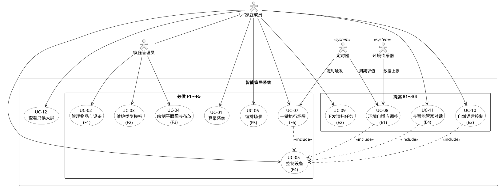
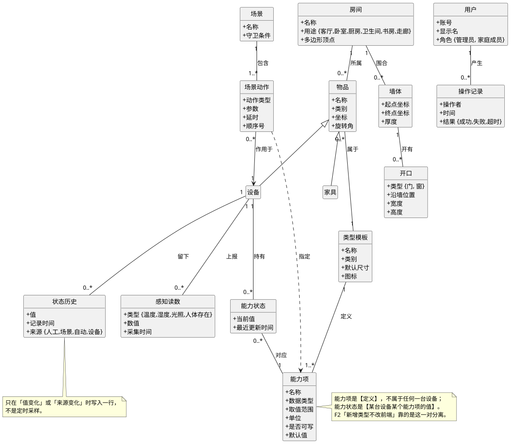
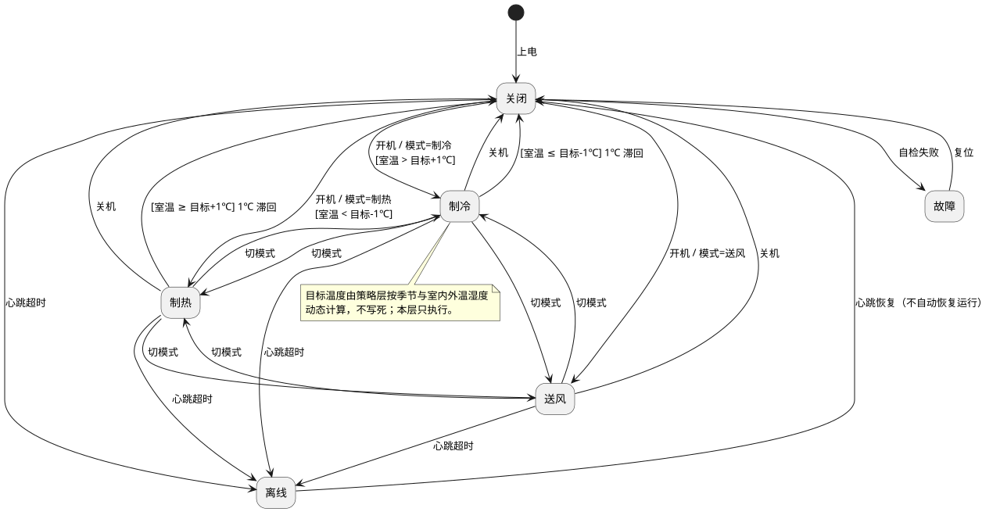
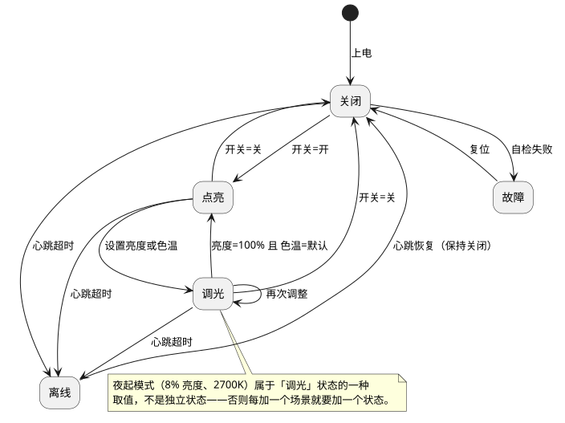
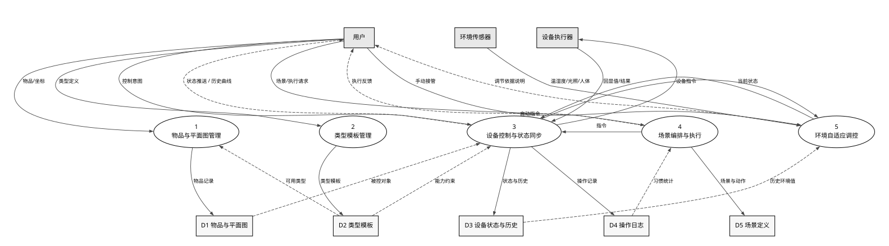
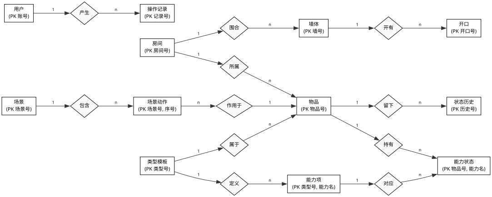
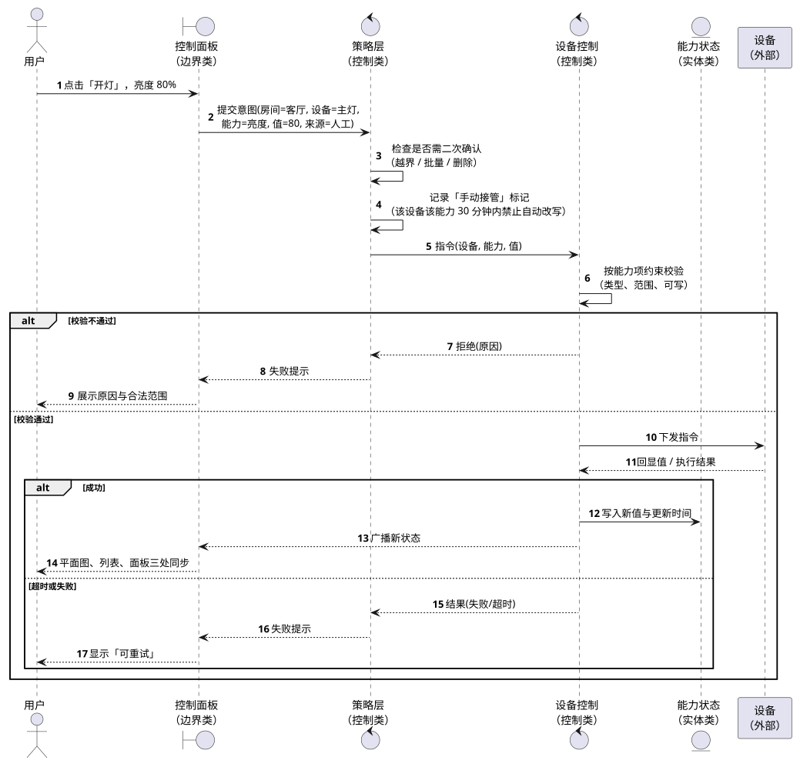
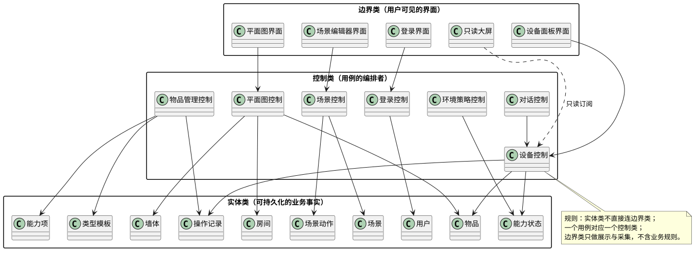

# 智能家居系统 需求图表集

> 配套文档：[07-需求规格说明书-v1.0.md](07-需求规格说明书-v1.0.md)（以下简称 SRS）。
> 本文件覆盖指导书 2.4「需求文档必含内容」中的图形与用例描述部分。

## 图目录

| 图号 | 名称 | 文件 | 对应内容 |
| --- | --- | --- | --- |
| 图 1 | 系统用例图 | [01-usecase.svg](diagrams/svg/01-usecase.svg) | SRS 2.1、第 3 章 |
| 图 2 | 领域模型类图 | [02-domain-model.svg](diagrams/svg/02-domain-model.svg) | SRS 第 3 章 |
| 图 3 | 空调完整状态机 | [03-state-ac.svg](diagrams/svg/03-state-ac.svg) | FR-5.5、FR-5.6 |
| 图 4 | 灯具完整状态机 | [04-state-light.svg](diagrams/svg/04-state-light.svg) | FR-4.1、FR-5.9 |
| 图 5 | 分层数据流图（DFD 第 1 层） | [05-dfd.svg](diagrams/svg/05-dfd.svg) | 第 5 章 |
| 图 6 | 实体-联系图（陈氏记法） | [06-er.svg](diagrams/svg/06-er.svg) | 第 6 章 |
| 图 7 | 顺序图：下发一条控制命令 | [07-seq-control.svg](diagrams/svg/07-seq-control.svg) | FR-4.1～FR-4.5 |
| 图 8 | ECB 分析类图 | [08-ecb.svg](diagrams/svg/08-ecb.svg) | 第 8 章 |

图纸源码在 `docs/diagrams/src/`（PlantUML 与 Graphviz DOT），重新生成执行 `./scripts/build-diagrams.sh`。导出格式为 SVG：图内文字是可检索的文本而不是像素，满足课程对「不得用整页截图充当图件」的要求。

---

## 1 用例图

三处画法说明（都是课上明确点过的错误，这里逐条回避）：

1. **设备与传感器不作为参与者。** 「环境传感器」「定时器」用 `«system»` 构造型表示系统内部的事件来源，画在系统边界之外但不画成火柴人。理由：Actor 必须是系统外与系统交互的角色，把设备画成参与者等于承认"数据库是参与者"。
2. **管理员用泛化表示，不重复连线。** 家庭管理员具备家庭成员的全部能力，因此画成 `家庭成员 <|-- 家庭管理员` 的继承线，只给管理员单独连「管理物品与设备」「维护类型模板」「绘制平面图与布放」三个独占用例。若把 11 条用例各连两遍，图会变成一团乱线且掩盖了权限的真实结构。
3. **公共用例单独放置。** UC-12「查看只读大屏」不属于必做也不属于提高，画在系统边界内、两个包之外。

包含关系只有一处是有实际意义的：UC-07、UC-08、UC-10、UC-11 都最终落到 UC-05「控制设备」，所以画出 `«include»`。其余用例之间不造抽象——课上的反例之一就是"为了图好看而堆 `«extend»`"。

---

## 2 用例描述

按指导书 2.4 要求，F1～F5 各写一个主用例。字段取三处口径的并集（第三讲 5 字段 / 第四讲 7 字段 / 实验三四要素）：**参与者、触发、前置条件、基本流、备选与异常流、后置条件**。

### UC-02 管理物品与设备（对应 F1）

| 项 | 内容 |
| --- | --- |
| 参与者 | 家庭管理员（主）、家庭成员（可查看与移动） |
| 触发 | 用户进入「物品管理」 |
| 前置条件 | 已登录；管理员角色；系统内至少存在一个类别与一个类型模板 |
| 后置条件 | 物品数据持久化；平面图与列表同步刷新；写一条操作记录 |

**基本流**

1. 系统按房间与类别分组展示全部物品，并显示每件物品的坐标与状态。
2. 用户选择筛选条件（房间 / 类别）或输入关键字。
3. 系统返回匹配结果，并显示命中数量。
4. 用户新建或编辑一件物品，填写名称、类别、所属房间、坐标与各能力值。
5. 系统按所选类型模板动态生成属性表单，并校验必填项与取值范围。
6. 系统保存物品，同步更新平面图上的图形与状态。
7. 系统写入操作记录（操作者、时间、结果）。

**备选与异常流**

| 编号 | 情形 | 处理 |
| --- | --- | --- |
| A1 | 用户拖动物品到画布另一位置 | 坐标即时更新并落库；刷新后位置不变（FR-1.6） |
| A2 | 用户删除物品 | 二次确认；若被场景引用，列出引用该物品的场景并要求确认 |
| E1 | 必填项缺失或数值越界 | 高亮出错字段，提示合法范围，不保存 |
| E2 | 所选类型模板已被删除 | 该模板不出现在可选项中；若已选则提示重选 |
| E3 | 批量导入文件格式错误或版本不符 | **整份拒绝**，列出全部错误行号，不做部分写入（FR-1.5） |
| E4 | 导入的坐标越出画布边界 | 整份拒绝并提示越界条目 |

### UC-03 维护类型模板（对应 F2）

| 项 | 内容 |
| --- | --- |
| 参与者 | 家庭管理员 |
| 触发 | 用户进入「类型模板」 |
| 前置条件 | 已登录；管理员角色 |
| 后置条件 | 新类型立刻出现在家具库与属性表单中；**不需要重新部署** |

**基本流**

1. 系统按类别列出已有类型模板及其能力项。
2. 用户新建一个类型模板：名称、类别、默认尺寸、图标。
3. 用户逐个添加能力项：名称、数据类型、取值范围、单位、是否可写、默认值。
4. 系统实时预览该类型在属性面板中的表单形态。
5. 用户保存。
6. 系统立即在新家具库与布放流程中提供该类型（FR-2.4）。

**备选与异常流**

| 编号 | 情形 | 处理 |
| --- | --- | --- |
| E1 | 能力项名称重复、最小值大于最大值、枚举为空 | 拒绝保存并指出具体字段 |
| E2 | 修改已存在类型的能力项集合 | 已有物品保留原值；新增项取默认值；删除项仅标记为不可见，不物理删除 |
| E3 | 删除仍被物品引用的类型 | 拒绝删除，列出引用该类型的物品 |

### UC-04 绘制平面图与布放（对应 F3）

| 项 | 内容 |
| --- | --- |
| 参与者 | 家庭管理员（可绘制墙体）、家庭成员（可布放与移动） |
| 触发 | 用户进入「平面图」 |
| 前置条件 | 已登录 |
| 后置条件 | 墙体、房间、开口与物品坐标全部持久化；刷新后原样恢复 |

**基本流**

1. 用户点击起点与终点，绘制一面墙；系统提供网格吸附与端点捕捉。
2. 用户继续绘制，直到墙体围合出闭合区域。
3. 系统自动识别该区域为房间，并按顺序命名（如「房间 1」）。
4. 用户为房间指定用途（客厅 / 卧室 / 厨房 / 卫生间 / 书房 / 走廊）。
5. 用户从家具库拖拽物品到画布，系统按类型模板的默认尺寸渲染。
6. 用户移动、旋转物品；系统在拖拽结束后持久化坐标。
7. 用户在墙上放置门或窗，系统记录其沿墙位置、宽度与高度。

**备选与异常流**

| 编号 | 情形 | 处理 |
| --- | --- | --- |
| A1 | 墙体未闭合 | 系统**不创建房间**，将该区域标记为「未闭合区域」并提示缺口位置（FR-1.8） |
| A2 | 墙体被删除或移动 | 房间自动重算；挂在墙上的门窗随墙移动或删除，并提示受影响数量 |
| E1 | 墙体自交或重叠 | 允许绘制，但房间推导时提示异常，不崩溃 |
| E2 | 物品相互重叠 | 允许（真实家庭中家具会贴靠），在属性面板提示重叠数量 |
| E3 | 物品被拖出画布 | 坐标钳制在画布边界内 |

### UC-05 控制设备（对应 F4）

| 项 | 内容 |
| --- | --- |
| 参与者 | 家庭成员、家庭管理员 |
| 触发 | 用户在平面图、设备列表或控制面板上操作某设备 |
| 前置条件 | 已登录；设备在线或离线状态已知 |
| 后置条件 | 设备状态更新并同步到三处展示；写入状态历史与操作记录 |

**基本流**

1. 用户选中设备，系统展示该类型对应的控制项（开关 / 亮度 / 色温 / 目标温度 / 模式 / 风速 / 开合度）。
2. 用户调整某一项。
3. 系统校验取值是否在该能力项定义的范围内。
4. 系统下发命令，并显示「下发中」。
5. 设备返回执行结果与回显值。
6. 系统写入新状态与更新时间，并向所有在线终端广播。
7. 平面图、设备列表、控制面板三处在一秒内显示同一值（FR-4.2）。

**备选与异常流**

| 编号 | 情形 | 处理 |
| --- | --- | --- |
| A1 | 用户手工设定后，自动策略试图改写同一能力 | 30 分钟内不覆盖；超时或环境超阈值后解除（FR-5.9） |
| E1 | 参数越界 | 客户端与服务端均拒绝，提示合法范围 |
| E2 | 设备离线 | 立即失败并提示「设备离线」，不排队等待 |
| E3 | 命令超时（默认 5 秒） | 标记失败、显示「可重试」，记录到操作日志 |
| E4 | 同一设备同一能力在 1 秒内被重复提交 | 后一条覆盖前一条，不排队 |
| E5 | 两个终端同时改同一设备 | 按 人工 > 场景 > 自动 的优先级，同级后到者生效，并向所有端广播最终值（FR-4.8） |

### UC-07 一键执行场景（对应 F5）

| 项 | 内容 |
| --- | --- |
| 参与者 | 家庭成员、家庭管理员（主）；定时器（`«system»`，可选触发） |
| 触发 | 用户点击场景卡片，或到达设定的时间 |
| 前置条件 | 场景已定义；至少包含一个动作 |
| 后置条件 | 全部动作已执行或已终止；每一步的执行结果都可查询 |

**基本流**

1. 用户选择「回家」模式并点击执行。
2. 系统先求值守卫条件（例如「客厅有人」）。
3. 守卫通过后，系统按顺序执行动作集：开灯 → 延时 2 秒 → 开空调（目标温度由策略动态计算）。
4. 每个动作执行前，系统向界面推送该步骤的「进行中」状态。
5. 每个动作完成后推送「成功 / 失败 / 跳过」。
6. 全部完成后，系统汇总本次执行结果，并附上调温依据（例如「当前室温 32℃、湿度 75%，按夏季策略设定 26℃」）。

**备选与异常流**

| 编号 | 情形 | 处理 |
| --- | --- | --- |
| A1 | 守卫条件不满足 | 不执行，向用户说明未通过的原因 |
| A2 | 场景内部含条件分支 | 按分支条件只执行命中的一支 |
| E1 | 某动作的设备离线 | 该步标记失败；按场景配置决定「继续」还是「中止」 |
| E2 | 场景引用的设备已被删除 | 保存时校验拦截；执行时跳过并提示 |
| E3 | 执行中用户手动操作了某设备 | 该步骤后续不再改写该设备该能力（让位规则） |
| E4 | 执行总时长超过 5 分钟 | 标记超时并终止剩余步骤 |

### 用例与需求对照

| 用例 | 覆盖需求 |
| --- | --- |
| UC-01 登录系统 | NFR-10 |
| UC-02 管理物品与设备 | FR-1.1～FR-1.5、FR-2.4、FR-2.5 |
| UC-03 维护类型模板 | FR-2.1～FR-2.3、FR-2.6 |
| UC-04 绘制平面图与布放 | FR-3.1～FR-3.8、FR-1.7～FR-1.10 |
| UC-05 控制设备 | FR-4.1～FR-4.6、FR-4.8、FR-5.9 |
| UC-06 编排场景 | FR-5.1～FR-5.4 |
| UC-07 一键执行场景 | FR-5.5～FR-5.8 |
| UC-08 环境自适应调控 | FR-6.1～FR-6.5 |
| UC-09 下发清扫任务 | FR-7.1～FR-7.5 |
| UC-10 自然语言控制 | FR-8.1～FR-8.6 |
| UC-11 与智能管家对话 | FR-9.1～FR-9.5 |
| UC-12 查看只读大屏 | FR-4.7、NFR-10 |

---

## 3 领域模型类图

三个建模决定：

1. **能力项与能力状态拆成两个类。** 能力项是**类型级定义**（「目标温度是 16～30℃ 的数值，可写」），能力状态是**实例级取值**（「客厅柜机现在的目标温度是 26℃」）。F2 的「新增类型不改前端」正是靠这一对分离：前端渲染表单只读前者，展示状态只读后者。
2. **家具与设备都是物品的子类。** 两者在平面图上都是矩形、都有房间与坐标，唯一区别是设备额外持有能力状态。若拆成两个平行类，F1 的「按类别筛选 + 批量导入导出」就要对两张表各做一遍。
3. **房间由墙体围合，而不是手工画的多边形。** 这对应已经定下的自动推导方案（半边图）。图中「房间—墙体」是 1:n 的围合关系，房间的多边形顶点是推导结果而不是用户输入。

---

## 4 状态机

指导书 2.4 写的是「空调**或**灯的完整状态机」。两张都画。

### 图 3 空调完整状态机

| 当前状态 | 事件 | 守卫 | 目标状态 |
| --- | --- | --- | --- |
| 关闭 | 开机 | 模式=制冷 且 室温 > 目标+1℃ | 制冷 |
| 关闭 | 开机 | 模式=制热 且 室温 < 目标-1℃ | 制热 |
| 关闭 | 开机 | 模式=送风 | 送风 |
| 制冷 | 温度变化 | 室温 ≤ 目标-1℃（1℃ 滞回） | 关闭 |
| 制热 | 温度变化 | 室温 ≥ 目标+1℃（1℃ 滞回） | 关闭 |
| 制冷/制热/送风 | 切模式 | — | 对应模式状态 |
| 任意运行态 | 心跳超时 | — | 离线 |
| 离线 | 心跳恢复 | — | 关闭（不自动恢复运行） |
| 关闭 | 自检失败 | — | 故障 |

两个要点：

- **滞回发生在状态机里，不在策略层。** 策略层算「目标温度应该是多少」，状态机负责「什么时候停」。若把滞回放策略层，那么手动设定温度时就没有滞回保护。
- **离线恢复后回到「关闭」而不是原状态。** 这是安全决定：断线期间设备可能被人手动动过，恢复时不能擅自执行。

### 图 4 灯具完整状态机

灯具只有四个状态，关键在于**没有为每个场景造状态**：「夜起时 8% 亮度、2700K」是「调光」状态的一组取值，不是独立状态。若按场景造状态，每加一个场景就要改一次状态机，这是状态机最常见的误用。

---

## 5 分层数据流图

### 加工说明

| 编号 | 加工 | 输入 | 输出 | 处理要点 |
| --- | --- | --- | --- | --- |
| 1 | 物品与平面图管理 | 物品、坐标、房间命名 | 物品记录、平面图 | 校验坐标边界；墙体变动后触发房间重算 |
| 2 | 类型模板管理 | 类型定义、能力项定义 | 类型模板 | 能力项取值域校验；被引用时禁止删除 |
| 3 | 设备控制与状态同步 | 控制意图、自动指令、指令序列 | 设备指令、状态推送、状态与历史、操作记录 | 双重校验；单一写入点；写库后广播 |
| 4 | 场景编排与执行 | 场景定义、执行请求、习惯统计 | 场景与动作、指令序列 | 守卫求值；按序执行；逐步反馈 |
| 5 | 环境自适应调控 | 感知数据、当前状态、历史环境值、手动接管 | 自动指令 | 多目标冲突按 安全>舒适>节能>偏好 仲裁 |

### 数据字典

**数据流（5 条）**

| 名称 | 组成 | 来源 → 去向 |
| --- | --- | --- |
| 控制意图 | 房间 + 设备 + 能力 + 目标值 + 来源（人工/场景/自动） | 用户 → 加工 3 |
| 设备指令 | 设备标识 + 能力名 + 目标值 + 超时阈值 | 加工 3 → 设备执行器 |
| 回显值 | 设备标识 + 能力名 + 实际值 + 执行结果 + 时间 | 设备执行器 → 加工 3 |
| 状态推送 | 设备标识 + 能力名 + 值 + 更新时间 + 来源 | 加工 3 → 用户（三处展示） |
| 感知数据 | 传感器标识 + 类型（温度/湿度/光照/人体）+ 数值 + 采集时间 | 环境传感器 → 加工 5 |

**数据存储（5 个）**

| 名称 | 主键 | 主要字段 | 保留策略 |
| --- | --- | --- | --- |
| D1 物品与平面图 | 物品标识 | 名称、类别、房间、坐标、旋转角、能力值快照 | 永久 |
| D2 类型模板 | 类型标识 | 名称、类别、默认尺寸、图标、能力项集合 | 永久 |
| D3 设备状态与历史 | 设备标识 + 能力名；历史另有时间 | 当前值、更新时间；历史值、来源 | 当前值永久；历史 30 天 |
| D4 场景定义 | 场景标识 | 名称、守卫条件、动作序列 | 永久 |
| D5 操作日志 | 记录号 | 操作者、时间、对象、结果 | 90 天 |

**加工（5 个）**：见上表「加工说明」。

---

## 6 实体-联系图

关键联系的基数：

- 房间 1 : n 墙体（一个房间由多面墙围合）；墙体 1 : n 开口。
- 房间 1 : n 物品；类型模板 1 : n 物品。
- 类型模板 1 : n 能力项；物品 1 : n 能力状态；能力项 1 : n 能力状态（「对应」联系把定义与取值连起来）。
- 场景 1 : n 场景动作；场景动作 n : 1 物品。
- 用户 1 : n 操作记录；物品 1 : n 状态历史。

---

## 7 顺序图：下发一条控制命令

这张图有意画出了三件容易被省掉的事：

1. **策略层先做「二次确认」与「手动接管标记」**，再往下传。若把让位逻辑放到设备控制层，那么自动策略自己发出的指令也会被标记成「人工」，让位立刻失效。
2. **校验在设备控制层做，且失败要能逐层回传到界面。** 图中 `alt 校验不通过` 分支一直回到用户，这不是形式主义——不允许校验失败后静默丢弃。
3. **广播用的是写入后的值。** 先写状态再广播，保证「三处一致」里的三处看到的是同一个已落库的值，而不是各自看到的乐观值。

---

## 8 ECB 分析类图

三条边界类规则（课上点评过的错误）：

1. **实体类不得直连边界类。** 图中所有实体类只与控制类相连。
2. **一个用例对应一个控制类。** `设备控制` 对应 UC-05，`场景控制` 对应 UC-06/UC-07，`环境策略控制` 对应 UC-08。
3. **边界类只做展示与采集。** 平面图界面不含任何业务规则；「能不能改这个值」的判断在控制类与能力项定义里。

`只读大屏` 是唯一一条虚线（只读订阅），因为它是特殊边界：不参与任何写流程。

---

## 9 可追溯矩阵

行是需求，列是对应用例、图形与验收步骤。空白表示该需求只靠人工验收、不单独出图。

| 需求 | 用例 | 图 | 用例描述 | 验收步骤 |
| --- | --- | --- | --- | --- |
| FR-1.1 物品增删改查 | UC-02 | 图 2、图 8 | UC-02 | W4 |
| FR-1.2 筛选与搜索 | UC-02 | 图 2 | UC-02 | — |
| FR-1.3～FR-1.5 导入导出 | UC-02 | 图 2 | UC-02 | W16 |
| FR-1.6 坐标持久化 | UC-02、UC-04 | 图 2 | UC-02、UC-04 | W16、W17 |
| FR-1.7～FR-1.10 房间自动识别 | UC-04 | 图 2、图 6 | UC-04 | W2、W3 |
| FR-2.1～FR-2.3 类型模板 | UC-03 | 图 2、图 8 | UC-03 | W5 |
| FR-2.4 新增类型不改前端 | UC-03 | 图 2 | UC-03 | W5 |
| FR-2.5～FR-2.6 图标与校验 | UC-03 | — | UC-03 | — |
| FR-3.1～FR-3.8 平面图 | UC-04 | 图 5、图 7、图 8 | UC-04 | W2、W4、W17 |
| FR-4.1～FR-4.6 设备控制 | UC-05 | 图 7、图 8 | UC-05 | W6、W7 |
| FR-4.7 只读大屏 | UC-12 | 图 1、图 8 | — | — |
| FR-4.8 并发优先级 | UC-05 | 图 7 | UC-05 | — |
| FR-5.1～FR-5.4 场景编排 | UC-06 | 图 2、图 8 | UC-07（执行侧） | W8 |
| FR-5.5～FR-5.8 温控与反馈 | UC-07 | 图 3 | UC-07 | W8、W11 |
| FR-5.9 手动接管让位 | UC-05、UC-07 | 图 7 | UC-05、UC-07 | W9 |
| FR-6.1～FR-6.5 环境自适应 | UC-08 | 图 5、图 8 | UC-05（异常流 A1） | W9、W10、W11 |
| FR-7.1～FR-7.5 可移动设备 | UC-09 | 图 2 | — | W14 |
| FR-8.1～FR-8.6 自然语言 | UC-10 | 图 1 | — | W12、W13 |
| FR-9.1～FR-9.5 智能管家 | UC-11 | 图 1 | — | W15 |
| NFR-1～NFR-3 性能 | — | — | — | 度量 |
| NFR-4～NFR-6 可靠性 | — | 图 5（D3、D5） | — | — |
| NFR-7～NFR-9 可用性 | — | — | — | W18 |
| NFR-10～NFR-12 安全性 | UC-01 | 图 1、图 8 | — | W1、W18 |
| NFR-13 可扩展 | UC-03 | 图 2 | UC-03 | W5 |
| NFR-14～NFR-16 维护与兼容 | — | — | — | — |

---

## 10 与课程「必画清单」的对照

| 课内实验 / 课程设计要求 | 本文档位置 | 状态 |
| --- | --- | --- |
| 用例图（标注必做/提高） | 第 1 章 图 1 | ✅ |
| 用例描述（含前置、基本流、异常流、后置） | 第 2 章（5 份） | ✅ |
| 领域模型类图 | 第 3 章 图 2 | ✅ |
| ECB 分析类图 | 第 8 章 图 8 | ✅ |
| 状态图（含迁移表） | 第 4 章 图 3、图 4 | ✅ |
| 分层 DFD | 第 5 章 图 5 | ✅ |
| 数据字典（≥5 流 / 5 加工 / 5 存储） | 第 5 章 | ✅ |
| ER 图 | 第 6 章 图 6 | ✅ |
| 顺序图 | 第 7 章 图 7 | ✅ |
| 可追溯矩阵（≥10 条） | 第 9 章（24 行） | ✅ |
| MoSCoW 优先级表 | SRS 第 5 章 | ✅（在 SRS 中） |
| 可量化非功能需求表 | SRS 第 4 章 | ✅（在 SRS 中） |

设计阶段（第 11 周）还需补：系统结构图（初始 + 精化）、模块 IPO 表、设计类图、设计级顺序图、PDL、构件/部署图、质量属性场景、接口契约。这些不属于需求阶段，不在本文件范围内。
