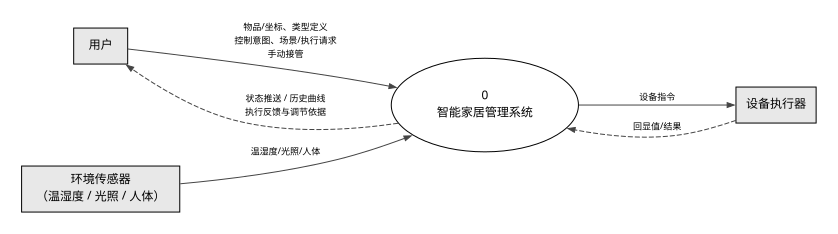

# 智能家居系统 可行性研究报告

| 项目 | 内容 |
| --- | --- |
| 文档编号 | FS-SMART-HOME-001 |
| 版本 | v1.1（2026-11-20 按课程第 5 章「可行性研究」重写） |
| 文档标准 | GB/T 8567-2006《计算机软件文档编制规范》—— 25 种文档之一「可行性分析（研究）报告」 |
| 上游依据 | 指导书 1.4 交付物清单第 1 项及其备注；课程第 5 章「需求分析」模块二「可行性研究」 |
| 结论 | **通过立项**（技术、经济、操作、法律、社会五维全部通过；经济维度边际，见 5.2.5） |

> 可行性研究回答的是「这个问题在当前条件下值不值得被解决」，需求分析回答的是「系统究竟必须做什么」。本报告只回答前者，两者顺序不可颠倒。
>
> 五个维度是**「与」不是「或」**：任一维度判定不成立，项目就不应立项（一票否决制）。因此第 9 章逐维度给出明确结论，而不是笼统的「总体可行」。

本报告按课程给出的**八个研究步骤**组织：

| 步骤 | 内容 | 本文位置 |
| :---: | --- | --- |
| 1 | 复查系统规模和目标 | 第 1 章 |
| 2 | 研究目前正在使用的系统 | 第 2 章 |
| 3 | 导出新系统的高层逻辑模型 | 第 3 章（顶层 DFD） |
| 4 | 重新定义问题 | 第 1.3 节 |
| 5 | 导出和评价候选方案 | 第 4 章、第 6 章 |
| 6 | 推荐行动方针 | 第 6.3 节 |
| 7 | 草拟开发计划 | 第 8 章 |
| 8 | 书写文档并提交审查 | 第 9 章 |

---

## 1 项目背景与问题定义

### 1.1 项目背景

课程设计要求实现一个可运行的智能家居系统。本项目在此之上选定了一个真实家庭作为服务对象：南京一套 89 ㎡ 的三室两厅住宅，常住四口人——32 岁的程序员（每周两天居家办公）、30 岁的护士（三班倒，作息不规律）、5 岁的女儿、62 岁有高血压且夜里起夜、睡在书房的母亲。

选择这个家庭不是为了叙事方便，而是因为它同时包含三类典型冲突：**作息冲突**（三班倒与朝九晚五）、**能力冲突**（老人不会用复杂界面）、**生理冲突**（老人怕冷、儿童房间偏干）。这三类冲突恰好对应系统最难做对的三件事。

### 1.2 系统规模和目标

系统规模：18 台固定设备（10 台可写、8 台只读上报）+ 1 台移动设备（扫地机器人），跨照明、温控、遮阳、环境、传感、清洁 6 个类别；一套 89 ㎡ 户型的平面图；5 个内置场景模板；2 种用户角色、3 个家庭成员账号。

目标（按优先级）：

1. 能在浏览器里画户型、布放家具与设备，并让平面图与三维视图共用同一份数据。
2. 能下发命令、观察状态，且状态在平面图、设备列表、控制面板三处始终一致。
3. 能编排一键场景，并让系统按室内外温湿度、光照与人体存在自动调节环境。
4. 每次自动调节都能给出可读的依据，而不是"系统觉得该这样"。

Won't（明确不做）：商业化运营、计费、上架发布、多租户隔离的实际实现（只留接缝）。

### 1.3 重新定义的问题（步骤 4）

初期的表述是"做一个智能家居 Web 系统"，这个表述有两个毛病：

- 它把**设备控制**当成了目的。但设备控制是现成商业产品已经做好的事，重复实现它没有价值。
- 它回避了**为什么现有产品没能解决这个家庭的问题**。

重新定义后的问题是：

> **一个家庭里，决策依据散落在人的记忆与多个厂商 App 中；系统能执行，但不能解释，也不能在冲突时让位给正确的一方。**
>
> 本项目要解决的是：把"谁在什么时候、基于什么、做了什么决定"变成一条可追溯、可解释、可手动覆盖的链路。

定义变化带来的取舍：系统的主要工作量从"接设备"转移到"状态一致性 + 决策可解释 + 执行过程可观测"，这也解释了后面技术方案为什么以**单一写入点**和**执行记录**为核心，而不是以设备接入数量为核心。

---

## 2 现有系统分析（步骤 2）

当前家庭的自动化程度很低，主要靠手动操作与几个互不相通的厂商 App。这一节的目的不是罗列现状，而是找出"现有做法到底贵在哪里"。

| 现状 | 做法 | 优点 | 缺点与成本 |
| --- | --- | --- | --- |
| 手动开关与遥控器 | 走到墙边按开关、找遥控器 | 零成本、极可靠、老人会用 | 无联动；出门忘关空调是常态；夜里起夜要摸黑找开关 |
| 厂商 App（空调、灯、扫地机各一个） | 手机上分别装 App | 品牌内可控，能远程 | **跨品牌不互通**；无统一平面图；无跨设备场景；历史曲线只有个别 App 有；账号分散 |
| 商业全屋智能方案 | 购买基础包并安装 | 稳定、有售后、开箱可用 | **8000～15000 元**；策略固定（多为定时表）；封闭，无法二次开发；数据在厂商云 |
| 自建 Home Assistant | 购买硬件 + 配置集成 | 开放、集成多、社区活跃 | 硬件 3000～8000 元；长期维护与学习成本高；**指导书 1.2 明确禁止套用现成平台换皮** |

三条结论：

1. **现有做法的问题不是"控制不了"，而是"没有一处能同时看到全部状态、也没有一处能解释为什么"。** 这正是第 1.3 节重新定义问题后的靶心。
2. 商业方案的能力边界由规模化交付决定，它必然砍掉"可解释"与"按户定制策略"这类难以复制的能力——这不是它做得不好，而是它不做。这块空白是可以争取的。
3. Home Assistant 功能最全，但直接在其上做界面等于换皮，违反课程禁令；它的价值是**架构与领域模型的设计参考**，而非运行时底座。

---

## 3 新系统的高层逻辑模型（步骤 3）

用顶层数据流图刻画新系统（课程第 5 章步骤 3）。顶层只有一个加工、不出现数据存储；第 1 层及以下的展开属需求分析阶段，见《需求规格说明书》附录 A.5 图 5（[05-dfd.svg](../diagrams/svg/05-dfd.svg)）。

*图 F-1 顶层数据流图（源文件 `docs/diagrams/src/00-dfd-top.dot`，Graphviz 渲染为 SVG）*

顶层把系统当成一个黑盒，只回答「它与外界交换什么」。三类外部实体：

- **用户**：输入是物品/坐标、类型定义、控制意图、场景/执行请求与手动接管；输出是状态推送、历史曲线、执行反馈与调节依据说明（与《需求规格说明书》第 1 层 DFD 严格保持父子平衡）。
- **环境传感器**：温湿度、光照、人体存在三类读数，单向流入。
- **设备执行器**：接收设备指令，回写回显值与执行结果。

顶层模型在这里的作用是**验证可行性**而不是完成设计：它表明系统只需在「用户意图 → 决策 → 设备指令 → 状态回写 → 展示」这一条链路上闭环，不依赖任何不可获得的输入（如厂商云 API 的私有数据）。

模型层面的三个关键判断：

1. **住户发的是"意图"不是"设备命令"。** 因为系统要能做策略决策，就必须在意图与指令之间留一个可插入判断的位置。
2. **环境读数与设备回显是两条独立输入。** 若把二者混为一条，就无法区分"人不舒服"与"设备没执行"。
3. **操作日志必须独立于状态历史。** 失败的命令不改变状态，但它必须留下痕迹——这是"可解释"的物质基础；在需求阶段的第 1 层图里它们是 D5 与 D3 两个存储，在同一条链路上不能合并。

---

## 4 候选方案（步骤 5 前半）

| 方案 | 构成 | 一句话 |
| --- | --- | --- |
| **A 指导书推荐组合** | React + Vite / Fork Home3D / FastAPI / MySQL 8 | 严格照搬指导书 2.1 推荐表，含 4.3 路线 B |
| **B 本项目方案** | React 19 + TS / 自研 2D 与 3D / Go + chi / PostgreSQL 17 / 契约先行 | 在推荐组合上替换三处，理由见 6.2 |
| **C 纯前端原型** | 浏览器 localStorage，无服务端 | 最快出可视效果 |
| **D 开源平台二次开发** | 在 Home Assistant 之上做主题与插件 | 功能最全 |

---

## 5 五个维度的可行性分析

### 5.1 技术可行性

**结论：可行。** 关键技术风险已在编码前用 9 项验证项（V1–V9）实测，其中 6 项做了动手实验，不成立的 1 项已启用并确认退路（实测结果与对策见下表）。

| 技术点 | 实测结果 | 风险与对策 |
| --- | --- | --- |
| 前端三级依赖（three / r3f / drei） | 兼容；场景图可构建（REVISION 187） | 浏览器实渲染未验，第 12 周补；失败则降级为纯 2D + CSS 3D |
| TypeScript 7 | **不成立**：typescript-eslint 声明 `peer <6.1.0` 且解析器直接拒绝 TS 7 | 已退到 6.0.3 并三项全过；此为已处置风险 |
| 契约生成（OpenAPI → Go/TS） | 可生成 chi 接口与 UUID 类型；认证 schema 不生成中间件 | 认证手写（本就要写），类型仍自动生成 |
| JSONB 映射（sqlc/pgx） | 通过；**可空 jsonb 需额外一条 override 规则** | 已固化进代码生成配置，实测通过 |
| 同事务写入（命令日志 + 状态历史） | 通过 | — |
| 环境演化可演示（E1） | 一阶惯性模型 90 行即可让温湿度在数分钟内可见变化 | 演示依赖时间加速接口，已列为演示辅助而非验收项 |
| 桌面双形态（mygo 壳） | 可构建、可签名（9.6 MB .app），DMG 因沙箱权限失败但可跳过 | 属第二阶段形态，不阻塞主线；失败即砍 |
| 房间自动推导 | 参考实现（半边图 DCEL）已核验算法路径 | 自研实现量约 300–500 行，是本项目最大技术不确定点（R1） |

技术难点集中在三处：**房间由墙自动推导**（拓扑正确性）、**三处状态一致**（并发与广播时序）、**渲染性能**（50 件家具 ≥30FPS）。三者都有明确的降级路径（手动画房间 / 单端优先 / 2D 优先），因此判定技术可行。

### 5.2 经济可行性

#### 5.2.1 收益口径的说明

本项目是**自用工具，不是产品**，因此没有销售收入。按课程要求仍须做成本—收益分析，收益采用**替代成本节约**口径：即"如果不做这套系统，为达到同等能力需要付出的最小代价"。这一口径的局限在第 5.2.5 节如实说明。

#### 5.2.2 成本

**开发成本（一次性）**

| 项目 | 金额 | 说明 |
| --- | --- | --- |
| 人力 | 7,200 ～ 9,000 元 | 36～45 人日 × 200 元/人日（按学生实习日薪折算；**不实际支付**，是机会成本） |
| 软件 | 0 元 | 全部为 MIT / Apache-2.0 / PostgreSQL License 开源组件 |
| 硬件 | 0 元（必需）/ 150 元（可选） | 设备全部由模拟器提供；可选 1 台 Matter 智能灯作真实硬件试点 |
| 云服务 | ≤50 元 | 自然语言解析所用大模型接口，按演示用量估算 |
| **合计** | **7,400 ～ 9,200 元** | 保守测算取上限 **9,200 元** |

**年度运行维护成本**

| 项目 | 金额 | 说明 |
| --- | --- | --- |
| 云服务 | ≤50 元/年 | 仅 E3 自然语言功能使用，可随时关停 |
| 电费 | 0 元 | 与开发机共用，不单独计 |
| 维护人力 | ≈100 元/年 | 按每月 2 小时、全年 0.5 人日估算 |
| **合计** | **≈150 元/年** | 保守测算取 **300 元/年** |

#### 5.2.3 收益

| 项目 | 金额 | 说明 |
| --- | --- | --- |
| 替代商业方案（摊销） | 4,000 元/年 | 商业基础包 12,000 元一次性，按 3 年摊销 |
| 节能 | ≈50 元/年 | 无人自动关空调：夏季 90 天 × 1 kWh/天 × 0.6 元/kWh |
| **合计** | **4,050 元/年** | |

#### 5.2.4 三个核心指标

| 指标 | 计算 | 结果 | 判据 |
| --- | --- | --- | --- |
| 年度净收益 | 4,050 − 300 | **3,750 元/年** | — |
| 投资回收期 | 9,200 ÷ 3,750 | **≈ 2.45 年** | 课程判据 ≤2～3 年 → **通过（临界）** |
| 净现值 NPV（r = 8%，3 年） | −9,200 + 3,750 × (P/A, 8%, 3) = −9,200 + 3,750 × 2.577 | **≈ +464 元** | NPV > 0 → **通过（很薄）** |
| 投资回报率 ROI | 3,750 ÷ 9,200 | **≈ 41%** | 正值 → 通过 |

**两种口径的对照（必须同时给出，否则容易自欺）**：

- 若只算**现金口径**（160～200 元现金 ÷ 4,050 元/年），回收期约 **0.05 年（约 18 天）**——看起来极划算。
- 若算**全成本口径**（含人力机会成本 9,200 元），回收期 **2.45 年**。

课程要求成本分析应包含人力，因此以全成本口径为准。现金口径只说明"不需要额外投入钱"，不说明"这件事值得做"。

#### 5.2.5 敏感性分析（结论的脆弱点在哪）

| 人力单价假设 | 开发成本 | 回收期 | NPV（3 年） | 是否通过 |
| --- | --- | --- | --- | --- |
| 150 元/人日（36 人日） | 5,600 元 | 1.49 年 | +4,064 元 | 通过，舒适 |
| **200 元/人日（基准，45 人日）** | **9,200 元** | **2.45 年** | **+464 元** | **通过，临界** |
| 300 元/人日（45 人日） | 13,700 元 | 3.65 年 | −4,036 元 | **不通过** |

必须直说：**本项目的经济可行性对"人力如何计价"高度敏感，在 300 元/人日的假设下不成立。** 这不是测算错误，而是"自用工具"这一属性的必然结果——它的收益上限就是一台商业方案的价钱，而它的成本下限是三个人八周的劳动。因此：

- 经济维度判定为**通过但边际**，而不是"显著可行"。
- 真正让它成立的，是那些**无法计价的部分**：全过程文档与答辩材料本身就是课程产出；技术验证与架构决策是可复用的能力；代码与报告是可展示的作品。这些不进入财务口径，但在课程语境下是主要产出。
- 若把本项目当作商业产品来评估（需要定价、获客、售后），经济维度将**不成立**——本报告不主张它具备商业可行性。

### 5.3 操作可行性

**结论：可行。**

| 维度 | 分析 |
| --- | --- |
| 使用者 | 3 个家庭成员账号 + 1 个免登录只读大屏。张先生 `admin`（管类型/房间/账号/导入导出），李女士与张母 `member`（控制设备、执行与编辑场景），女儿无账号 |
| 学习成本 | 心智与现有开关面板一致：看到房间、看到设备、点一下。老人使用"大按钮视图"，该视图只保留灯与空调两类 |
| 使用门槛 | 单口令登录（第一版），浏览器访问 `http://localhost:<端口>`，无客户端安装 |
| 组织支持 | 家庭内部自用，无需审批；唯一需要全家接受的是"手动操作后 30 分钟内自动策略让位"这条规则——它把最终控制权留给人 |
| 运维 | 一条命令启动（`start.sh`）；健康检查与日志内建；三周迭代期内每天重启十余次是常态，因此数据必须持久化、重启后平面图不能变灰 |
| 培训 | 不需要专门培训。验收走查（W1–W18）本身就是使用演示 |
| 阻力 | ①长者对自动化的不信任 → 保留物理开关路径与手动接管；②家人担心"被监视" → 不装摄像头、不录音，人体存在传感器只输出布尔值 |

### 5.4 法律可行性

**结论：可行。**

| 事项 | 依据 | 本项目的做法 |
| --- | --- | --- |
| 依赖许可证 | MIT / Apache-2.0 / PostgreSQL License 均允许商用、修改、再分发 | 全部通过 `package.json` / `go.mod` 声明，无 GPL 传染性依赖 |
| 无许可证代码 | 无许可证即默认保留所有权利 | **不复制** Home3D 等无许可证仓库的代码；只参考其算法思路并自行实现，在报告与源码注释中署名致谢 |
| 个人信息保护 | 《个人信息保护法》最小必要原则 | 只保存用户名与口令哈希（不存手机号、位置）；演示数据为虚构家庭；数据仅存本机，不上传第三方 |
| 生物识别与音视频 | 《个人信息保护法》对生物识别信息的严格规定 | 不采集人脸、声纹、图像、音频；"人体存在"只用红外/毫米波传感器的布尔输出 |
| 生成式 AI | 《生成式人工智能服务管理暂行办法》要求内容标识与合规使用 | E3 的解析结果**先给用户确认再执行**（四元组回显 + 白名单二次确认）；界面标注"AI 解析"，不生成虚假设备或虚假数据 |
| 学术规范 | 课程与学校规定 | 代码自写；不提交他人代码库；引用开源项目在报告中署名 |

### 5.5 社会可行性（含健康、安全、文化影响）

**结论：可行。** 按指导书 1.4 备注的要求，本维度覆盖社会、健康、安全、文化四个方面。

**社会影响**

- **适老化**：真实用户里有一位 62 岁、有高血压、夜间起夜的长者。系统提供大字号大按钮的简化视图与中文口语输入，降低学习成本。这不是加分项，而是需求来源之一。
- **家庭协作**：把"谁关的灯""为什么空调自己开了"变成可追溯记录（`command_log` + 调节依据文案），减少家庭成员之间因琐事产生的摩擦。
- **能源**：无人自动关闭、按季节动态设定温度，减少空转与过度制冷。单户节能量的精确测量不在本项目范围内，因此只作定性描述，不做夸大宣传。

**健康影响**

- **夜间照明**：起夜场景使用 8% 亮度、2700K 暖光，3 分钟后自动关闭，避免强光抑制褪黑素影响再次入睡。
- **温湿度**：夏季 24～28℃、冬季 18～22℃，配合湿度控制；1℃ 滞回避免空调频繁启停带来的体感波动，对老年人心血管更友好。
- **跌倒风险**：光照低于阈值自动补光，减少夜间摸黑行走。

**安全影响**

- **误操作防护**：参数上下限在客户端与服务端双重校验；批量操作（≥3 台设备）、越界值、删除类操作触发二次确认。
- **越权防护**：`admin` 与 `member` 分离"改配置"与"只操作"；只读大屏不提供任何控制入口。
- **设备失控防护**：断线恢复后回到关闭状态而非原状态；命令有超时与可重试；自动策略在用户手动操作后 30 分钟内让位；失败被标记为 `unavailable`，绝不展示过期值冒充当前值。

**文化影响**

- **代际差异**：长者更信任看得见摸得着的物理开关，年轻人更接受自动化。系统同时保留两条路径，不用"全自动"取代人工。
- **隐私边界**：传感器在家庭内部天然带有"被监视"意味。选择人体存在传感器而非摄像头、只存布尔值而非图像，是对这一文化心理的回应。
- **语言习惯**：自然语言输入以中文口语为准（"把客厅空调调到 26 度"），而非命令行式参数拼接，降低非技术成员的使用门槛。

---

## 6 候选方案评价与推荐

### 6.1 评价矩阵

权重依据：课程评分中"实现"占 30%、"报告与答辩"占 60%，因此需求契合度与可演示性权重最高；技术风险与工作量直接决定能否按期交付。

| 维度 | 权重 | A | B | C | D |
| --- | :---: | :---: | :---: | :---: | :---: |
| 与课程要求契合度 | 30% | 5 | 5 | 2 | 1 |
| 技术风险（分越高越安全） | 25% | 2 | 4 | 5 | 4 |
| 工作量与进度可控性 | 20% | 3 | 3 | 5 | 4 |
| 可演示性 | 15% | 3 | 5 | 2 | 4 |
| 可扩展与可维护 | 10% | 2 | 5 | 1 | 4 |
| **加权得分** | | **3.25** | **4.35** | **3.25** | **3.10** |

### 6.2 方案 A 的三个致命问题

1. **Home3D 没有许可证。** GitHub API 返回 `license: null`，`/license` 端点 404，根目录无 LICENSE/NOTICE/COPYING，两个 `package.json` 也无 `license` 字段；仓库描述自称 "Open-source" 只是自述。无许可证即默认保留所有权利，指导书 4.4「遵守其许可证并署名」此时无对象可遵守。照搬会在第 12 周卡在"要不要复制这段代码"上——这是学术规范问题，不是技术问题。
2. **它只解决一件事。** 指导书 4.1 列出的七项可复用能力（2D 编辑、约束、碰撞、依赖、3D、撤销重做、本地存储）全部只服务 F3 与三维视口；F1/F2/F4/F5 一概不管。而 F3 恰是必做项里最容易自研的一块。
3. **代码形态不匹配。** 4120 行全 JS/JSX 零 TypeScript、无服务端 API、家具目录与模型硬编码在组件里（`Sidebar.jsx:15-52` 与 `Canvas3D.jsx:159` 的 switch）。要接 F2 的"新增类型不改前端"，必须重写这部分，等于保留了一个我们不需要的基座。

### 6.3 推荐行动方针（步骤 6）

**推荐方案 B，立项开发。**

三处对指导书推荐组合的替换，均有可核验依据：

| 替换 | 从 | 到 | 理由 |
| --- | --- | --- | --- |
| 平面图/三维 | Fork Home3D | 自研 2D + 3D 同源 | 见 6.2：无许可证、能力只覆盖 F3、代码形态不匹配 |
| 后端 | FastAPI | Go 1.27 + chi | 单文件部署；F4 的"命令→设备→写库→广播"是强并发链路；自动文档能力用"契约先行"补回，顺带得到前后端类型对齐 |
| 数据库 | MySQL 8 | PostgreSQL 17 | 设备能力值是结构化但不固定的数据，JSONB 比开十张类型表更贴合；`timestamptz` 与 JSONB 索引在统计筛选上更省事 |

被否决的方案及原因：**A** 见 6.2；**C** 无法验证 F4 的三处一致、超时反馈与并发，且指导书 2.1 明确要求"含前端页面与后端服务"；**D** 直接违反 1.2「不允许套用现成平台换皮」。

---

## 7 风险评估

| 编号 | 风险 | 概率 | 影响 | 等级 | 应对 | 触发信号 |
| --- | --- | :---: | :---: | :---: | --- | --- |
| R1 | 自研平面图与三维吃掉主干时间 | 高 | 高 | **红** | 先把 2D 闭环做完整（F3 全部验收点），3D 只做"同一份数据换视角"的只读投影，排在第 13 周之后作为增量 | 第 13 周末 2D 仍有验收点未过 |
| R2 | 技术栈版本不兼容 | 已发生 | 中 | 黄 | TS 7 被 lint 工具链阻断，已实测确认并退到 6.0.3，记录在案 | 已处置 |
| R3 | 本机无法运行数据库或容器 | 已发生 | 中 | 黄 | 开发机无 Docker 守护进程，验证阶段改用嵌入式 PostgreSQL；正式环境仍要求一条命令启动 | 已处置 |
| R4 | 组员投入不足导致进度塌方 | 中 | 高 | **红** | 三条纵切轨各有人负责；每周四集成日必须全员合入并跑通启动脚本；连续两周未合入即升级处理 | 周四集成日失败 |
| R5 | 第三方库许可证风险 | 低 | 中 | 绿 | 只用 MIT / Apache-2.0 / PostgreSQL License；不使用无许可证仓库代码 | 新增依赖时复核 |
| R6 | 真实硬件拿不到或不兼容 | 中 | 低 | 绿 | Matter 试点列为可选，拿不到就砍，不影响任何必做项 | 第 13 周仍未到货 |
| R7 | 答辩现场环境故障 | 中 | 中 | 黄 | 演示视频预先录制；现场只跑"从零启动 + 一条主链路" | 预验收时启动失败 |
| R8 | 需求在实现中反复变更 | 中 | 中 | 黄 | 需求 v1.0 已冻结，变更走变更记录，编号不得重排 | 变更记录超过 10 条 |

两项红色风险至今**没有被消除**，只是被安排了可控的处置方式。若 R1 触发，正确动作是砍三维而不是砍必做项；若 R4 连续两周触发，正确动作是缩小范围并如实记录，而不是赶工掩盖。

---

## 8 开发计划（步骤 7）

### 8.1 进度

| 周次 | 阶段 | 主要产出 | 检查点 |
| --- | --- | --- | --- |
| 第 9 周 | 选题与调研 | 选题报告、分工表、技术选型、技术验证 | — |
| 第 10 周 | 需求分析 | 可行性报告、需求规格说明书 v1.0、需求图表、架构图 | **检查一** |
| 第 11 周 | 架构设计 | 概要设计说明书、数据模型（含 corner/opening）、接口契约 | — |
| 第 12 周 | 迭代一 | 数据层、设备层、家具库、平面图基础 + 一条最薄的纵向链路 | — |
| 第 13 周 | 迭代二 | 设备控制、状态同步、控制面板 | **检查二（可运行版本 1）** |
| 第 14 周 | 迭代三 | 场景策略、环境自适应、提高功能 | — |
| 第 15 周 | 预验收 | 测试报告、用户手册、缺陷修复、代码冻结 | **检查三** |
| 第 16 周 | 验收 | 演示视频、答辩 PPT | **验收** |

说明：指导书 1.3 正文写"第 3 周末必须通过架构评审"，与 1.3 进度表（第 10 周架构图、第 11 周架构设计）及 5.2（第 10 周架构评审）三处口径存在差异。本计划按 1.3 进度表执行，并在第 10 周前备齐评审材料。

### 8.2 人员与分工（3 人）

| 轨道 | 负责人 | 范围 | 起步顺序 |
| --- | --- | --- | --- |
| A 数据与契约 | 组长 | 表结构与迁移、OpenAPI 契约、鉴权中间件、F1 物品管理、seed、E3 后端 | 第一批：表结构 + 契约 + 鉴权；随后 F1、E3、E4 解释 |
| B 前端与建模 | 组员 1 | 脚手架、F2 动态表单、F3 平面图、F5 编辑器界面、主题层 | 平面图 → 动态表单 → 场景编辑器 → 主题层 → 三维视口 |
| C 运行时与策略 | 组员 2 | 设备模拟器、F4 命令/状态/历史/WS、F5 执行引擎、E1、E2 | 模拟器 → 控制链路 → 状态同步 → 策略引擎 |

节奏：周一 15 分钟站会（结论写进 Issue 评论）；周四集成日（全员合 main、跑启动脚本）；周五互评（记录落 `docs/reviews/`）；迭代末打 tag `v0.1`/`v0.2`/`v0.3`。

### 8.3 工作量与缺口

估算 70 人日，可用 36～45 人日。缺口靠三件事填：能力元数据一套定义三处用（省 4～6 人日）；契约先行减少联调返工（省 3～5 人日）；明确让位顺序（智能管家 → 可移动设备 → 自然语言），但**不降级必做五项**。

关键路径：`表结构定稿 → 接口契约 → 控制链路 → 三处状态一致`。任何功能都无法绕过它单独验收，因此迭代一末尾安排一条最薄纵向链路（一个设备、一条命令、一条推送），让关键路径在第 12 周先跑通一次。

---

## 9 结论（步骤 8）

### 9.1 五维结论表（一票否决制）

| 维度 | 结论 | 依据 | 若否的后果 |
| --- | :---: | --- | --- |
| 技术可行性 | **通过** | 9 项验证中 6 项动手实测；唯一不成立项已退到 6.0.3 并三项全过；三处难点均有降级路径 | 项目无法交付 |
| 经济可行性 | **通过（边际）** | 全成本口径回收期 2.45 年、NPV +464 元、ROI 41%；对人力单价高度敏感，300 元/人日下不通过 | 不值得投入 |
| 操作可行性 | **通过** | 心智与现有开关一致、长者有专用视图、无需培训、单人可运维 | 用户用不起来 |
| 法律可行性 | **通过** | 依赖许可合规、不使用无许可证代码、隐私最小化、AI 结果先确认后执行 | 侵权或违规 |
| 社会可行性 | **通过** | 适老化、隐私边界清晰、健康与安全有具体设计、代际差异被保留而非抹平 | 不该做 |

**五项全部通过 → 建议立项，按方案 B 实施。**

### 9.2 本报告的适用边界

- 经济测算基于第 5.2 节的假设（人力 200 元/人日、商业方案 12,000 元、摊销 3 年）。假设变化会影响结论，敏感性见 5.2.5。
- 技术结论建立在 9 项验证的实测结果上，其中浏览器实渲染、窗口启动、鉴权类型生成三项尚未在真实环境验证，留到第 12 周补；若彼时不成立，按 5.1 表中对策降级。
- 社会与法律结论基于"自用、单户、不采集敏感信息"这一前提。若将来作为产品对外提供，需重新评估（尤其是个人信息保护与生成式 AI 的合规义务）。

### 9.3 提交审查

本报告与[需求规格说明书](02-需求规格说明书.md)一并提交第 10 周检查一（架构评审 / 需求评审）。评审意见将作为 v1.2 的变更来源，变更记录附于下节。

**变更记录**

| 版本 | 日期 | 变更 | 原因 |
| --- | --- | --- | --- |
| v1.0 | 2026-11-20 | 初稿：经济、成本周期、方案比选、风险、社会/健康/安全/法律/文化 | 按指导书 1.4 备注撰写 |
| v1.1 | 2026-11-20 | 按课程第 5 章「可行性研究」重写：补齐五维框架（新增**操作可行性**）、八步骤结构、成本—收益三指标（回收期/NPV/ROI）与敏感性、现有系统分析、顶层 DFD、一票否决结论表 | 初稿只对齐了指导书备注，未对齐课程章的五个维度与八步骤，缺操作可行性与经济指标测算 |

---

## 附录 A 依据与参考

| 依据 | 用途 |
| --- | --- |
| 课程课件《第5章 需求分析（第1-2学时）》模块二「可行性研究」 | 五维框架、八步骤、成本—收益三指标、一票否决制 |
| GB/T 8567-2006《计算机软件文档编制规范》 | 本文档的体裁与必备内容 |
| 《2026 智能家居系统-课程设计指导书》1.4 交付物清单及备注 | 交付物范围、功能判据与评分构成 |
| 《需求规格说明书》（SRS-SMART-HOME-001） | 下游需求基线与功能边界对应 |
| [ADR 0001 技术栈选型](../adr/0001-技术栈选型.md) 与本文第 5.1 节 V1–V9 技术实测 | 三处技术栈替换的论证依据与可行性实测 |

## 附录 B 经济测算假设汇总

| 假设 | 取值 | 来源/说明 |
| --- | --- | --- |
| 人力折算单价 | 200 元/人日 | 学生实习日薪口径；敏感性区间 150～300 |
| 总人力 | 36～45 人日 | 3 人 × 8 周 × 每周 12～15 小时 |
| 商业方案价格 | 12,000 元 | 3 灯 + 2 空调伴侣 + 窗帘电机 + 网关 + 人体传感器的基础包 |
| 摊销年限 | 3 年 | 与课程周期无关，取电子产品典型使用年限 |
| 折现率 | 8% | 课程示例取值 |
| 年度维护人力 | 0.5 人日/年 | 按每月 2 小时估算 |
| 节能假设 | 夏季 90 天、每天 1 kWh、0.6 元/kWh | 定性观察，未做实测 |
