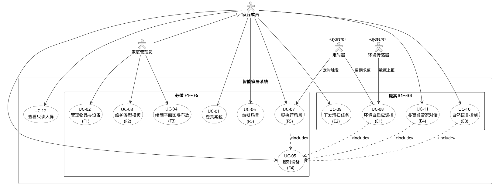
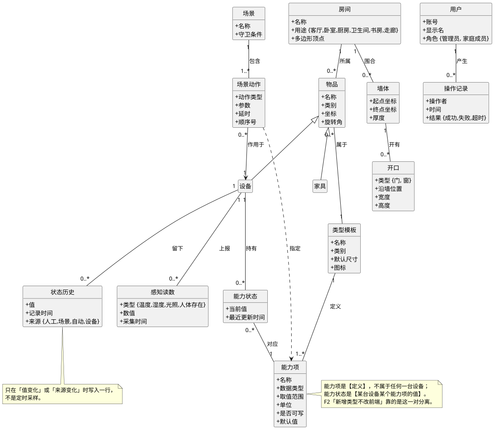
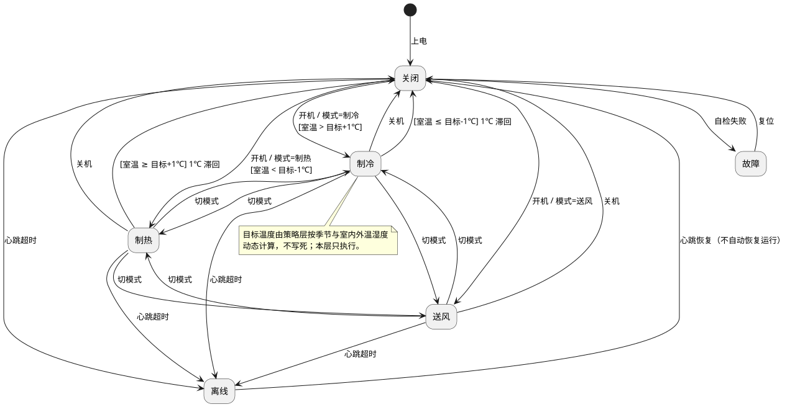
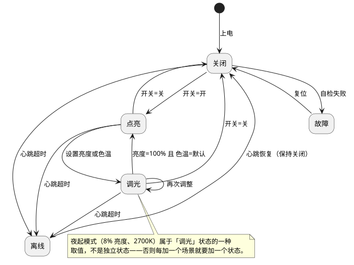
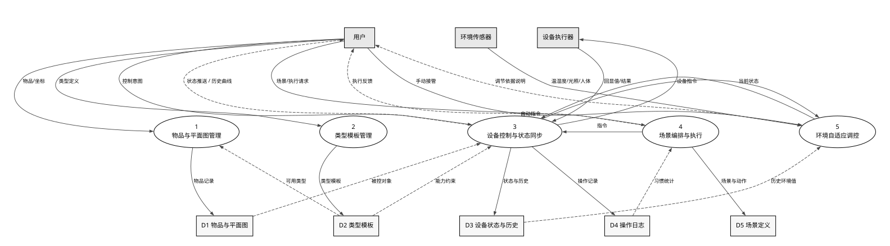
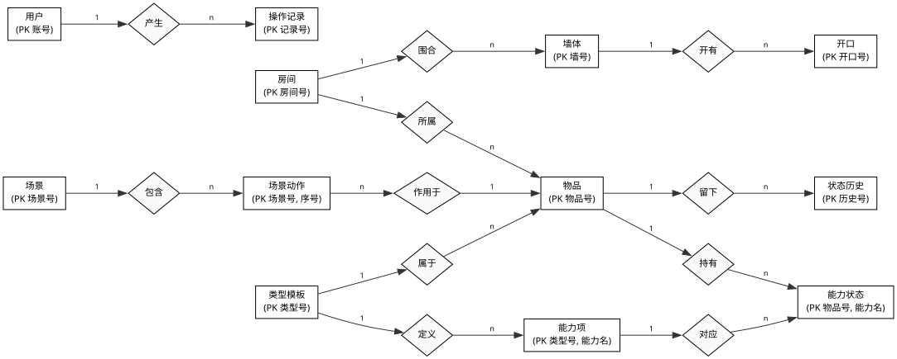
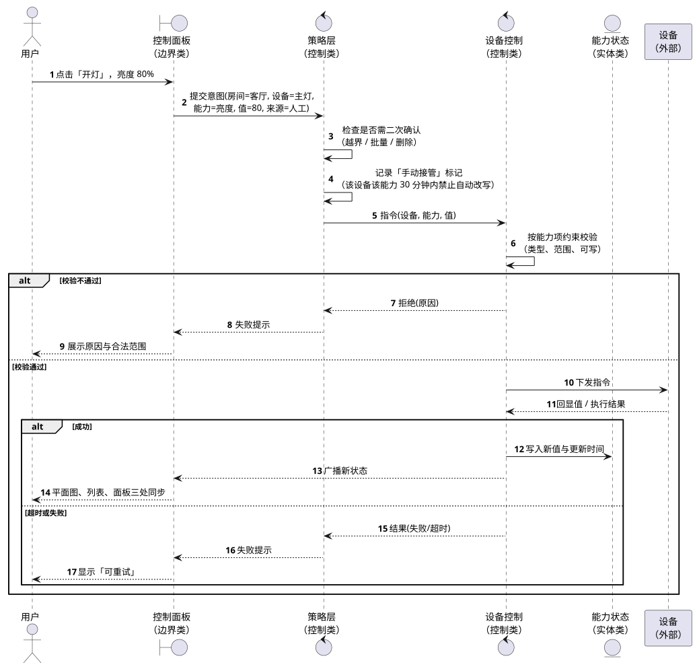
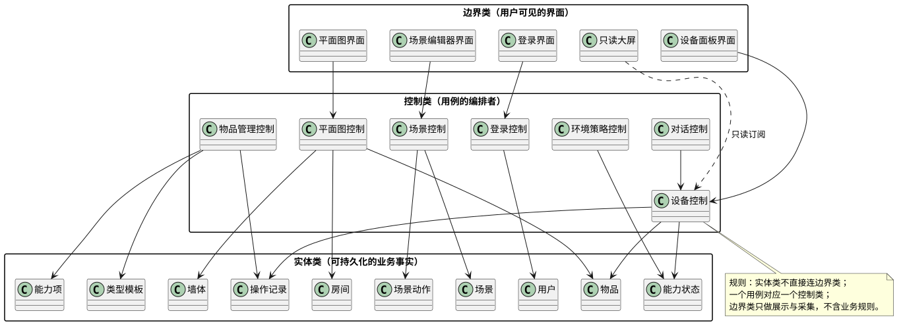

# 智能家居系统 需求规格说明书

| 项目 | 内容 |
| --- | --- |
| 文档编号 | SRS-SMART-HOME-001 |
| 版本 | **v1.2（当前）** · v1.0 于 2026-11-20 冻结 → v1.1 合并附录 → v1.2 补齐课程骨架缺章 |
| 冻结日期 | 2026-11-20（v1.0）；最近修订 2026-11-21（v1.2） |
| 对应指导书 | 《2026 智能家居系统-课程设计指导书》2.1～2.4 |
| 变更方式 | 冻结后任何修改必须登记在第 10 章变更记录，并注明受影响的用例编号 |

---

## 1 引言

### 1.1 目的

本文档定义智能家居系统**做什么**，不定义**怎么做**。

读者对象：课程评审教师、项目组全体成员、负责验收的答辩教师。

按课程口径（第五讲「需求说做什么，设计说怎么做」），本文档**不出现**具体技术栈、框架名、数据库产品名、部署方式。这些内容属于《概要设计说明书》与 ADR。

### 1.2 范围

系统面向**单个家庭**的一套住宅（三室两厅一卫，约 89 ㎡），覆盖：

- 家居物品（家具与设备）的数字化管理与平面图布放；
- 设备控制、状态同步与历史查询；
- 场景（一键策略）的编排与执行；
- 房间环境的感知与自适应；
- 可移动设备（扫地机器人）的任务与轨迹；
- 自然语言控制；
- 智能管家的多轮对话与习惯建议。

**不在范围内**：多住宅/多租户的隔离与计费、商业化运营、移动端 App 适配、真实厂商云平台对接。

其中「多租户」按指导书 1.2 属「可以不做」，本文档的处理是：**不做租户隔离，但保留扩展接缝**（见 2.5）。「商业化」是唯一明确排除的项。

### 1.3 术语与缩略语

本文档中反复出现的词，按「业务与领域」「环境与运行」「建模与文档」「缩略语」四组定义。定义即约定：后文出现某个词时含义以本表为准，不再另行解释。共 66 条（领域 29 条、环境与运行 12 条、建模与文档 17 条、缩略语 8 条）。

#### 1.3.1 业务与领域术语

| 术语 | 含义 | 相关章节 |
| --- | --- | --- |
| 物品 | 家居中被管理的一切对象，是家具与设备的统称，也是 F1 的管理单位 | FR-1 |
| 家具 | 无控制能力、只占位的物品（沙发、床、餐桌），平面图上以矩形表示 | FR-1、FR-2 |
| 设备 | 具备一项或多项可读写控制能力的物品（灯、空调、窗帘、加湿器） | FR-1、FR-4 |
| 移动设备 | 可自主移动、需要路径规划的设备（扫地机器人）；与固定设备的区别在于位置可变 | FR-7 |
| 类型模板 | 一类物品的共有定义：名称、默认尺寸、图标、能力项集合；F2 的管理单位 | FR-2 |
| 能力项 | 设备的一个可控或可读属性，含名称、数据类型、取值范围、单位、是否可写；是类型级定义 | FR-2 |
| 能力值 | 某台设备某个能力项的当前取值；是实例级数据 | FR-4 |
| 能力元数据 | 描述能力项的可机读结构。同一份数据同时驱动前端表单、后端校验、设备模拟与图标映射，是「新增类型不改前端」的实现依据 | FR-2、附录 A.3 |
| 可写能力 | 允许用户下发命令改变取值的能力项（开关、亮度、目标温度） | FR-4 |
| 只读能力 | 只能由设备上报、不允许下发的能力项（温度读数、人体存在、门磁状态） | FR-4、FR-6 |
| 房间 | 由闭合墙体围合出的区域，由系统自动识别，允许命名并指定用途 | FR-1、FR-3 |
| 未闭合区域 | 墙体未闭合、无法形成房间的区域。系统应标记但**不创建**房间 | FR-1 |
| 未分配房间 | 物品未落在任何房间内，或原所属房间被删除后的状态 | FR-1 |
| 户型 | 一个家庭的墙体与开口构成的平面结构，是房间识别的输入 | FR-3 |
| 平面图 | 户型的二维可视表示，同时是系统的主要操作界面 | FR-3 |
| 墙体 | 平面图中的线段对象，含起点、终点、厚度；房间由墙体闭合关系推导 | FR-3 |
| 开口 | 墙上的门窗。以「所在墙 + 沿墙偏移 + 宽高」定位，本质是墙上的一个区间 | FR-3 |
| 布放 | 把家具或设备放到平面图上的操作，产物是坐标 | FR-3 |
| 场景（模式） | 用户可一键执行的动作序列，可带守卫条件 | FR-5 |
| 场景模板 | 系统内置的场景样例（回家、离家、睡眠、夜起、补眠），用户可复制后修改 | FR-5 |
| 步骤 | 场景中的一条指令或一个延时；可嵌套子步骤 | FR-5 |
| 子步骤 | 嵌套在条件分支、循环、并行节点内部的步骤集合 | FR-5 |
| 守卫条件 | 场景执行前的判断，不满足则不执行。与「触发器」相对：守卫在动作之前判，触发器决定何时开始 | FR-5 |
| 触发器 | 自动启动一段执行逻辑的条件（时间、环境阈值、设备事件）。本项目不提供独立的触发器配置界面，该职责由策略引擎承担 | FR-5、FR-6 |
| 策略引擎 | 把用户意图与环境变化翻译为设备指令集的统一组件。两个入口：用户触发（F5）、条件触发（E1） | FR-5、FR-6 |
| 意图 | 用户表达的愿望（「我热了」「执行回家模式」「调到 26℃」）。意图不是设备命令，需经策略判断才成为指令 | 附录 A.7 |
| 指令 | 策略引擎判断之后，下发给某台设备某个能力项的确定性操作 | FR-4、附录 A.7 |
| 手动接管 | 用户直接操作某设备后，自动策略在让位窗口内不再改写该设备的该能力项 | FR-6 |
| 让位窗口 | 手动接管的有效期（默认 30 分钟）与被超越条件（环境变化超阈值时自动解除） | FR-6 |

#### 1.3.2 环境与运行术语

| 术语 | 含义 | 相关章节 |
| --- | --- | --- |
| 环境读数 | 温度、湿度、光照、人体存在四类传感数据 | FR-6 |
| 舒适度区间 | 按季节与时段定义的目标温度范围：夏季 24–28℃、冬季 18–22℃、春秋自然通风 | FR-6 |
| 滞回 | 为避免设备在阈值附近反复启停而设置的差值（默认 1℃）：达到上限才开、低于下限才关 | FR-6、附录 A.4 |
| 回显 | 设备执行后回报的实际取值。它与命令中的期望值可能不同，系统以回显为准 | FR-4 |
| 三处一致 | 同一能力值在平面图、设备列表、控制面板三处展示相同 | FR-4 |
| 状态过期 | 某能力值超过预期更新窗口未刷新。此时应标为「不可用」，绝不显示旧值充当当前值 | FR-4、FR-6 |
| 时间加速 | 调试与演示用的仿真时间倍率，用于快速观察环境演化；不作为验收功能项 | 2.4 |
| 降级 | 外部能力不可用时的替代路径（例如自然语言解析失败时退回关键词匹配） | FR-8 |
| 白名单 | 自然语言可以作用的设备与操作范围。越界需二次确认或拒绝 | FR-8 |
| 二次确认 | 对危险操作的显式再确认：参数越界、批量影响 ≥3 台设备、删除或覆盖类操作 | FR-8 |
| 解释文案 | 系统给出的「为什么这样调」的自然语言说明，由模板生成，不让模型自由发挥 | FR-6、FR-9 |
| 习惯挖掘 | 从操作记录中统计出高频时段与高频动作，形成可采纳的建议 | FR-9 |

#### 1.3.3 建模与文档术语

| 术语 | 含义 | 相关章节 |
| --- | --- | --- |
| 参与者 | 与系统交互的外部角色。本项目的参与者只有人，设备与传感器不是参与者 | 附录 A.1 |
| 用例 | 参与者通过系统达成的一个完整目标，以「动词 + 对象」命名 | 附录 A.1、A.2 |
| 包含关系 | 一个用例必然要执行另一个用例的行为（«include»）。只在确有必然关系时使用 | 附录 A.1 |
| 泛化 | 参与者或类之间的继承关系。本项目用它表达「管理员具备成员的全部权限」 | 附录 A.1 |
| 边界类 | 与用户交互的界面对象（BCE 记法） | 附录 A.8 |
| 控制类 | 协调一个用例流程的对象，一个用例最多一个 | 附录 A.8 |
| 实体类 | 需要持久化的业务事实。既不是界面，也不是设备 | 附录 A.8 |
| 数据流图 | 结构化分析模型，用加工、数据流、数据存储、外部实体描述系统 | 附录 A.5 |
| 数据字典 | 对数据流、加工、数据存储的逐项定义 | 附录 A.5 |
| 加工说明 | 对数据流图中每个加工的输入、输出、处理规则的文字描述 | 附录 A.5 |
| 实体-联系图 | 描述实体、属性与联系的模型 | 附录 A.6 |
| 可追溯矩阵 | 把需求、用例、模型与验收项对应起来的表 | 附录 A.9 |
| 需求基线 | 冻结之后作为设计与验收依据的需求版本。基线之后的变化必须留变更记录 | 第 10 章 |
| MoSCoW | 优先级标注法：Must（必须有）、Should（应该有）、Could（可以有）、Won't（本期不做） | 第 7 章 |
| 验收走查 | 按预设步骤操作并记录通过与否的验收方式，区别于自动化测试 | 第 9 章 |
| 非功能需求 | 对性能、可靠性、易用性等质量属性的量化要求 | 第 6 章 |
| 约束 | 对实现方式的限制（环境、合规、既有条件），不是功能也不是质量属性 | 2.4 |

#### 1.3.4 缩略语

| 缩写 | 全称 | 说明 |
| --- | --- | --- |
| SRS | Software Requirements Specification | 即本文档 |
| FR | Functional Requirement | 功能需求，编号形如 `FR-1.1` |
| NFR | Non-Functional Requirement | 非功能需求，编号形如 `NFR-1` |
| UC | Use Case | 用例，编号形如 `UC-05` |
| UI | User Interface | 用户界面 |
| ER | Entity-Relationship | 实体-联系（用于 ER 图） |
| JSON | JavaScript Object Notation | F1 批量导入导出使用的全量格式 |
| CSV | Comma-Separated Values | F1 批量导入导出使用的清单格式 |

### 1.4 编制原则

1. **「必含」是下限不是上限。** 指导书 2.4 列出的是文档必须包含的六项内容，不构成"只做这些"的许可。凡指导书标注「建议」「鼓励」「提高」的内容，本项目的处理是**应做尽做**，并在优先级表中如实标注其承诺等级（第 7 章）。
2. **每条需求可验收。** 每条功能需求都给出验收方法；无法写出验收方法的需求视为未定义清楚，退回重写。
3. **需求与实现解耦。** 同一需求允许多种实现，本文档只约束可观察的外部行为。

---

### 1.5 参考资料

| 编号 | 资料 | 用途 |
| --- | --- | --- |
| R1 | 《2026 智能家居系统-课程设计指导书》 | 需求来源（2.1～2.4、3.4 命令报文、第四章 Home3D） |
| R2 | 课程课件：《第4章 理解需求》《第5章 需求分析》《第6章 软件设计》 | 建模规范与文档写法 |
| R3 | GB/T 8567-2006《计算机软件文档编制规范》 | 文档体系依据（可行性报告与 SRS 均为其规定文档） |
| R4 | GB/T 9385《计算机软件需求规格说明规范》 | SRS 质量特性自查依据（见第 8 章） |
| R5 | Home Assistant 官方文档（自动化、场景、脚本、状态模型） | 领域概念与场景三分法参考 |
| R6 | Home3D（lohith9/Home_View）参考实现 | 平面图与三维视口交互参考 |

## 2 总体描述

### 2.1 用户角色与权限

系统面向同一家庭的 2～4 名成员，只设两种角色。

| 角色 | 权限范围 |
| --- | --- |
| 管理员（admin） | 全部操作，含房间与类型模板配置、成员账号管理、批量导入导出、删除场景 |
| 家庭成员（member） | 控制设备、执行与编辑场景、查看历史；不可改房间与类型模板、不可管理账号、不可批量导入 |

权限矩阵：

| 操作 | 管理员 | 家庭成员 |
| --- | :---: | :---: |
| 查看平面图与设备状态 | ✓ | ✓ |
| 控制设备（开关/亮度/温度等） | ✓ | ✓ |
| 执行场景 | ✓ | ✓ |
| 新建/编辑/删除场景 | ✓ | ✓ |
| 新建/编辑类型模板 | ✓ | ✗ |
| 新增/重命名房间 | ✓ | ✗ |
| 移动家具与设备坐标 | ✓ | ✓ |
| 批量导入/导出 | ✓ | ✗ |
| 成员账号管理 | ✓ | ✗ |
| 查看历史曲线与操作日志 | ✓ | ✓ |

说明：

- 「访客」角色按指导书 2.1「可选」处理，本项目**不建第三角色**，改为提供一个免登录的只读大屏页面（见 FR-4.7），满足"客厅墙上挂一块屏"的展示需求。
- 权限差异只落在「改配置」与「只操作」这条线上，因此两种角色足够。若后续出现第三种职责差异，需在变更记录中提出。

### 2.2 运行环境

| 项 | 要求 |
| --- | --- |
| 客户端 | Chrome / Edge 最新版，桌面端 |
| 分辨率 | 1366×768 及以上正常显示；不要求移动端适配 |
| 网络 | 家庭局域网；单机部署亦可 |
| 部署形态 | 单机一键启动（一个启动脚本或一条容器编排命令） |
| 服务端 | 单实例，无集群要求 |

### 2.3 假设与依赖

| 编号 | 假设 | 不成立时的影响 |
| --- | --- | --- |
| A1 | 家庭内设备数量 ≤ 50 台 | 平面图性能指标需重新评估 |
| A2 | 设备通过统一抽象接口接入，不区分厂商协议 | 真实硬件接入需增加适配工作 |
| A3 | 温湿度、光照、人体存在由模拟器提供数据，采样间隔可配置 | 无数据则 E1 无法演示 |
| A4 | 时间可加速（调试与演示辅助，见 FR-6.5） | 环境自适应类需求无法在答辩现场展示 |
| A5 | 浏览器支持 Canvas / WebGL2 | 平面图与三维视图需降级方案 |

### 2.4 设计与实现约束（只写约束，不写技术）

| 编号 | 约束 | 来源 |
| --- | --- | --- |
| C1 | 必须采用分层架构，层间依赖单向，禁止跨层调用 | 指导书 3.1（强制） |
| C2 | 新增设备类型不得修改前端代码 | 指导书 F2 |
| C3 | 平面图坐标改动必须落到数据层，刷新后不丢失 | 指导书 F1 |
| C4 | 敏感配置（口令、密钥）不入库明文、不入代码仓库 | 指导书 2.3 |
| C5 | 命令失败必须可感知、可重试 | 指导书 2.3 |
| C6 | 关键操作留日志，可追溯到操作者与时间 | 指导书 2.3 |

### 2.5 扩展接缝（不做，但预留）

按指导书 1.2「可以不做」不等于禁止，以下三项**本期不实现，但不得堵死**：

| 接缝 | 预留方式 | 验收时如何证明 |
| --- | --- | --- |
| 多租户 | 所有数据访问经统一数据访问层；主键为全局唯一标识，不使用"租户内自增" | 代码评审：无任何查询绕过数据访问层；主键类型全局唯一 |
| 真实硬件 | 设备控制经统一适配接口，模拟器只是其中一种实现 | 代码评审：接口存在，且有第二个实现（模拟器之外的桩） |
| 原生客户端 | 前后端通过稳定的接口契约通信，不依赖页面渲染细节 | 接口契约文档存在，且与前端实现解耦 |

---

## 3 功能需求

编号规则：`FR-<功能号>.<序号>`。功能号 1～5 对应必做 F1～F5，6～9 对应选做 E1～E4。

每条需求的验收方法取值：**人工**（按步骤操作观察）、**脚本**（自动化测试或命令行复现）、**度量**（读取指标数值）。

需求来源只记四类，避免多套编号共存：**S**——指导书 2.1～2.4 原文要求；**C**——课程课件与实验要求（如「图内文字可检索」）；**P**——场景推演（从 89 ㎡ 三室两厅的家庭设定出发）；**R**——同类产品调研（Home Assistant 与商业智能家居方案对比）。本文档**不另设 R01… 形式的第二套编号**：`FR-x.y` 就是唯一基线标识，编号一经发布不重排、不复用（课程对「编号规则中途变更」明文扣分）。来源的逐条对应见附录 A.9 可追溯矩阵。

### 3.1 FR-1 家居物品管理（F1）

| 编号 | 需求 | 验收方法 |
| --- | --- | --- |
| FR-1.1 | 系统应支持物品的增、删、改、查。物品属性至少包含：名称、类别、所属房间、坐标、状态 | 人工：新建→编辑→删除各一次，刷新后结果一致 |
| FR-1.2 | 应支持按**房间**与**类别**两个维度筛选，并支持按名称关键字搜索；三者可组合 | 人工：分别单条件与组合条件筛选，结果集正确 |
| FR-1.3 | 应支持 JSON 与 CSV 两种批量导入导出 | 脚本：导出→清库→导入→比对条目数与坐标 |
| FR-1.4 | 导入导出范围**仅限物品与平面图**（房间、墙体、家具、设备及其坐标与能力值快照），**不含**状态历史与场景定义 | 人工：检查导出文件字段 |
| FR-1.5 | 导入文件应带格式版本号；版本不匹配时拒绝导入并给出提示，不得部分导入 | 脚本：构造旧版本文件，验证拒绝且数据未变 |
| FR-1.6 | 坐标改动必须落到数据层：拖拽结束后应持久化，刷新后位置不变 | 人工：拖拽后刷新；脚本：比对数据库坐标 |
| FR-1.7 | 应自动识别闭合墙体围合的区域为房间，并允许为房间命名、指定用途 | 人工：画一个闭合矩形，房间自动出现 |
| FR-1.8 | 墙体不闭合时**不得**创建房间，应将区域标记为「未闭合区域」并给出可读提示 | 人工：故意留一处缺口，验证不生成房间且提示出现 |
| FR-1.9 | 房间存在后，修改墙体应触发房间重新计算；房间被删除时其内物品不得丢失，应回到「未分配房间」状态 | 人工：删掉一面墙，观察房间与物品状态 |
| FR-1.10 | 物品的「所属房间」应可由坐标自动推断，也允许手工指定；手工指定优先 | 人工：把沙发拖进卧室，所属房间自动变为卧室 |

异常与边界：

- 房间重名：允许，但列表中需以「房间名 + 序号」区分显示。
- 导入文件缺字段、坐标越界、引用了不存在的类型：整份导入失败并列出全部错误行号，不做部分写入。
- 删除仍被物品引用的类型模板：拒绝删除，并列出引用该类型的物品。

### 3.2 FR-2 常用家具库（F2）

| 编号 | 需求 | 验收方法 |
| --- | --- | --- |
| FR-2.1 | 应为每类家具/设备定义类型模板，模板属性至少包含：名称、类别、默认尺寸、图标、可配置属性集合 | 人工：新建一个类型模板并查看 |
| FR-2.2 | 属性应按类型差异化：灯有亮度与色温；空调有目标温度、模式、风速；窗帘有开合度；传感器为只读 | 人工：分别打开三类设备的属性面板比对 |
| FR-2.3 | 能力项定义应包含：名称、数据类型（布尔/数值/枚举/文本）、取值范围、单位、是否可写、默认值 | 人工：查看任一类模板的定义 |
| FR-2.4 | **新增类型不得修改前端代码**：管理员在界面上新建类型、配置能力项后，该类型应立刻出现在家具库并可用于布放，其属性表单按能力项自动生成 | 人工：现场新建一个「智能晾衣架」类型（含开关与升降高度），不做任何部署，直接布放并操作 |
| FR-2.5 | 每类至少一张示意图（图标）；系统预置不少于 6 个类别、20 个类型模板 | 人工：清点类别与模板数量 |
| FR-2.6 | 能力项的取值约束应在**录入时**与**命令下发时**双重校验，越界值必须被拒绝并提示 | 脚本：构造越界命令，验证被拒绝 |

异常与边界：

- 能力项重名、取值范围非法（最小值大于最大值）、枚举选项为空：保存时拒绝。
- 删除仍被物品引用的类型模板：拒绝，列出引用物品。
- 修改某类型的能力项集合：已存在的物品保留其已有能力值，新增能力项取默认值，删除的能力值仅标记不可见不物理删除。

### 3.3 FR-3 平面图绘制与布放（F3）

| 编号 | 需求 | 验收方法 |
| --- | --- | --- |
| FR-3.1 | 应支持绘制墙体：点击起点与终点生成一面墙；绘制过程应有网格吸附与端点捕捉 | 人工：连续画四面墙形成房间 |
| FR-3.2 | 应支持从家具库拖拽物品到画布完成布放 | 人工：拖入沙发 |
| FR-3.3 | 已布放物品应支持移动、旋转、删除 | 人工：各操作一次并刷新验证 |
| FR-3.4 | 图上选中物品应可查看并编辑其属性 | 人工：选中灯，改亮度，观察状态 |
| FR-3.5 | 门窗应作为墙上的开口表达（沿墙位置、宽度、高度），墙体移动或旋转时门窗应随之移动 | 人工：在墙上放一扇门，拖动墙，门跟着走 |
| FR-3.6 | 平面图数据必须持久化，刷新后原样恢复 | 人工：刷新页面 |
| FR-3.7 | 50 件家具以内，拖拽与缩放操作应保持不低于 30 FPS | 度量：浏览器性能面板采样，取 P50 |
| FR-3.8 | 平面图应实时显示设备状态（如灯亮/灭、空调开/关、当前温度） | 人工：改变设备状态，观察图上变化 |

异常与边界：

- 墙体自交、重叠：允许绘制，但房间推导时应能识别并给出提示，不得崩溃。
- 家具相互重叠：允许（真实家庭中家具也可能贴靠），但属性面板提示重叠数量。
- 删除一面承重相关的墙导致门窗悬空：门窗随墙删除，并在操作后提示受影响数量。
- 拖拽越出画布边界：坐标钳制到画布内。

### 3.4 FR-4 设备控制与状态查询（F4）

| 编号 | 需求 | 验收方法 |
| --- | --- | --- |
| FR-4.1 | 选中设备应可下发命令：开关、亮度、目标温度、模式、开合度 | 人工：逐类设备各下发一次 |
| FR-4.2 | 设备状态应在**平面图、设备列表、控制面板三处保持一致**（需求表述为"任一展示位置一致"，验收锚定这三处） | 人工：在一处改，另两处 1 秒内同步 |
| FR-4.3 | 应展示设备当前状态与**最近更新时间** | 人工：查看时间戳随命令变化 |
| FR-4.4 | 应提供历史曲线，可按时间范围查看某设备某能力的变化 | 人工：调出近 1 小时温度曲线 |
| FR-4.5 | 每条命令必须有明确结果：成功、失败（含原因）、超时 | 人工/脚本：注入失败与超时，验证三种反馈 |
| FR-4.6 | 应提供设备模拟器，可配置响应时延与失败率，用于演示失败与超时 | 人工：设置失败率 100%，观察反馈 |
| FR-4.7 | 应提供一个**免登录只读**的大屏页面，展示平面图与关键状态，不允许任何控制操作 | 人工：不登录访问，确认只读 |
| FR-4.8 | 并发写入时优先级为：**人工 > 场景 > 自动**；同级之间后到者生效，并向所有在线终端广播最终值 | 脚本：两端同时下发，验证最终值一致 |

异常与边界：

- 设备离线：命令立即返回失败并提示「设备离线」，不得无限等待。
- 参数越界：在客户端与服务端均拒绝，提示合法范围。
- 命令超时：默认 3 秒（可配置），超时后标记失败，并记录可重试。
- 重复提交：同一设备同一能力在 1 秒内的重复命令，后一条覆盖前一条，不排队执行。

### 3.5 FR-5 一键控制策略（F5）

| 编号 | 需求 | 验收方法 |
| --- | --- | --- |
| FR-5.1 | 应内置「回家」「离家」「睡眠」三个模式，并支持用户自定义新模式 | 人工：执行三个内置模式；新建一个模式 |
| FR-5.2 | 每个模式由**守卫条件 + 动作集**构成；守卫条件不满足时不执行并说明原因 | 人工：设置「客厅无人时不执行回家模式」，验证 |
| FR-5.3 | 动作应支持参数与延时；动作按定义顺序执行，支持插入延时步骤 | 人工：配置"开灯 → 等 2 秒 → 开空调"，观察时序 |
| FR-5.4 | 动作集应支持嵌套的分支与重复（至少支持"条件分支"一种嵌套） | 人工：配置一条带条件分支的模式 |
| FR-5.5 | 温度**不得写死**：目标温度应按季节、室内温度、湿度动态计算，并限制在合理区间（夏季 24～28℃，冬季 18～22℃，春秋优先建议自然通风） | 人工：切换季节设定，观察目标温度变化 |
| FR-5.6 | 空调启停应带 **1℃ 滞回**，避免阈值附近反复启停 | 脚本：构造温度在阈值附近抖动，统计启停次数 |
| FR-5.7 | 每次自动调节后应给出**可读的调节依据**，包含当时的室温、湿度与所采用的策略 | 人工：读取依据文案 |
| FR-5.8 | 场景执行应有**过程反馈**：能看到每一步的开始、成功、失败、跳过 | 人工：执行一个含 5 步的场景，观察逐步状态 |
| FR-5.9 | 手动接管应让位：用户手动操作某设备后，该设备该能力在 **30 分钟**内不被自动策略改写；若环境变化超过阈值（温度 ±3℃、湿度 ±10%RH、光照 ±200 lux），或用户再次手动操作、或有场景执行，则立即解除 | 人工：手动开灯后等待自动策略，验证不覆盖 |

异常与边界：

- 执行中设备离线：该步骤标记失败，后续步骤按配置决定「继续」或「中止」。
- 场景引用的设备已被删除：保存时校验，执行时跳过并提示。
- 同一场景被重复触发：默认「重新开始」，并可配置为「忽略」。
- 执行时长超过 5 分钟：标记超时并终止剩余步骤。

### 3.6 FR-6 房间环境感知与自适应（E1）

| 编号 | 需求 | 验收方法 |
| --- | --- | --- |
| FR-6.1 | 应接入或模拟四类感知数据：温度、湿度、光照（照度）、人体存在 | 人工：查看四类数据实时刷新 |
| FR-6.2 | 应支持基于阈值的自动动作：光照低于阈值自动开灯；湿度高于阈值自动除湿；无人一段时间后自动关闭设备 | 人工：逐条触发 |
| FR-6.3 | 多目标冲突时应按固定优先级仲裁：**安全 > 舒适 > 节能 > 偏好**，并输出仲裁理由 | 人工：构造"省电 vs 舒适"冲突，读取理由 |
| FR-6.4 | 手动接管让位规则同 FR-5.9 | 人工：同 FR-5.9 |
| FR-6.5 | 应提供时间加速能力（仿真时间倍率），用于在演示中快速观察环境演化；该能力属调试与演示辅助，不作为功能验收项 | 人工：以 10 倍速观察 30 分钟演化 |

异常与边界：

- 传感器离线：该房间相关自动规则暂停，并提示，不得使用过期值做决策。
- 数值跳变（如温度一秒内变化 10℃）：判定为异常数据，丢弃并记录。
- 多条规则同时命中同一设备：按 FR-6.3 的优先级仲裁，只执行一条。

### 3.7 FR-7 可移动设备（E2）

| 编号 | 需求 | 验收方法 |
| --- | --- | --- |
| FR-7.1 | 移动设备应具备位置、朝向、电量、工作状态四项属性 | 人工：查看属性面板 |
| FR-7.2 | 平面图应实时显示其位置与已走过的轨迹 | 人工：下发清扫任务后观察轨迹 |
| FR-7.3 | 应支持下发清扫任务、暂停、继续、回充 | 人工：逐条下发 |
| FR-7.4 | 应实现覆盖路径规划（栅格地图 + 最短路径或往复式覆盖），**不得**使用随机游走 | 人工：观察路径为规则覆盖；度量：覆盖率 ≥ 90% |
| FR-7.5 | 电量耗尽或低于阈值应自动停止任务并回充 | 人工：把电量调到 10%，观察行为 |

异常与边界：

- 目标点不可达：返回失败并保持原位。
- 行进中前方有家具：绕行；无法绕行则标记该栅格不可达并继续其他区域。

### 3.8 FR-8 自然语言控制（E3）

| 编号 | 需求 | 验收方法 |
| --- | --- | --- |
| FR-8.1 | 应支持输入自然语言并执行为设备命令，例如「把客厅空调调到 26 度」 | 人工：输入 10 条典型语句，统计成功率 |
| FR-8.2 | 应把语句解析为四元组：{房间, 设备, 动作, 参数}，并回显解析结果供用户确认 | 人工：查看解析结果 |
| FR-8.3 | **必须有降级路径**：解析服务不可用时退化为关键词匹配，功能仍可用 | 人工：断开解析服务，重试同一条语句 |
| FR-8.4 | 应做白名单校验：只允许已定义的设备与能力被操作 | 脚本：构造未定义设备名的语句，验证被拒绝 |
| FR-8.5 | 危险操作需二次确认，至少覆盖三类：①参数越界（如温度 < 16 或 > 30）；②批量影响 ≥ 3 台设备；③删除/覆盖类（删除场景、清空房间内设备） | 人工：分别构造三类语句，验证弹出确认 |
| FR-8.6 | 解析存在歧义时（如「开灯」未指明房间且多个房间有灯）应追问澄清，不得擅自选择 | 人工：输入歧义语句 |

异常与边界：

- 无法解析：返回「没听懂」并给出示例句式，不得静默失败。
- 语句同时命中多台设备且属于批量操作：按 FR-8.5 二次确认。
- 参数超出物理范围：拒绝并提示范围。

### 3.9 FR-9 智能管家（E4）

| 编号 | 需求 | 验收方法 |
| --- | --- | --- |
| FR-9.1 | 应支持多轮对话，至少连续 5 轮保持上下文 | 人工：连续问 5 轮并检查是否记得前述约束 |
| FR-9.2 | 应理解简化指令与指代，指代范围至少覆盖「它」「这个房间」 | 人工：先说"打开客厅的灯"，再说"把它调暗" |
| FR-9.3 | 应从历史操作中挖掘习惯，并主动给出建议（至少 3 条可解释的建议） | 人工：查看建议列表即可解释来源 |
| FR-9.4 | 对每个建议与每次自动决策，应提供"为什么这么做"的解释 | 人工：逐条查看解释 |
| FR-9.5 | 解释必须基于真实数据生成（引用当时的操作记录与环境数据），不得编造未发生的事实 | 人工：抽 3 条解释，与操作日志核对 |

异常与边界：

- 对话中断后继续：应能从最近上下文接续，或在无法接续时明确说明「我不记得之前的内容了」。
- 习惯数据不足（操作记录 < 20 条）：不给建议，说明"数据不足"。
- 用户否定建议：记录一次否定，同一建议不得反复推送。

---

## 4 数据需求

本章只声明「要存什么、存多久、必须满足什么」。表结构、索引与存储选型属设计阶段，见第 11 周《概要设计说明书》。

### 4.1 数据实体与关系

实体与关系的图形表示见附录 A.6 图 6。文字版如下：

| 实体 | 含义 | 关键属性 | 与其他实体的关系 |
| --- | --- | --- | --- |
| 户型 | 一套住宅的平面结构 | 名称、比例尺 | 含多条墙体 |
| 墙体 | 平面图中的线段 | 起点、终点、厚度 | 属一个户型；有多条开口 |
| 开口 | 墙上的门窗 | 沿墙偏移、宽、高、类型（门/窗） | 属一条墙体 |
| 房间 | 由墙体闭合推导出的区域 | 名称、用途 | 属一个户型；被多个物品引用 |
| 类型模板 | 一类物品的共有定义 | 名称、分类、默认尺寸、图标 | 含多个能力项；被多个物品引用 |
| 能力项 | 类型级的能力定义 | 键名、数据类型、范围、单位、是否可写 | 属一个类型模板 |
| 物品 | 家具或设备的实例 | 名称、坐标、旋转角、状态 | 引用一个类型模板；落在一个房间（可为空） |
| 能力值 | 某个物品某个能力项的当前取值 | 取值、更新时间、来源 | 属一个物品 |
| 状态历史 | 能力值的变化记录 | 取值、记录时间、来源 | 按物品与能力项追加 |
| 操作记录 | 每次下发命令的记录 | 请求标识、结果、失败原因、操作者、耗时 | 按物品与能力项追加 |
| 场景 | 用户编排的动作序列 | 名称、守卫条件、并发策略、创建者 | 含多个步骤 |
| 场景步骤 | 场景中的一步 | 顺序、类型（指令/延时/分支）、参数 | 属一个场景；可嵌套子步骤 |
| 账号 | 家庭成员身份 | 用户名、口令摘要、角色 | 引用操作记录与场景的创建者 |

### 4.2 数据规模

| 数据 | 估算规模 | 依据 |
| --- | --- | --- |
| 户型 / 墙体 / 开口 / 房间 | 1 套 / 20–40 段 / 10–15 个 / 5–8 间 | 89 ㎡ 三室两厅一卫的典型户型；自绘时人工可数 |
| 类型模板 / 能力项 | 约 20 个模板，单模板能力项 ≤ 6 条 | 6 个类别（照明、温控、遮阳、环境、传感、清洁）下的常见型号 |
| 物品 | 30–40 件 | 18 台固定模拟设备 + 1 台移动设备 + 10–20 件家具 + 1 台可选真实硬件 |
| 能力值 | 约 90 条 | 18 台固定设备平均 5 个能力项 |
| 状态历史 | 按变化触发，日增 10³ 量级 | 稳态下每小时变化十几到几十次；上限按每 30 秒采样估算，三周约 1.8×10⁶ 条，仍在单表可承载范围 |
| 操作记录 | 日增 10²–10³ 条 | 每人每天 10–50 次操作 × 2–4 个账号 |
| 场景 | 5–20 个，每场景 5–20 步 | 内置 5 个模板，用户在此基础上增删 |

### 4.3 数据保留与清理

| 数据 | 保留期 | 清理方式 | 说明 |
| --- | --- | --- | --- |
| 物品、户型、房间、类型模板、场景、账号 | 长期 | 由用户删除 | 删除前须检查引用关系 |
| 状态历史 | 30 天 | 按天批量删除 | 越界数据不再参与历史曲线 |
| 操作记录 | 90 天 | 按天批量删除 | 保留期长于状态历史，用于回溯「谁在什么时候试过、为什么失败」 |

清理不可恢复，界面上须明示这一点，并允许用户在导入导出时自行备份。

### 4.4 完整性约束（需求级）

| 编号 | 约束 | 判定方式 |
| --- | --- | --- |
| DR-1 | 物品坐标必须落到持久层，刷新、重启后位置不变 | 拖拽后刷新比对 |
| DR-2 | 能力值必须落在能力项定义的类型与范围内，越界命令被拒绝并给出可读原因 | 构造越界命令 |
| DR-3 | 被物品引用的类型模板不得删除，删除请求须列出引用它的物品 | 直接删除被引用模板 |
| DR-4 | 房间被删除时，其内物品不得丢失，回到「未分配房间」 | 删房间后查看物品 |
| DR-5 | 批量导入必须整份成功或整份失败，不得部分写入 | 构造含错误行的文件 |
| DR-6 | 同一控制请求重复提交只生效一次，不产生重复副作用 | 重放同一请求 |
| DR-7 | 一次场景执行的全部步骤记录应能按执行实例聚合查询 | 执行后按实例号查记录 |

### 4.5 数据来源与所有权

- 运行数据全部由系统自身产生与保存，**不依赖任何第三方云数据**；外部服务不可用时，系统的存储与查询不受影响。
- 导入数据由用户提供，文件须带格式版本号（FR-1.5）。
- 自然语言请求只发送用户那句话的文本，**不发送户型、设备清单、状态历史**（最小化原则）。这一点在用户授权说明中写明。

### 4.6 隐私与合规

| 项 | 处理方式 |
| --- | --- |
| 人体存在 | 只判断「有人/无人」，不采集音视频，不采集可识别身份的生物特征 |
| 账号 | 只保存用户名与口令摘要，不保存明文 |
| 家庭数据 | 本地部署，数据不出住宅；仅自然语言功能会向外部服务发送当次文本 |
| 生成内容 | 自然语言与管家解释均标注「由程序生成」，执行前须用户确认（FR-8） |

---

## 5 接口与界面需求

**范围声明**：课程第五讲把人机界面归入需求阶段，实验四又明确「设计阶段不含接口设计」。本章只声明**需要哪些接口、界面上必须有什么、错误如何呈现**，不写接口路径、字段名与配色；接口契约在第 11 周《概要设计说明书》中定义。

### 5.1 外部接口清单

| 接口 | 对端 | 用途 | 必须满足 |
| --- | --- | --- | --- |
| 用户操作通道 | 浏览器 | 承载全部人工操作 | 1366×768 下完整可用，无需横向滚动 |
| 实时状态通道 | 浏览器 | 支撑三处一致 | 断线重连后先发全量快照再发增量；消息带序号，序号断开即重新取全量 |
| 设备适配接口 | 设备模拟器 / 真实硬件 | 下发指令、读取回显 | 模拟器与真实硬件遵循同一契约；新增驱动不改动上层 |
| 文件导入导出 | 用户本地文件系统 | F1 批量导入导出 | 带格式版本号；JSON 为全量、CSV 为物品清单 |
| 自然语言解析 | 外部模型服务（可选） | E3 语义解析 | 不可用时降级为关键词匹配，**不得阻断**设备控制主线 |

### 5.2 界面清单与每页要求

| 页面 | 必须展示 | 必须可执行 | 错误与异常呈现 |
| --- | --- | --- | --- |
| 平面图 | 房间轮廓与名称、全部物品、设备状态徽标 | 拖动布放、选中、缩放、进入单设备控制、切换到三维视图 | 未闭合区域以虚线标出并提示；状态过期以灰显表示 |
| 设备列表 | 按房间/类别分组的设备、当前值、最近更新时间 | 筛选、搜索、单台与批量控制 | 命令失败时定位到具体设备并给出原因 |
| 控制面板 | 当前值、最近更新时间、历史曲线 | 下发命令、查看历史 | 超时与不可用分别提示，不显示旧值 |
| 场景编排 | 步骤树、每步参数、守卫条件 | 增删步骤、拖拽排序、嵌套分支、试运行 | 失败定位到具体步骤并保留已完成步骤的记录 |
| 只读大屏 | 全屋状态总览 | 无（免登录、只读） | 断线时显示「已断开」而不是冻结的画面 |
| 管理与导入导出 | 类型模板列表、账号列表、导入结果 | 增删改类型与账号、导入导出 | 导入失败列出错误行号，且数据未被修改 |

### 5.3 界面通用要求

1. **过期状态不得冒充当前值。** 超过更新窗口未刷新的能力值必须标为「不可用」，灰显并给出最后更新时间。
2. **失败必须可定位。** 任何失败提示都应说明「哪台设备、哪个能力项、什么原因」，不允许只提示「操作失败」。
3. **反馈时延。** 点击后 1 秒内必须出现可见反馈（按钮态或进度），与 NFR-2 对应。
4. **数字带单位。** 温度带 ℃、湿度带 %、亮度带 %、色温带 K，不允许裸数字。
5. **危险操作二次确认。** 参数越界、批量影响 ≥3 台设备、删除或覆盖类操作，须二次确认并说明影响范围。
6. **免登录只读大屏不出现任何控制入口。** 它是展示页，不是被裁剪的控制页。

---

## 6 非功能需求

| 编号 | 维度 | 需求（可量化） | 验收方法 |
| --- | --- | --- | --- |
| NFR-1 | 性能 | 平面图在 50 件家具以内，拖拽、缩放操作 ≥ 30 FPS | 度量：性能面板采样 P50 |
| NFR-2 | 性能 | 控制指令端到端时延 ≤ 1 秒（局域网，从点击到三处状态刷新完成） | 度量：脚本打时间戳 |
| NFR-3 | 性能 | 首屏加载 ≤ 3 秒（冷启动，正常家用带宽） | 度量：浏览器 Performance 面板 |
| NFR-4 | 可靠性 | 服务异常重启后，已持久化的物品、坐标、场景、历史数据不丢失 | 人工：重启服务后核对 |
| NFR-5 | 可靠性 | 命令失败可重试，不产生重复副作用（同一请求重复提交只生效一次） | 脚本：重放同一请求 |
| NFR-6 | 可靠性 | 关键操作（控制、场景执行、配置变更）留日志，含操作者、时间、结果 | 人工：抽查三条日志 |
| NFR-7 | 可用性 | 主要功能从首屏起 3 次点击内可达（含所有中间点击） | 人工：逐条走查主要功能并计数 |
| NFR-8 | 可用性 | 错误提示可理解：说明发生了什么、可能原因、下一步怎么做 | 人工：抽查 5 条错误提示 |
| NFR-9 | 可用性 | 支持 Chrome / Edge 最新版 | 人工：两个浏览器各走一遍主流程 |
| NFR-10 | 安全性 | 必须有登录；未登录不得访问任何控制接口与大屏以外的页面 | 脚本：未登录调用接口，验证 401 |
| NFR-11 | 安全性 | 接口参数校验：类型、范围、必填项，非法输入返回可读错误 | 脚本：构造非法输入 |
| NFR-12 | 安全性 | 敏感配置（口令、密钥）不得明文入库、不得进入代码仓库 | 人工：代码与配置审查 |
| NFR-13 | 可扩展 | 新增设备类型不改核心代码，仅通过界面配置即可完成 | 人工：执行 FR-2.4 的现场新建 |
| NFR-14 | 可维护 | 分层清晰、命名规范；有 README 与一键启动脚本 | 人工：按 README 从零启动一次 |
| NFR-15 | 兼容性 | 1366×768 及以上正常显示，不出现横向滚动条挤压 | 人工：切到 1366×768 |
| NFR-16 | 数据 | 环境与操作历史保留：状态历史 30 天、操作日志 90 天，按天清理 | 人工：查看保留策略与清理日志 |

---

## 7 优先级表（MoSCoW）

| 等级 | 条目 | 说明 |
| --- | --- | --- |
| **Must** | F1、F2、F3、F4、F5 | 指导书 2.1 的必做基线，缺项直接影响功能完成度评分，属"不交付即不合格" |
| **Should** | E1、E2、E3、E4 | 指导书 2.2 的选做项，**本期计划全部交付**；若真出现不可抗延期，让位顺序为 E4 → E2 → E3（保 E1，因其与 F5 共用策略引擎与手动让位机制） |
| **Should** | 多租户接缝（2.5） | 不实现的隔离能力，但数据访问层与全局唯一主键必须预留，避免后期重建 |
| **Should** | 真实硬件接入（1 台） | 通过统一适配接口接 1 台 Matter 智能灯作试点，证明接缝可用 |
| **Should** | 原生客户端形态适配 | 第二阶段形态，排在主线闭环之后；不阻塞交付，但列在计划内 |
| **Won't** | 商业化（计费、多租户运营、上架发布） | 与课程功能无交集，明确不做 |

取舍说明：

1. **为什么 E 项标 Should 而不是 Must。** Must 的含义是"不交付就不合格"。E 项不交付只影响加分，标 Must 会让优先级表失去区分能力；同时 Won't 一栏若为空，评审会认为没有做取舍。
2. **为什么多租户标 Should 而不是 Won't。** 指导书 1.2 的「可以不做」是许可不是禁止。本期不做隔离实现，但"数据访问统一入口 + 全局唯一主键"这两件事必须在第一批就做对，否则后期加租户要重建主键与全部查询。
3. **为什么真实硬件标 Should。** 它有独立价值：证明设备抽象不是只为模拟器写的空壳。但依赖外部硬件，故不作为 Must。
4. **「应做尽做」如何体现。** 优先级表表达的是**承诺等级**，不是**工作范围**。所有 Should 项都在本期实施范围内，让位顺序只在极端情况下启用。

---

## 8 需求验证

### 8.1 按需求规格说明的质量特性自查

| 特性 | 自查问题 | 本项目的做法 | 证据位置 |
| --- | --- | --- | --- |
| 正确性 | 每条需求是否都能追溯到真实来源？ | 每条 FR 可回指指导书 2.1～2.4 或场景推演结论 | 3.1～3.9 各节末的「异常与边界」与附录 A.9 |
| 无歧义 | 是否存在「友好」「快速」「较多」这类不可判定的词？ | 全部质量要求量化（帧率、时延、点击次数、温度区间） | 第 6 章 NFR-1～NFR-16 |
| 完整性 | 是否覆盖了输入、处理、输出与异常？ | 每条 FR 都写明正常路径与至少一条异常或边界 | 3.1～3.9 |
| 一致性 | 同一概念在不同章节是否用同一个词？ | 术语以 1.3 为唯一口径；需求编号唯一且不复用 | 1.3、第 10 章冻结规则 |
| 可验证性 | 每条需求是否都能被验证？ | 每条 FR 带验收方法（人工 / 脚本 / 度量），并有第 9 章走查脚本 | 3.1～3.9、第 9 章 |
| 可修改性 | 改一条需求需要动几处？ | 需求按「编号 + 表格行」组织，改一行即可；图与正文分离，重绘不动正文 | 附录 A |
| 可追踪性 | 能否从需求追到设计与测试？ | 附录 A.9 可追溯矩阵把需求、用例、模型、验收项串起来 | 附录 A.9 |

> 「按重要性与稳定性分级」不在上表：分级结果集中体现在第 7 章优先级表，避免两处口径。

### 8.2 评审安排

| 轮次 | 时间 | 参与人 | 范围 | 结论 |
| --- | --- | --- | --- | --- |
| 第 1 轮 | 第 10 周 | 组内 3 人 | 章节结构、FR/NFR 覆盖是否完整 | 待进行 |
| 第 2 轮 | 第 10 周 | 组内 3 人 | 用例、类图、状态图与需求是否一致 | 待进行 |
| 第 3 轮 | 第 11 周 | 组内 3 人 | 需求与概要设计的接口、数据模型是否对得上 | 待进行 |

评审记录按 `docs/reviews/YYYY-Www.md` 归档，对应指导书 1.3「组内至少每周一次代码互评，记录计入过程考核」。

### 8.3 AI 使用声明

本文档的编写使用了 AI 辅助：需求条目整理、章节结构、图表源码（PlantUML / Graphviz）与措辞润色。使用方式与人工判断如下。

**AI 参与的部分**：把指导书 2.1～2.4 与课程课件的要求拆成可验收的需求条目；生成图表源码；统一术语与措辞。

**人工逐条核对的部分**：所有 FR 均与指导书原文比对过；所有量化指标均按本项目的实际规模重新估算（例如把「50 件家具」写进 NFR-1 是按平面图上限而非拍脑袋）。

**被人工否决或改写的 AI 建议**（三个实例，说明判断确实发生过）：

| AI 建议 | 人工处置 | 理由 |
| --- | --- | --- |
| 把智能管家（E4）、可移动设备（E2）降级为「有余力再做」 | 改为「应做尽做」，三项鼓励内容与四项选做全部进计划 | 指导书的「鼓励做 / 提高」是下限不是上限，不能由 AI 替项目组决定放弃 |
| 把多租户列入 Won't | 改为 Should 中的「预留接口、不实现」 | 指导书 1.2 的「可以不做」是许可而非禁止，预留接缝的成本远低于事后改造 |
| 把场景建模成「设备 → 状态」的键值对 | 改为脚本语义（有序步骤、延时、守卫、过程反馈） | 键值对做不出延时、顺序与过程反馈，而这三项是 F5 的验收点 |

---

## 9 验收走查脚本

用于验收（而非答辩彩排）：按序执行下列操作，每步都必须成功，任一步失败即该条需求未通过。

| 步骤 | 操作 | 覆盖需求 | 通过判据 |
| --- | --- | --- | --- |
| W1 | 从零启动服务，用管理员账号登录 | NFR-10、NFR-14 | 3 秒内进入首屏；未登录访问控制页被拒 |
| W2 | 画四面墙围出一个房间，系统自动命名 | FR-3.1、FR-1.7 | 房间自动出现，可改名与指定用途 |
| W3 | 故意留一个缺口，观察是否误判房间 | FR-1.8 | 不生成房间，出现「未闭合区域」提示 |
| W4 | 从家具库拖入沙发、灯、空调，各改一次属性 | FR-3.2、FR-3.4、FR-2.2 | 属性面板按类型差异化 |
| W5 | 现场新建一个类型模板并布放，全程不重启不部署 | FR-2.4、NFR-13 | 新类型立即可用，表单自动生成 |
| W6 | 控制灯与空调，观察平面图、列表、面板三处同步 | FR-4.1、FR-4.2 | 三处 1 秒内一致 |
| W7 | 注入设备失败与超时，观察反馈 | FR-4.5、FR-4.6 | 分别出现失败原因与超时提示 |
| W8 | 执行「回家」模式，观察逐步进度与延时 | FR-5.1、FR-5.3、FR-5.8 | 步骤级进度可见，延时正确 |
| W9 | 手动开灯，等待自动策略，验证让位 | FR-5.9、FR-6.4 | 30 分钟内不被自动改写 |
| W10 | 制造"省电 vs 舒适"冲突，读取仲裁理由 | FR-6.3 | 理由说明优先级与依据 |
| W11 | 时间加速观察空调收敛与 1℃ 滞回 | FR-5.5、FR-5.6、FR-6.5 | 目标温度随季节变化，无反复启停 |
| W12 | 输入"把客厅空调调到 26 度"，再输入歧义语句 | FR-8.1、FR-8.6 | 前者执行，后者追问澄清 |
| W13 | 断开解析服务，重试同一条语句 | FR-8.3 | 关键词降级仍可执行 |
| W14 | 下发扫地任务，观察轨迹与覆盖率 | FR-7.2、FR-7.4 | 轨迹为规则覆盖，覆盖率 ≥90% |
| W15 | 连续 5 轮对话 + 指代 + 查看一条解释并核对日志 | FR-9.1、FR-9.2、FR-9.4 | 上下文保持，解释可溯源 |
| W16 | 导出 JSON，清库后导入，核对坐标与条目 | FR-1.3、FR-1.4、FR-1.6 | 条目数与坐标一致 |
| W17 | 刷新页面 | FR-3.6、FR-1.6 | 平面图与物品位置完全恢复 |
| W18 | 用成员账号重试管理员专属操作 | 2.1 权限矩阵 | 被拒绝且提示可读 |

---

## 10 变更记录

| 版本 | 日期 | 变更内容 | 影响需求 | 提出人 |
| --- | --- | --- | --- | --- |
| v1.0 | 2026-11-20 | 首版冻结 | — | 项目组 |
| v1.1 | 2026-11-20 | 结构调整：原独立的《需求图表集》并入本文档附录 A，交付物收敛为单一文件；内容无增删，编号未变 | 无（仅文档合并） | 项目组 |
| v1.2 | 2026-11-21 | 补齐课程骨架缺章：术语 13→66 条（分四组）、新增第 4 章数据需求、第 5 章接口与界面需求、第 8 章需求验证（质量特性自查 / 评审安排 / AI 声明）、1.5 参考资料；原 4–7 章顺延为 6–10 章 | 无（FR/NFR 编号未变） | 项目组 |

冻结规则：

1. v1.0 冻结后，任何需求增删改必须新增一条变更记录，写明「为什么改」与「影响哪些用例」，并同步更新可追溯矩阵。
2. 需求编号一经发布不得重排或复用（课程实验三/四明确对"编号规则中途变更"扣分）。
3. 变更导致的技术设计调整，记入 ADR 或《概要设计说明书》，不回写本文档。

---

## 附录 A 用例与图表

### A.0 图表索引

| 图号 | 名称 | 所在小节 | 对应正文 |
| --- | --- | --- | --- |
| 图 1 | 系统用例图 | A.1 | 2.1 用户角色、第 3 章功能需求 |
| 图 2 | 领域模型类图 | A.3 | 第 3 章（类与属性的出处） |
| 图 3 | 空调完整状态机 | A.4 | FR-5.5、FR-5.6 |
| 图 4 | 灯具完整状态机 | A.4 | FR-4.1、FR-5.9 |
| 图 5 | 分层数据流图（DFD 第 1 层） | A.5 | 附录 A.5 加工说明与数据字典 |
| 图 6 | 实体-联系图（陈氏记法） | A.6 | 附录 A.9 可追溯矩阵 |
| 图 7 | 顺序图：下发一条控制命令 | A.7 | FR-4.1～FR-4.5 |
| 图 8 | ECB 分析类图 | A.8 | 附录 A.9 可追溯矩阵 |

图纸源码在 `docs/diagrams/src/`（PlantUML 与 Graphviz DOT），重新生成执行 `./scripts/build-diagrams.sh`。导出为 SVG，图内文字是可检索的文本而不是像素，满足课程「不得用整页截图充当图件」的要求。可行性报告里的顶层数据流图（图 F-1）是本文图 5 的父图。

### A.1 用例图

三处画法说明（都是课上明确点过的错误，这里逐条回避）：

1. **设备与传感器不作为参与者。** 「环境传感器」「定时器」用 `«system»` 构造型表示系统内部的事件来源，画在系统边界之外但不画成火柴人。理由：Actor 必须是系统外与系统交互的角色，把设备画成参与者等于承认"数据库是参与者"。
2. **管理员用泛化表示，不重复连线。** 家庭管理员具备家庭成员的全部能力，因此画成 `家庭成员 <|-- 家庭管理员` 的继承线，只给管理员单独连「管理物品与设备」「维护类型模板」「绘制平面图与布放」三个独占用例。若把 11 条用例各连两遍，图会变成一团乱线且掩盖了权限的真实结构。
3. **公共用例单独放置。** UC-12「查看只读大屏」不属于必做也不属于提高，画在系统边界内、两个包之外。

包含关系只有一处是有实际意义的：UC-07、UC-08、UC-10、UC-11 都最终落到 UC-05「控制设备」，所以画出 `«include»`。其余用例之间不造抽象——课上的反例之一就是"为了图好看而堆 `«extend»`"。

---

### A.2 用例描述

按指导书 2.4 要求，F1～F5 各写一个主用例。字段取三处口径的并集（第三讲 5 字段 / 第四讲 7 字段 / 实验三四要素）：**参与者、触发、前置条件、基本流、备选与异常流、后置条件**。

#### UC-02 管理物品与设备（对应 F1）

| 项 | 内容 |
| --- | --- |
| 参与者 | 家庭管理员（主）、家庭成员（可查看与移动） |
| 触发 | 用户进入「物品管理」 |
| 前置条件 | 已登录；管理员角色；系统内至少存在一个类别与一个类型模板 |
| 后置条件 | 物品数据持久化；平面图与列表同步刷新；写一条操作记录 |

**基本流**

1. 系统按房间与类别分组展示全部物品，并显示每件物品的坐标与状态。
2. 用户选择筛选条件（房间 / 类别）或输入关键字。
3. 系统返回匹配结果，并显示命中数量。
4. 用户新建或编辑一件物品，填写名称、类别、所属房间、坐标与各能力值。
5. 系统按所选类型模板动态生成属性表单，并校验必填项与取值范围。
6. 系统保存物品，同步更新平面图上的图形与状态。
7. 系统写入操作记录（操作者、时间、结果）。

**备选与异常流**

| 编号 | 情形 | 处理 |
| --- | --- | --- |
| A1 | 用户拖动物品到画布另一位置 | 坐标即时更新并落库；刷新后位置不变（FR-1.6） |
| A2 | 用户删除物品 | 二次确认；若被场景引用，列出引用该物品的场景并要求确认 |
| E1 | 必填项缺失或数值越界 | 高亮出错字段，提示合法范围，不保存 |
| E2 | 所选类型模板已被删除 | 该模板不出现在可选项中；若已选则提示重选 |
| E3 | 批量导入文件格式错误或版本不符 | **整份拒绝**，列出全部错误行号，不做部分写入（FR-1.5） |
| E4 | 导入的坐标越出画布边界 | 整份拒绝并提示越界条目 |

#### UC-03 维护类型模板（对应 F2）

| 项 | 内容 |
| --- | --- |
| 参与者 | 家庭管理员 |
| 触发 | 用户进入「类型模板」 |
| 前置条件 | 已登录；管理员角色 |
| 后置条件 | 新类型立刻出现在家具库与属性表单中；**不需要重新部署** |

**基本流**

1. 系统按类别列出已有类型模板及其能力项。
2. 用户新建一个类型模板：名称、类别、默认尺寸、图标。
3. 用户逐个添加能力项：名称、数据类型、取值范围、单位、是否可写、默认值。
4. 系统实时预览该类型在属性面板中的表单形态。
5. 用户保存。
6. 系统立即在新家具库与布放流程中提供该类型（FR-2.4）。

**备选与异常流**

| 编号 | 情形 | 处理 |
| --- | --- | --- |
| E1 | 能力项名称重复、最小值大于最大值、枚举为空 | 拒绝保存并指出具体字段 |
| E2 | 修改已存在类型的能力项集合 | 已有物品保留原值；新增项取默认值；删除项仅标记为不可见，不物理删除 |
| E3 | 删除仍被物品引用的类型 | 拒绝删除，列出引用该类型的物品 |

#### UC-04 绘制平面图与布放（对应 F3）

| 项 | 内容 |
| --- | --- |
| 参与者 | 家庭管理员（可绘制墙体）、家庭成员（可布放与移动） |
| 触发 | 用户进入「平面图」 |
| 前置条件 | 已登录 |
| 后置条件 | 墙体、房间、开口与物品坐标全部持久化；刷新后原样恢复 |

**基本流**

1. 用户点击起点与终点，绘制一面墙；系统提供网格吸附与端点捕捉。
2. 用户继续绘制，直到墙体围合出闭合区域。
3. 系统自动识别该区域为房间，并按顺序命名（如「房间 1」）。
4. 用户为房间指定用途（客厅 / 卧室 / 厨房 / 卫生间 / 书房 / 走廊）。
5. 用户从家具库拖拽物品到画布，系统按类型模板的默认尺寸渲染。
6. 用户移动、旋转物品；系统在拖拽结束后持久化坐标。
7. 用户在墙上放置门或窗，系统记录其沿墙位置、宽度与高度。

**备选与异常流**

| 编号 | 情形 | 处理 |
| --- | --- | --- |
| A1 | 墙体未闭合 | 系统**不创建房间**，将该区域标记为「未闭合区域」并提示缺口位置（FR-1.8） |
| A2 | 墙体被删除或移动 | 房间自动重算；挂在墙上的门窗随墙移动或删除，并提示受影响数量 |
| E1 | 墙体自交或重叠 | 允许绘制，但房间推导时提示异常，不崩溃 |
| E2 | 物品相互重叠 | 允许（真实家庭中家具会贴靠），在属性面板提示重叠数量 |
| E3 | 物品被拖出画布 | 坐标钳制在画布边界内 |

#### UC-05 控制设备（对应 F4）

| 项 | 内容 |
| --- | --- |
| 参与者 | 家庭成员、家庭管理员 |
| 触发 | 用户在平面图、设备列表或控制面板上操作某设备 |
| 前置条件 | 已登录；设备在线或离线状态已知 |
| 后置条件 | 设备状态更新并同步到三处展示；写入状态历史与操作记录 |

**基本流**

1. 用户选中设备，系统展示该类型对应的控制项（开关 / 亮度 / 色温 / 目标温度 / 模式 / 风速 / 开合度）。
2. 用户调整某一项。
3. 系统校验取值是否在该能力项定义的范围内。
4. 系统下发命令，并显示「下发中」。
5. 设备返回执行结果与回显值。
6. 系统写入新状态与更新时间，并向所有在线终端广播。
7. 平面图、设备列表、控制面板三处在一秒内显示同一值（FR-4.2）。

**备选与异常流**

| 编号 | 情形 | 处理 |
| --- | --- | --- |
| A1 | 用户手工设定后，自动策略试图改写同一能力 | 30 分钟内不覆盖；超时或环境超阈值后解除（FR-5.9） |
| E1 | 参数越界 | 客户端与服务端均拒绝，提示合法范围 |
| E2 | 设备离线 | 立即失败并提示「设备离线」，不排队等待 |
| E3 | 命令超时（默认 3 秒，可配置） | 标记失败、显示「可重试」，记录到操作日志 |
| E4 | 同一设备同一能力在 1 秒内被重复提交 | 后一条覆盖前一条，不排队 |
| E5 | 两个终端同时改同一设备 | 按 人工 > 场景 > 自动 的优先级，同级后到者生效，并向所有端广播最终值（FR-4.8） |

#### UC-07 一键执行场景（对应 F5）

| 项 | 内容 |
| --- | --- |
| 参与者 | 家庭成员、家庭管理员（主）；定时器（`«system»`，可选触发） |
| 触发 | 用户点击场景卡片，或到达设定的时间 |
| 前置条件 | 场景已定义；至少包含一个动作 |
| 后置条件 | 全部动作已执行或已终止；每一步的执行结果都可查询 |

**基本流**

1. 用户选择「回家」模式并点击执行。
2. 系统先求值守卫条件（例如「客厅有人」）。
3. 守卫通过后，系统按顺序执行动作集：开灯 → 延时 2 秒 → 开空调（目标温度由策略动态计算）。
4. 每个动作执行前，系统向界面推送该步骤的「进行中」状态。
5. 每个动作完成后推送「成功 / 失败 / 跳过」。
6. 全部完成后，系统汇总本次执行结果，并附上调温依据（例如「当前室温 32℃、湿度 75%，按夏季策略设定 26℃」）。

**备选与异常流**

| 编号 | 情形 | 处理 |
| --- | --- | --- |
| A1 | 守卫条件不满足 | 不执行，向用户说明未通过的原因 |
| A2 | 场景内部含条件分支 | 按分支条件只执行命中的一支 |
| E1 | 某动作的设备离线 | 该步标记失败；按场景配置决定「继续」还是「中止」 |
| E2 | 场景引用的设备已被删除 | 保存时校验拦截；执行时跳过并提示 |
| E3 | 执行中用户手动操作了某设备 | 该步骤后续不再改写该设备该能力（让位规则） |
| E4 | 执行总时长超过 5 分钟 | 标记超时并终止剩余步骤 |

#### 用例与需求对照

| 用例 | 覆盖需求 |
| --- | --- |
| UC-01 登录系统 | NFR-10 |
| UC-02 管理物品与设备 | FR-1.1～FR-1.5、FR-2.4、FR-2.5 |
| UC-03 维护类型模板 | FR-2.1～FR-2.3、FR-2.6 |
| UC-04 绘制平面图与布放 | FR-3.1～FR-3.8、FR-1.7～FR-1.10 |
| UC-05 控制设备 | FR-4.1～FR-4.6、FR-4.8、FR-5.9 |
| UC-06 编排场景 | FR-5.1～FR-5.4 |
| UC-07 一键执行场景 | FR-5.5～FR-5.8 |
| UC-08 环境自适应调控 | FR-6.1～FR-6.5 |
| UC-09 下发清扫任务 | FR-7.1～FR-7.5 |
| UC-10 自然语言控制 | FR-8.1～FR-8.6 |
| UC-11 与智能管家对话 | FR-9.1～FR-9.5 |
| UC-12 查看只读大屏 | FR-4.7、NFR-10 |

---

### A.3 领域模型类图

三个建模决定：

1. **能力项与能力状态拆成两个类。** 能力项是**类型级定义**（「目标温度是 16～30℃ 的数值，可写」），能力状态是**实例级取值**（「客厅柜机现在的目标温度是 26℃」）。F2 的「新增类型不改前端」正是靠这一对分离：前端渲染表单只读前者，展示状态只读后者。
2. **家具与设备都是物品的子类。** 两者在平面图上都是矩形、都有房间与坐标，唯一区别是设备额外持有能力状态。若拆成两个平行类，F1 的「按类别筛选 + 批量导入导出」就要对两张表各做一遍。
3. **房间由墙体围合，而不是手工画的多边形。** 这对应已经定下的自动推导方案（半边图）。图中「房间—墙体」是 1:n 的围合关系，房间的多边形顶点是推导结果而不是用户输入。

---

### A.4 状态机

指导书 2.4 写的是「空调**或**灯的完整状态机」。两张都画。

#### 图 3 空调完整状态机

| 当前状态 | 事件 | 守卫 | 目标状态 |
| --- | --- | --- | --- |
| 关闭 | 开机 | 模式=制冷 且 室温 > 目标+1℃ | 制冷 |
| 关闭 | 开机 | 模式=制热 且 室温 < 目标-1℃ | 制热 |
| 关闭 | 开机 | 模式=送风 | 送风 |
| 制冷 | 温度变化 | 室温 ≤ 目标-1℃（1℃ 滞回） | 关闭 |
| 制热 | 温度变化 | 室温 ≥ 目标+1℃（1℃ 滞回） | 关闭 |
| 制冷/制热/送风 | 切模式 | — | 对应模式状态 |
| 任意运行态 | 心跳超时 | — | 离线 |
| 离线 | 心跳恢复 | — | 关闭（不自动恢复运行） |
| 关闭 | 自检失败 | — | 故障 |

两个要点：

- **滞回发生在状态机里，不在策略层。** 策略层算「目标温度应该是多少」，状态机负责「什么时候停」。若把滞回放策略层，那么手动设定温度时就没有滞回保护。
- **离线恢复后回到「关闭」而不是原状态。** 这是安全决定：断线期间设备可能被人手动动过，恢复时不能擅自执行。

#### 图 4 灯具完整状态机

灯具只有四个状态，关键在于**没有为每个场景造状态**：「夜起时 8% 亮度、2700K」是「调光」状态的一组取值，不是独立状态。若按场景造状态，每加一个场景就要改一次状态机，这是状态机最常见的误用。

---

### A.5 分层数据流图

#### 加工说明

| 编号 | 加工 | 输入 | 输出 | 处理要点 |
| --- | --- | --- | --- | --- |
| 1 | 物品与平面图管理 | 物品、坐标、房间命名 | 物品记录、平面图 | 校验坐标边界；墙体变动后触发房间重算 |
| 2 | 类型模板管理 | 类型定义、能力项定义 | 类型模板 | 能力项取值域校验；被引用时禁止删除 |
| 3 | 设备控制与状态同步 | 控制意图、自动指令、指令序列 | 设备指令、状态推送/历史曲线、状态与历史、操作记录 | 双重校验；单一写入点；写库后广播 |
| 4 | 场景编排与执行 | 场景定义、执行请求、习惯统计 | 场景与动作、指令序列、执行反馈 | 守卫求值；按序执行；逐步反馈 |
| 5 | 环境自适应调控 | 感知数据、当前状态、历史环境值、手动接管 | 自动指令、调节依据说明 | 多目标冲突按 安全>舒适>节能>偏好 仲裁 |

#### 数据字典

**数据流（7 条）**

| 名称 | 组成 | 来源 → 去向 |
| --- | --- | --- |
| 控制意图 | 房间 + 设备 + 能力 + 目标值 + 来源（人工/场景/自动） | 用户 → 加工 3 |
| 设备指令 | 设备标识 + 能力名 + 目标值 + 超时阈值 | 加工 3 → 设备执行器 |
| 回显值 | 设备标识 + 能力名 + 实际值 + 执行结果 + 时间 | 设备执行器 → 加工 3 |
| 状态推送 / 历史曲线 | 设备标识 + 能力名 + 当前值/历史序列 + 更新时间 + 来源 | 加工 3 → 用户（三处展示与曲线） |
| 执行反馈 | 执行实例标识 + 步骤标识 + 状态（进行中/成功/失败/跳过）+ 时间 | 加工 4 → 用户 |
| 调节依据说明 | 房间 + 当前温湿度 + 适用策略 + 目标值说明文案 | 加工 5 → 用户 |
| 感知数据 | 传感器标识 + 类型（温度/湿度/光照/人体）+ 数值 + 采集时间 | 环境传感器 → 加工 5 |

**数据存储（5 个）**

| 名称 | 主键 | 主要字段 | 保留策略 |
| --- | --- | --- | --- |
| D1 物品与平面图 | 物品标识 | 名称、类别、房间、坐标、旋转角、能力值快照 | 永久 |
| D2 类型模板 | 类型标识 | 名称、类别、默认尺寸、图标、能力项集合 | 永久 |
| D3 设备状态与历史 | 设备标识 + 能力名；历史另有时间 | 当前值、更新时间；历史值、来源 | 当前值永久；历史 30 天 |
| D4 操作日志 | 记录号 | 操作者、时间、对象、结果 | 90 天 |
| D5 场景定义 | 场景标识 | 名称、守卫条件、动作序列 | 永久 |

**加工（5 个）**：见上表「加工说明」。

---

### A.6 实体-联系图

关键联系的基数：

- 房间 1 : n 墙体（一个房间由多面墙围合）；墙体 1 : n 开口。
- 房间 1 : n 物品；类型模板 1 : n 物品。
- 类型模板 1 : n 能力项；物品 1 : n 能力状态；能力项 1 : n 能力状态（「对应」联系把定义与取值连起来）。
- 场景 1 : n 场景动作；场景动作 n : 1 物品。
- 用户 1 : n 操作记录；物品 1 : n 状态历史。

---

### A.7 顺序图：下发一条控制命令

这张图有意画出了三件容易被省掉的事：

1. **策略层先做「二次确认」与「手动接管标记」**，再往下传。若把让位逻辑放到设备控制层，那么自动策略自己发出的指令也会被标记成「人工」，让位立刻失效。
2. **校验在设备控制层做，且失败要能逐层回传到界面。** 图中 `alt 校验不通过` 分支一直回到用户，这不是形式主义——不允许校验失败后静默丢弃。
3. **广播用的是写入后的值。** 先写状态再广播，保证「三处一致」里的三处看到的是同一个已落库的值，而不是各自看到的乐观值。

---

### A.8 ECB 分析类图

三条边界类规则（课上点评过的错误）：

1. **实体类不得直连边界类。** 图中所有实体类只与控制类相连。
2. **一个用例对应一个控制类。** `设备控制` 对应 UC-05，`场景控制` 对应 UC-06/UC-07，`环境策略控制` 对应 UC-08。
3. **边界类只做展示与采集。** 平面图界面不含任何业务规则；「能不能改这个值」的判断在控制类与能力项定义里。

`只读大屏` 是唯一一条虚线（只读订阅），因为它是特殊边界：不参与任何写流程。

---

### A.9 可追溯矩阵

行是需求，列是对应用例、图形与验收步骤。空白表示该需求只靠人工验收、不单独出图。

| 需求 | 用例 | 图 | 用例描述 | 验收步骤 |
| --- | --- | --- | --- | --- |
| FR-1.1 物品增删改查 | UC-02 | 图 2、图 8 | UC-02 | W4 |
| FR-1.2 筛选与搜索 | UC-02 | 图 2 | UC-02 | — |
| FR-1.3～FR-1.5 导入导出 | UC-02 | 图 2 | UC-02 | W16 |
| FR-1.6 坐标持久化 | UC-02、UC-04 | 图 2 | UC-02、UC-04 | W16、W17 |
| FR-1.7～FR-1.10 房间自动识别 | UC-04 | 图 2、图 6 | UC-04 | W2、W3 |
| FR-2.1～FR-2.3 类型模板 | UC-03 | 图 2、图 8 | UC-03 | W5 |
| FR-2.4 新增类型不改前端 | UC-03 | 图 2 | UC-03 | W5 |
| FR-2.5～FR-2.6 图标与校验 | UC-03 | — | UC-03 | — |
| FR-3.1～FR-3.8 平面图 | UC-04 | 图 5、图 7、图 8 | UC-04 | W2、W4、W17 |
| FR-4.1～FR-4.6 设备控制 | UC-05 | 图 7、图 8 | UC-05 | W6、W7 |
| FR-4.7 只读大屏 | UC-12 | 图 1、图 8 | — | — |
| FR-4.8 并发优先级 | UC-05 | 图 7 | UC-05 | — |
| FR-5.1～FR-5.4 场景编排 | UC-06 | 图 2、图 8 | UC-07（执行侧） | W8 |
| FR-5.5～FR-5.8 温控与反馈 | UC-07 | 图 3 | UC-07 | W8、W11 |
| FR-5.9 手动接管让位 | UC-05、UC-07 | 图 7 | UC-05、UC-07 | W9 |
| FR-6.1～FR-6.5 环境自适应 | UC-08 | 图 5、图 8 | UC-05（异常流 A1） | W9、W10、W11 |
| FR-7.1～FR-7.5 可移动设备 | UC-09 | 图 2 | — | W14 |
| FR-8.1～FR-8.6 自然语言 | UC-10 | 图 1 | — | W12、W13 |
| FR-9.1～FR-9.5 智能管家 | UC-11 | 图 1 | — | W15 |
| NFR-1～NFR-3 性能 | — | — | — | 度量 |
| NFR-4～NFR-6 可靠性 | — | 图 5（D3、D4） | — | — |
| NFR-7～NFR-9 可用性 | — | — | — | W18 |
| NFR-10～NFR-12 安全性 | UC-01 | 图 1、图 8 | — | W1、W18 |
| NFR-13 可扩展 | UC-03 | 图 2 | UC-03 | W5 |
| NFR-14～NFR-16 维护与兼容 | — | — | — | — |

---

### A.10 与课程「必画清单」的对照

| 课内实验 / 课程设计要求 | 本文档位置 | 状态 |
| --- | --- | --- |
| 用例图（标注必做/提高） | 附录 A.1 图 1 | ✅ |
| 用例描述（含前置、基本流、异常流、后置） | 附录 A.2（5 份） | ✅ |
| 领域模型类图 | 附录 A.3 图 2 | ✅ |
| ECB 分析类图 | 附录 A.8 图 8 | ✅ |
| 状态图（含迁移表） | 附录 A.4 图 3、图 4 | ✅ |
| 分层 DFD | 附录 A.5 图 5 | ✅ |
| 数据字典（≥5 流 / 5 加工 / 5 存储） | 附录 A.5 | ✅ |
| ER 图 | 附录 A.6 图 6 | ✅ |
| 顺序图 | 附录 A.7 图 7 | ✅ |
| 可追溯矩阵（≥10 条） | 附录 A.9（24 行） | ✅ |
| MoSCoW 优先级表 | 第 7 章 | ✅ |
| 可量化非功能需求表 | 第 6 章 | ✅ |

设计阶段（第 11 周）还需补：系统结构图（初始 + 精化）、模块 IPO 表、设计类图、设计级顺序图、PDL、构件/部署图、质量属性场景、接口契约。这些不属于需求阶段，不在本文件范围内。

---

## 附录 B 与指导书 2.4「必含内容」的对应关系

| 指导书要求 | 本文档位置 | 状态 |
| --- | --- | --- |
| 用例图（角色与用例关系，标注必做/提高） | 附录 A.1 图 1 | ✅ |
| 用例描述（F1～F5 各一个主用例，含前置条件、主流程、异常流程、后置条件） | 附录 A.2（5 份） | ✅ |
| 领域模型类图 | 附录 A.3 图 2 | ✅ |
| 状态图（空调或灯的完整状态机） | 附录 A.4 图 3、图 4（**两张都画**） | ✅ |
| 优先级表（MoSCoW 标注并说明取舍） | 本文档第 7 章 | ✅ |
| 可量化的非功能需求表 | 本文档第 6 章 | ✅ |

> 说明：指导书 2.4 写的是「空调**或**灯的完整状态机」。本项目按「应做尽做」原则两张都画，不作为负担，也不改变必含项的判定。验收走查脚本见第 9 章，需求编号与图号的对应见附录 A.9 可追溯矩阵。
