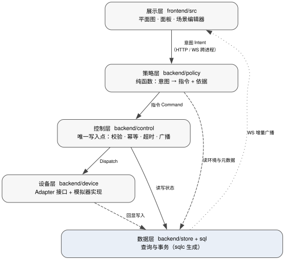
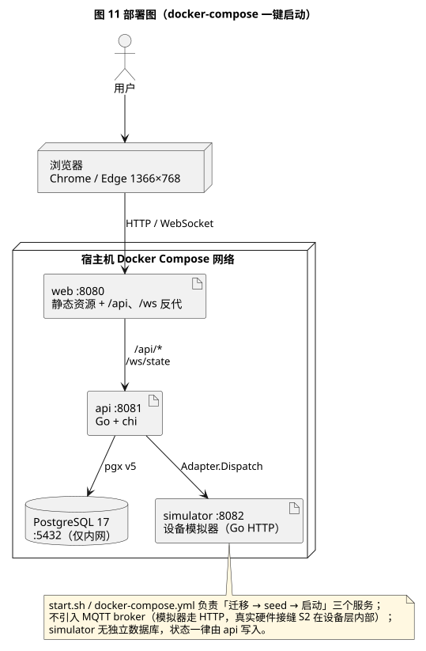
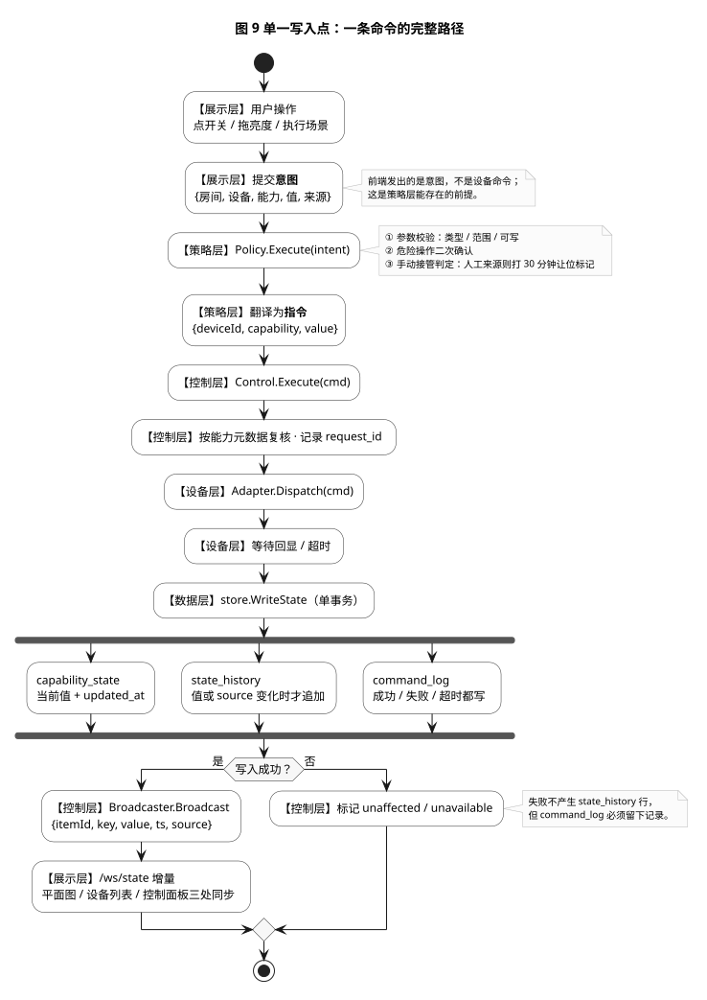
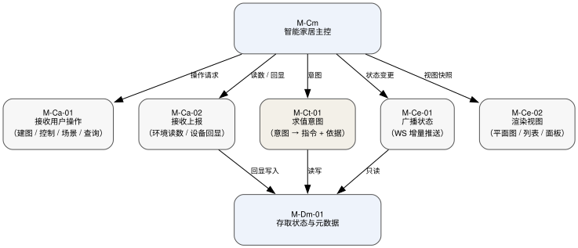
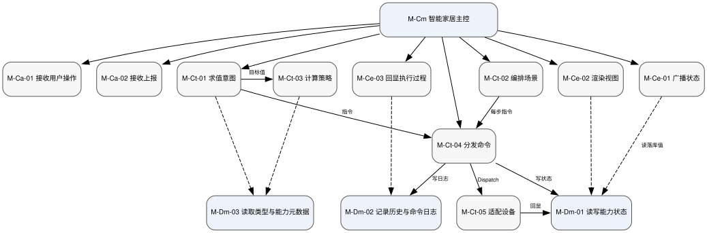
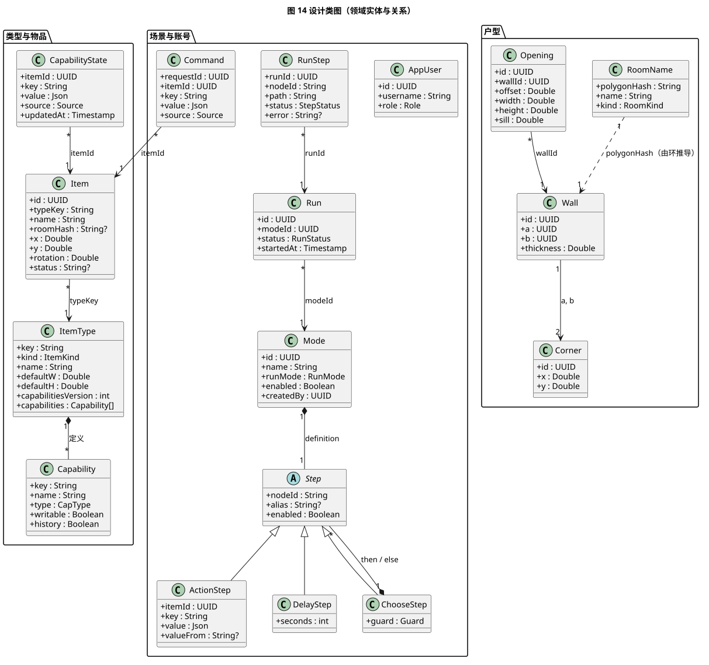
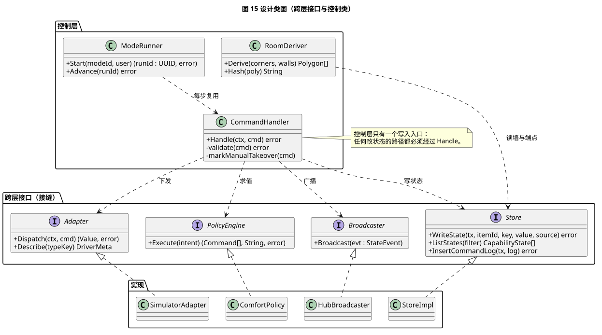
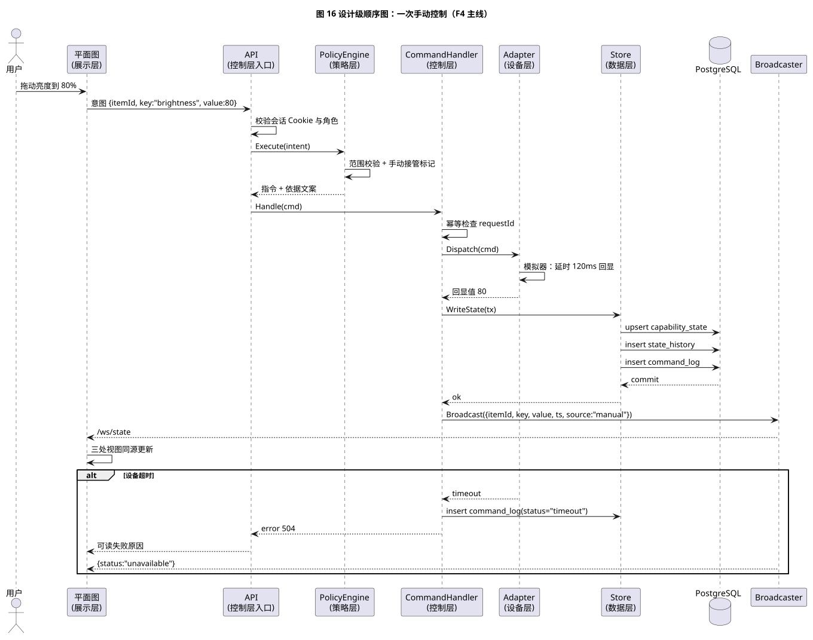
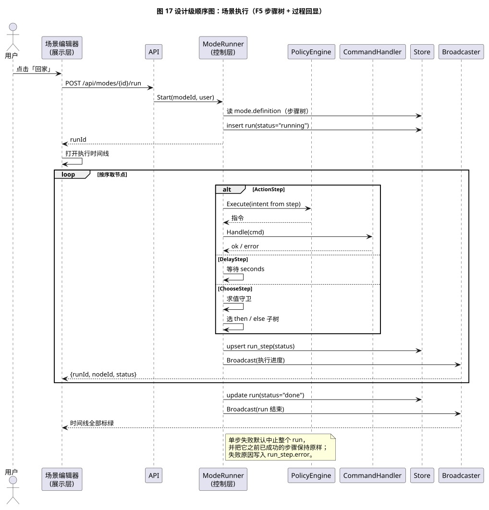

# 概要设计说明书

> 交付物 3／9 · 版本 **v1.2** · 2026-11-22
> 需求基线：《需求规格说明书》**v1.2**（FR-1.1～FR-9.5 共 62 条、NFR-1～NFR-16、DR-1～DR-7）
> 上游：[`02-需求规格说明书.md`](02-需求规格说明书.md)；架构决策记录：[ADR 0001](../adr/0001-技术栈选型.md)（技术栈选型）、[ADR 0002](../adr/0002-数据模型与分层.md)（数据模型与分层）
> 下游：`04-详细设计说明书.md`（类方法级细节、算法实现、表物理设计）
> 本文只回答「系统由哪些部件组成、它们怎么协作、部件之间约定什么」，不回答「某个函数怎么写」。

---

## 1 设计输入与约束

### 1.1 需求基线

| 类别 | 数量 | 主要内容 | 出处 |
| --- | --- | --- | --- |
| 功能需求 | 62 条（`FR-1.1`～`FR-9.5`） | 9 个功能域：F1 物品与平面图、F2 类型与能力、F3 平面图绘制与布放、F4 设备控制、F5 场景编排、E1 环境自适应、E2 移动设备、E3 自然语言、E4 智能管家 | SRS §3 |
| 非功能需求 | 16 条（`NFR-1`～`NFR-16`） | 性能、可靠性、易用性、可维护性、安全、兼容 | SRS §6 |
| 数据需求 | 7 条约束（`DR-1`～`DR-7`） | 坐标落库、范围校验、引用完整性、导入原子性、幂等 | SRS §4.4 |
| 验收走查 | 18 步（`W1`～`W18`） | 每步写明覆盖的需求与通过判据 | SRS §9 |

设计不新增功能：本文出现的每个模块，都能在 §8 的可追溯矩阵里回指到具体的 `FR-x.y`。

### 1.2 设计约束

| 编号 | 约束 | 来源 | 对设计的影响 |
| --- | --- | --- | --- |
| C-1 | 必须是浏览器可访问的 Web 系统，含前端页面与后端服务 | 指导书 2.1 必须做 | 展示层与后端必须跨进程，接口契约成为一等公民 |
| C-2 | 强制分层架构，依赖单向，禁止跨层调用 | 指导书 3.1 | 五个包边界固定，见 §2.1 |
| C-3 | 本机一键启动（`docker-compose.yml` 或 `start.sh`） | 指导书 2.1 最低要求 | 部署图不得出现「需要手工准备」的节点，见 §2.4 |
| C-4 | 技术栈：React 19.3.1 + TS 6.0.3 + Vite 8.3.8 / Go 1.27 + chi / PostgreSQL 17 | ADR 0001 | 语言层不参与本文的分层判断 |
| C-5 | 3 人、第 12–14 周三个迭代 | 指导书 1.3 | 模块边界要与分工边界大致重合，避免三人同改一个文件 |
| C-6 | 设备只经模拟器（18 台固定 + 1 台移动），真实硬件为可选接缝 | SRS §2.3、ADR 0002 S2 | 设备层保留 `Adapter` 接口，模拟器只是它的一个实现 |
| C-7 | 本地部署，运行数据不出住宅（E3 主动调用外部模型时只发文本） | SRS §4.6 | 不引入云端状态存储 |

### 1.3 前置订正留痕

写本文之前，有三处早先的判断被推翻。留痕是为了让评审看得见「哪些是改过的结论」，而不是把改动藏进最终稿。

| 订正项 | 原判断 | 订正后 | 依据 |
| --- | --- | --- | --- |
| 层间依赖方向 | 展示 → 控制 → 策略/设备 → 数据 | **展示 → 策略 → 控制 → 设备**，数据层被各层以接口方式依赖 | 指导书 3.1 原文；原写法还让控制层反向依赖策略层，与「控制层不写业务规则」自相矛盾 |
| 桌面壳 mygo 的定位 | 可选加分项，砍掉不影响交付 | **第二阶段形态适配**，在计划内但排在主线闭环之后 | 项目组需求评审结论（SRS §7 优先级表；接缝 S3） |
| 设备通道 MQTT | ADR 0001 曾列 Mosquitto | **不引入 broker**：模拟器走 HTTP；真实硬件接缝留在设备层内部 | 模拟器无 MQTT 路径；Matter 走 IP/Thread 而非 MQTT |

### 1.4 质量属性场景

按「刺激—环境—响应—度量」写。这四条是设计的目标，也是 §9 评审的检查项。

| 编号 | 属性 | 刺激 | 环境 | 响应 | 度量 |
| --- | --- | --- | --- | --- | --- |
| QA-1 | 性能 | 拖动一件家具改变坐标 | 平面图上有 50 件家具，1366×768 | 视图跟随移动，坐标变更在松手后落库 | 拖拽期间帧率 **P50 ≥ 30 FPS**，输入到画面更新 < 50 ms |
| QA-2 | 可用性 | 设备离线（模拟器停止响应） | 用户点亮某台灯 | 三处视图标为不可用并给出可读原因；其余设备不受影响 | 离线后 **3 秒内**标灰；命令返回带 `reason` 的失败，**不展示过期值** |
| QA-3 | 安全 | 未登录用户直接请求页面、`/api` 或 `/ws/state` | 会话 Cookie 缺失或过期 | 页面跳登录；接口返回 401；WS 拒绝握手 | 三类入口**均被拒绝**，响应体不含设备清单、户型或历史数据 |
| QA-4 | 可修改性 | 新增第 19 台设备类型（例如空气炸锅） | 系统已运行，前端已构建 | 只插一行类型模板（含能力元数据）即可出现在设备库并可控制 | 改动 **≤1 张表、0 行前端代码**，半天内完成 |

### 1.5 编号与引用规则

| 前缀 | 含义 | 示例 | 稳定性 |
| --- | --- | --- | --- |
| `M-` | 模块（结构图节点） | `M-Ct-01` | 与图 12/13 一致，一经发布不重排 |
| `IF-` | 构件间接口契约 | `IF-3 命令下发` | 与 `openapi.yaml` 的资源分组对应 |
| `T-` | 逻辑表 | `T-capability_state` | 与 `sql/` 迁移里的表名一致 |
| `QA-` | 质量属性场景 | `QA-1` | 本节定义，§9 检查 |
| `图 N` | 图纸编号 | 图 10～图 17 | 图号与图题在正文引用处保持一致 |

本文件所有图由 PlantUML / Graphviz 生成 SVG 后嵌入，源文件在 `docs/diagrams/src/`，不手改 SVG。

### 1.6 本文不覆盖的内容

- 类方法的算法步骤与数据结构选择 → 详细设计 §4；
- 表的索引、约束、迁移脚本与 `jsonb` 键约定 → 详细设计 §5；
- 接口路由与错误码细节 → 详细设计 §3；
- 界面布局、配色、组件结构 → 详细设计 §6（课程实验四明确不要求人机界面设计，但答辩要看，故放详细设计）；
- 需求本身 → SRS，本文只引用不复述。

---

## 2 体系结构设计

### 2.1 分层结构



*图 10 分层体系结构与依赖方向（源文件 `docs/diagrams/src/10-layers.dot`）*

| 层 | 目录 | 职责 | 不得做的事 |
| --- | --- | --- | --- |
| 展示层 | `frontend/src/` | 渲染平面图与面板、采集意图、按能力元数据生成表单 | 不得直接调设备；不得自己算舒适温度 |
| 策略层 | `backend/policy/` | 纯函数：环境读数 + 目标 → 目标值 + 依据文案；手动接管判定 | 不得访问数据库或网络 |
| 控制层 | `backend/control/` | **唯一写入点**：校验、幂等、超时、状态回写、广播 | 不得绕过 store 直接写 SQL |
| 设备层 | `backend/device/` | `Adapter` 接口与模拟器实现 | 不得知道 HTTP 或 UI 的存在 |
| 数据层 | `backend/store/` + `sql/` | 查询与事务；sqlc 生成的代码也在这层内 | 不得包含业务判断 |

依赖方向单向向下：**展示 → 策略 → 控制 → 设备**，数据层被各层以接口方式依赖。跨层调用一律经接口，不直接 `import` 下层的实现包。

### 2.2 构件职责表

| 构件 | 所在层 | 职责 | 对外提供 |
| --- | --- | --- | --- |
| `WebApp` | 展示层 | 路由、登录态、全局 store | 页面与交互 |
| `Canvas2D` / `Canvas3D` | 展示层 | 平面图编辑；三维只是同一份数据的投影 | 视图组件 |
| `CapabilityForm` | 展示层 | 读能力元数据渲染的表单（F2 的关键） | 动态表单组件 |
| `ModeEditor` | 展示层 | 步骤树编辑、拖拽排序 | 场景编辑器 |
| `APIHandler` | 控制层 | HTTP 入口：鉴权、参数形状、错误码 | `IF-1`～`IF-3` |
| `PolicyEngine` | 策略层 | 意图 → 指令；温控与环境自适应求值 | Go 接口 `Policy` |
| `CommandHandler` | 控制层 | 幂等、下发、超时、同事务写三处、广播 | `Handle(cmd)` |
| `ModeRunner` | 控制层 | 步骤树遍历、延时、守卫、过程回显 | `Start/Advance` |
| `RoomDeriver` | 控制层 | 由墙的环推导房间多边形与命名哈希 | `Derive/Hash` |
| `Adapter`（含 `SimulatorAdapter`） | 设备层 | 设备指令下发与回显 | 接口 `Adapter` |
| `Store`（含 `StoreImpl`） | 数据层 | 事务、查询、写入 | 接口 `Store` |
| `HubBroadcaster` | 控制层出站 | 把落库后的状态变化推给所有客户端 | `IF-4` |

### 2.3 架构决策索引

| ADR | 主题 | 状态 | 对本文的影响 |
| --- | --- | --- | --- |
| [ADR 0001](../adr/0001-技术栈选型.md) | 技术栈与五层落点 | 已接受 | §2.1 的目录与语言；V1–V9 验证结论 |
| [ADR 0002](../adr/0002-数据模型与分层.md) | 数据模型、单一写入点、七条接缝 | 已接受（2026-11-21 转正） | §2.5、§5 的表结构与不变量 |

### 2.4 部署



*图 11 部署图（源文件 `docs/diagrams/src/11-deploy.puml`）*

| 节点 | 端口 | 说明 |
| --- | --- | --- |
| 浏览器 | — | Chrome / Edge，1366×768 起 |
| `web` | 8080 | 静态资源 + `/api`、`/ws` 反代（同源，Cookie 才能同时用于 HTTP 与 WS） |
| `api` | 8081 | Go + chi，承载五层的后端部分 |
| `simulator` | 8082 | 设备模拟器，实现 `Adapter` 的一个 driver |
| `postgresql` | 5432 | 仅内网可达，不暴露给浏览器 |

`start.sh` / `docker-compose.yml` 负责「迁移 → seed → 启动」三步。**不引入 MQTT broker**：模拟器走 HTTP，真实硬件接缝在设备层内部，部署图上不多一个节点。

### 2.5 运行视图



*图 9 一条命令从意图到广播的完整路径（单一写入点不变量见下）*

四条不变量是体系结构级约束，任何模块都不得绕过：

1. 广播出去的值一定是**落库后**的值，不是期望值，也不是设备回包的原始字节；
2. 失败的命令也写 `command_log`，但不写 `state_history`（值没变）；
3. `source ∈ {manual, automation, device, timeout}`，E1 的「自动让位」靠它判定；
4. `capability_state.updated_at` 就是 F4 的「最近更新时间」，超出窗口即标 `unavailable`。

### 2.6 三个决定性的设计选择

**① 单一写入点。** 状态只有一条写入路径（图 9）。这不是风格问题：F4 要求「平面图、设备列表、控制面板三处一致」，只要允许第二个写入点，三处就一定会漂。

**② 契约先行。** `openapi.yaml` 是展示层与后端之间唯一的同源契约；Go 的 handler 骨架与 TS 的 client 都由它生成。没有契约，前端会开始猜字段名，而猜错的成本在第 13 周才会显现。

**③ 能力元数据一次定义、四处分发。** `item_type.capabilities` 同时是前端动态表单的字段描述、后端命令校验的规则来源、模拟器的行为描述、平面图图标的映射表。这条决定了 F2「新增设备类型不改前端代码」能不能成立。

---

## 3 结构化设计

### 3.1 流特性判定

系统的主线是一条**变换型**数据流：外部输入（操作意图、环境读数）→ 变换（求值、校验、下发）→ 输出（状态广播、视图更新）。因此第一级分解采用变换分析：主控 `M-Cm`、传入 `M-Ca`、变换 `M-Ct`、传出 `M-Ce`。

但「用户操作」这一支具有**事务型**特征：请求种类（建图、控制、场景、查询）决定走哪条动作路径。按课程口径，不对整张图下单一结论，而是按加工分区判断：整图以变换型为主，事务型只出现在 `M-Ct-01` 内部，作为它的子图处理（四种操作共用同一套参数校验与手动接管判定）。

### 3.2 第一级分解

| 角色 | 模块 | 依据 |
| --- | --- | --- |
| 主控 `Cm` | `M-Cm` 智能家居主控 | 接收外部输入，调度三个分支，汇总异常 |
| 传入 `Ca` | `M-Ca-01` 接收用户操作、`M-Ca-02` 接收上报 | DFD 的两类外部输入：人与传感器/设备 |
| 变换 `Ct` | `M-Ct-01` 求值意图 | DFD 中唯一的实质性变换：把意图变成可执行的指令 |
| 传出 `Ce` | `M-Ce-01` 广播状态、`M-Ce-02` 渲染视图 | 两类外部输出：推送与呈现 |
| 数据管理 `Dm` | `M-Dm-01` 存取状态与元数据 | 第二类信息流（读写的存储），不参与变换本身 |

### 3.3 初始结构图



*图 12 第一级分解（源文件 `docs/diagrams/src/12-structure-initial.dot`）*

图上每条调用箭头都标注了主要数据流；模块名统一为「动词 + 名词」，不使用序号。

### 3.4 第二级分解

| 上层模块 | 拆出的子模块 | 拆分理由 |
| --- | --- | --- |
| `M-Ct-01` 求值意图 | 依赖 `M-Ct-03` 计算策略 | 温控与环境自适应是纯函数，可独立测试，不该混进校验逻辑 |
| `M-Cm` | `M-Ct-02` 编排场景 | 场景执行是独立的循环结构（步骤树遍历），与单次命令不同 |
| `M-Ct-01` / `M-Ct-02` | `M-Ct-04` 分发命令 | 两条路径都要「下发 + 超时 + 落库 + 广播」，只实现一次 |
| `M-Ct-04` | `M-Ct-05` 适配设备 | 让「怎么下发」可替换（模拟器 / 真实硬件），即接缝 S2 |
| `M-Dm-01` | `M-Dm-02` 记录历史与命令日志 | 追加写与事务提交时序不同，失败命令只进日志不进历史 |
| `M-Dm-01` | `M-Dm-03` 读取类型与能力元数据 | 元数据是「读多写少」的配置，与高频状态读写分开 |
| `M-Ce-01` | `M-Ce-03` 回显执行过程 | F5 的「过程反馈」是另一类消息（带 `runId`/`nodeId`），不是状态变化 |

### 3.5 精化结构图



*图 13 第二级分解后的结构图（源文件 `docs/diagrams/src/13-structure-refined.dot`）*

### 3.6 精化前后对照

| 项 | 初始结构图（图 12） | 精化结构图（图 13） | 改的依据 |
| --- | --- | --- | --- |
| 模块数 | 7 | 14 | 控制模块下不再挂「一句话加工」，每个子模块有独立的数据流入流出 |
| 变换分支 | `M-Ct-01` 承担全部求值 | 拆为 `M-Ct-01`（求值）+ `M-Ct-03`（策略） | 提高内聚：策略是纯函数、可单测；求值含校验与让位判定 |
| 命令下发 | 隐含在 `M-Ct-01` 内 | 独立 `M-Ct-04` + `M-Ct-05` | 降低耦合：上层的两条路径（直控、场景）复用同一分发与适配 |
| 扇出 | `M-Cm` 出度 5 | `M-Cm` 出度 8 | 提高可测性：场景执行与执行回显成为独立可观察单元 |
| 数据管理 | 1 个 `M-Dm-01` | 3 个（`Dm-01/02/03`） | 读写频率与事务边界不同，分开后写入路径更短 |
| 数据流标注 | 4 条 | 9 条 | 精化后每条边都有明确的数据名，便于与接口契约对齐 |

### 3.7 模块清单

内聚 / 耦合列只对关键模块写判断（课程不要求抄全等级表，要求「以度量说明模块独立性」）。

| 编号 | 模块 | 职责 | 内聚 | 耦合 | 落点 |
| --- | --- | --- | --- | --- | --- |
| M-Cm | 智能家居主控 | 调度三个分支、异常汇总、统一错误码 | 逻辑 | 控制 | `backend/api/router.go` |
| M-Ca-01 | 接收用户操作 | 鉴权、解析、参数形状校验 | 功能 | 数据 | `backend/api/handlers_*.go` |
| M-Ca-02 | 接收上报 | 环境读数与设备回显的入口 | 功能 | 数据 | `backend/api/handlers_report.go` |
| M-Ct-01 | 求值意图 | 意图 → 指令 + 依据；含范围校验、二次确认、让位判定 | 功能 | 标记 | `backend/policy/intent.go` |
| M-Ct-02 | 编排场景 | 步骤树遍历、延时、守卫、失败中止 | 功能 | 控制 | `backend/control/mode_runner.go` |
| M-Ct-03 | 计算策略 | 温控舒适度、滞回、环境自适应（纯函数） | 功能 | 数据 | `backend/policy/comfort.go` |
| M-Ct-04 | 分发命令 | 幂等、超时、重试、同事务写三处、广播 | 功能 | 数据 | `backend/control/command.go` |
| M-Ct-05 | 适配设备 | `Adapter` 接口与模拟器 driver | 功能 | 数据 | `backend/device/` |
| M-Ce-01 | 广播状态 | WS 增量推送与全量重发 | 功能 | 数据 | `backend/api/ws.go` |
| M-Ce-02 | 渲染视图 | 平面图、设备列表、控制面板 | 功能 | 数据 | `frontend/src/features/` |
| M-Ce-03 | 回显执行过程 | 执行时间线与步骤状态 | 功能 | 数据 | `frontend/src/features/modes/` + `backend/api/ws.go` |
| M-Dm-01 | 读写能力状态 | 唯一写入点、事务、当前值查询 | 功能 | 数据 | `backend/store/state.go`、`sql/` |
| M-Dm-02 | 记录历史与命令日志 | 追加写、保留期清理 | 功能 | 数据 | `backend/store/history.go` |
| M-Dm-03 | 读取类型与能力元数据 | 类型模板与能力元数据查询 | 功能 | 数据 | `backend/store/types.go` |

### 3.8 模块 IPO（5 个关键模块）

**① M-Ct-01 求值意图**

- **所属上层**：M-Cm
- **输入**：`Intent`（用户、目标物品或场景、能力键、期望值、来源）；若为场景则另带 `modeId`。
- **输出**：`Command[]`（本步要下发的指令集，可能多条）、`reason string`（写进执行记录的依据文案）；或一个带错误码的拒绝。
- **内部过程**：判定操作种类（事务型子图）→ 查能力元数据确认键存在且可写 → 范围/枚举校验 → 危险操作判定（越界、批量 ≥3、删除类）→ 若命中则要求二次确认 → 检查该能力是否处于手动让位窗口 → 翻译为指令。判定点 4 个，无循环。
- **约束**：必须是纯函数，不读库不写库；元数据由调用方传入，便于单测。

**② M-Ct-04 分发命令**

- **所属上层**：M-Cm（也由 M-Ct-01、M-Ct-02 调用）
- **输入**：`Command`（含 `requestId` 幂等键、目标、能力键、值、来源）。
- **输出**：写入结果（成功 / 失败原因 / 是否超时）；成功时触发广播。
- **内部过程**：按 `requestId` 幂等检查 → `Adapter.Dispatch` 下发并等待回显（带超时）→ 打开事务 → 写 `capability_state` →（值变时）写 `state_history` →（无论成败）写 `command_log` → 提交 → 广播落库值。失败路径跳过历史写入。
- **约束**：这是全系统唯一允许写 `capability_state` 的模块；超时阈值来自配置而非硬编码。

**③ M-Ct-05 适配设备**

- **所属上层**：M-Ct-04
- **输入**：能力指令（设备标识、能力键、值）。
- **输出**：回显值，或 `unavailable` / `timeout` / `rejected`。
- **内部过程**：按 `item_type.driver` 选 driver → 组装该 driver 的报文 → 发送 → 解析回包 → 归一化成本系统的能力值。
- **约束**：不得出现 HTTP 状态码、不得抛出 UI 相关错误；上层只认归一化后的三种失败类型。

**④ M-Dm-01 读写能力状态**

- **所属上层**：M-Ct-04
- **输入**：事务句柄、`(itemId, capabilityKey)`、值、来源、时间戳。
- **输出**：提交结果；当前值查询结果（含 `updatedAt`、`source`）。
- **内部过程**：`upsert` 当前值 → 判断是否写历史（值或 `source` 变化才写）→ 返回。查询侧按 `(item_id, capability_key)` 主键直取，列表查询按房间/类别过滤。
- **约束**：`updatedAt` 由写入语句显式赋值，不用触发器（触发器在 sqlc 生成的代码里不可见）。

**⑤ M-Ce-01 广播状态**

- **所属上层**：M-Cm
- **输入**：落库后的状态事件（`itemId`、`capabilityKey`、值、`ts`、`source`）、连接集合。
- **输出**：WS 消息；新连接先收全量快照，再收增量。
- **内部过程**：为每条消息分配递增序号 → 写入该连接的发送队列 → 队列满时断开慢客户端 → 新连接时先推全量快照并把序号对齐。
- **约束**：只广播落库值；广播失败不影响已提交的事务。

---

## 4 面向对象设计

### 4.1 设计类图

设计类分两张画：实体与值对象一张（图 14），跨层接口与控制类一张（图 15）。分开的理由是它们面向两种读者——实体图回答「数据长什么样」，接口图回答「协作怎么发生」。



*图 14 领域实体与关系（源文件 `docs/diagrams/src/14-class-entities.puml`）*



*图 15 跨层接口与控制类（源文件 `docs/diagrams/src/15-class-services.puml`）*

图中元素含义：`+` 公有、`-` 私有；`?` 表示可空；连线上的 `1` / `*` 是多重性；`*--` 组合、`-->` 关联、`..>` 依赖、`<|--` 泛化、`<|..` 实现。

### 4.2 关键类职责

| 类 | 类型 | 职责 | 关键约束 |
| --- | --- | --- | --- |
| `Item` | 实体 | 家具与设备的统一表示（含坐标、房间、状态） | `status` 只对家具类有语义；设备状态在 `CapabilityState` |
| `ItemType` + `Capability` | 实体（组合） | 类型模板与其能力元数据 | `capability.key` 发布后不改名；改结构要升 `capabilitiesVersion` |
| `CapabilityState` | 实体 | 单个数据点的当前值、来源、更新时间 | 主键 `(itemId, key)`；`updatedAt` 是 F4 的「最近更新时间」 |
| `Corner` / `Wall` / `Opening` | 实体 | 户型几何；门窗以沿墙偏移表示 | 门窗不存绝对坐标，墙移动时随偏移跟随 |
| `RoomName` | 实体 | 房间的「名字与用途」，几何由墙推导 | 主键是多边形哈希，墙改则旧命名失效并提示 |
| `Step`（抽象）→ `ActionStep` / `DelayStep` / `ChooseStep` | 实体（继承） | 场景步骤树；`ChooseStep` 递归含子树 | 节点带稳定 `nodeId`，执行状态按 `nodeId` 回填 |
| `Command` / `Intent` | 值对象 | 指令与意图；意图含可选目标 | 二者不可混用：意图可能被策略层拒绝，指令一定可执行 |
| `Store` / `Adapter` / `PolicyEngine` / `Broadcaster` | 接口 | 四条跨层接缝 + 一条出站 | 接口总数 5，超过即过度设计（ADR 0002 §2.5） |
| `CommandHandler` | 控制类 | 幂等、下发、超时、同事务写、广播 | 全系统唯一写 `capability_state` 的入口 |
| `ModeRunner` | 控制类 | 步骤树遍历、延时、守卫、失败中止 | 单步失败默认中止整次执行，已成功步骤保持原样 |

### 4.3 设计级顺序图



*图 16 一次手动控制（F4 主线）（源文件 `docs/diagrams/src/16-seq-command.puml`）*

注意两个细节：策略层在 `Execute` 里**先打手动接管标记再下发**——如果放到设备层去标，自动指令也会被误标成人工；`command_log` 在成功与失败两条路径上都要写。



*图 17 场景执行与过程回显（源文件 `docs/diagrams/src/17-seq-mode.puml`）*

场景执行复用 `CommandHandler`，不复用 `ModeRunner` 之外的任何循环结构；每步结束都写一次 `run_step` 并广播，前端的执行时间线完全由这条流驱动（F5 的「过程反馈」）。

### 4.4 状态机与迁移表

状态图见需求文档附录 A.4（图 3 空调、图 4 灯），已随需求基线冻结。设计侧补的是**迁移表**——事件、守卫、动作这三列是需求图里没有的。

**T-AC 空调**

| 当前状态 | 事件 | 守卫 | 动作 | 目标状态 |
| --- | --- | --- | --- | --- |
| 关闭 | 开机 | 模式=制冷 且 室温 > 目标+1℃ | 记录 `source`；下发开机指令 | 制冷 |
| 关闭 | 开机 | 模式=制热 且 室温 < 目标-1℃ | 记录 `source`；下发开机指令 | 制热 |
| 关闭 | 开机 | 模式=送风 | 下发送风指令 | 送风 |
| 制冷 | 室温达到 | 室温 ≤ 目标−1℃（1℃ 滞回） | 下发停机指令 | 关闭 |
| 制热 | 室温达到 | 室温 ≥ 目标+1℃（1℃ 滞回） | 下发停机指令 | 关闭 |
| 制冷 / 制热 / 送风 | 切模式 | 目标模式与原模式不同 | 下发模式切换 | 对应模式 |
| 任意运行态 | 关机 | — | 下发关机指令 | 关闭 |
| 任意状态 | 心跳超时 | 超过 `offlineWindow` 未收到回显 | 标 `unavailable`，**不写期望值** | 离线 |
| 离线 | 心跳恢复 | — | 重新拉取一次状态 | 关闭（不自动恢复运行） |
| 任意状态 | 自检失败 | — | 写 `command_log`，标 `fault` | 故障 |
| 故障 | 复位 | 用户确认 | 下发复位 | 关闭 |

**T-LIGHT 灯**

| 当前状态 | 事件 | 守卫 | 动作 | 目标状态 |
| --- | --- | --- | --- | --- |
| 关闭 | 开关=开 | — | 下发 `on=true` | 点亮 |
| 点亮 | 设置亮度或色温 | 值在能力范围内 | 下发对应能力值 | 调光 |
| 调光 | 调整 | 值变化 | 下发并写历史（值变才写） | 调光 |
| 调光 | 恢复 | 亮度=100% 且 色温=默认 | — | 点亮 |
| 点亮 / 调光 / 关闭 | 开关=关 | — | 下发 `on=false` | 关闭 |
| 点亮 / 调光 / 关闭 | 心跳超时 | 超过 `offlineWindow` | 标 `unavailable` | 离线 |
| 离线 | 心跳恢复 | — | 重新拉取状态 | 关闭（保持关闭） |
| 任意状态 | 自检失败 | — | 写 `command_log` | 故障 |
| 故障 | 复位 | 用户确认 | 下发复位 | 关闭 |

夜起模式（8% 亮度、2700K）是「调光」状态的一组取值，**不是独立状态**——否则每加一个场景就要加一个状态。

### 4.5 关键算法 PDL

**① 房间推导（`RoomDeriver.Derive`）**

```
算法 Derive(corners, walls) -> rooms
  输入: corners 端点集合（共享），walls 墙段集合（每段引用两个端点）
  输出: 房间多边形列表，每个带 polygonHash

  1. 建立邻接: 对每段墙，在 corner 上记一条「半边」到对端
  2. 对每个 corner，按「下半边在下、顺时针排序」给半边排好出发顺序
     （这一步决定能否得到唯一的内侧环）
  3. 取一条尚未访问的半边 e，沿 e.next 前进:
        next = 对端 corner 上、e 反向半边之后的那条半边
        记录顶点，直到回到起点
  4. 若环的顶点数 < 3 或面积为负 → 丢弃（外轮廓未闭合）
     否则 → 规范化顶点序列（从最小 x 顶点起、统一绕向）
          → polygonHash = SHA1(规范化坐标序列)
  5. 返回所有环；未闭合的墙段单独返回「未闭合区域」提示
```

守卫与异常：端点被多段墙共享时不得重复计入；同一多边形只保留一个哈希；墙少于 3 段时直接返回空并给出提示。

**② 温控策略（`ComfortPolicy.Execute`）**

```
算法 Execute(intent, env, state) -> (target, reason) 或 拒绝
  输入: 意图（能力键 / 期望值或"auto"）、环境读数（室温/湿度/光照/季节）、当前状态（含 source）
  输出: 目标值与依据文案；或带错误码的拒绝

  1. 若该能力处于手动让位窗口内（now - lastManual < 30min）且不是用户本人发起:
        返回 拒绝(原因="手动接管中")
  2. 若 intent 带了显式值:
        校验范围（温度 16–30℃，步长 0.5）→ 越界则要求二次确认
        返回 (显式值, "按用户设定")
  3. 否则按季节选目标区间:
        夏季 24–28℃，冬季 18–22℃，春秋：不主动调温，返回 ("natural", 依据)
  4. 在区间内做舒适度加权:
        score = w1*|T-25| + w2*|RH-50|/10 + w3*(季节偏好)
        取 score 最小的整数度作为目标
  5. 应用 1℃ 滞回: 若当前已在该目标附近 ±1℃ 内，维持现状不产生新指令
  6. 生成依据文案:
        "当前室温 32℃、湿度 75%，按照夏季温控策略，设定目标温度 26℃"
  7. 返回 (目标, 依据)
```

守卫与异常：读数为 `unavailable` 时不得据其做决策，返回「等待数据」；同一环境读数在 60 秒内不重复产生指令（避免抖动）。

**③ 场景执行（`ModeRunner.Advance`）**

```
算法 Advance(run) -> 步骤状态
  输入: 一次执行（modeId、definition 步骤树、当前进度、runMode）
  输出: 完成 / 进行中 / 失败（含 nodeId 与原因）

  1. 取下一个待执行节点 node:
        按树深度优先；DelayStep 到点才产出；ChooseStep 先求值守卫
  2. 依节点类型分派:
        ActionStep:
            cmd 集 = PolicyEngine.Execute(意图(node), env)
            若被拒绝 → 记 failed、中止整个 run
            否则 → CommandHandler.Handle(每条 cmd)
               任一条失败 → 按 continueOnError 决定是否继续（默认中止）
        DelayStep:
            等待 seconds，期间保持 run 为 running
        ChooseStep:
            求值 guard（引用环境读数或状态值）
            → 取 then/else 子树，把子树压入待执行栈
  3. 写 run_step(nodeId, path, status) 并广播进度
  4. 全部节点完成 → run.status = done；出现中止 → run.status = failed
```

守卫与异常：同一 `runId` 重复调用 `Advance` 必须幂等（按 `nodeId` 判重）；环境读数缺失时，依赖它的守卫按「不成立」处理并记录原因；整次执行超过 `maxRunDuration` 强制失败，避免挂死。

### 4.6 设计模式落点

| 模式 | 落点 | 解决什么 | 若不用会怎样 |
| --- | --- | --- | --- |
| 策略（Strategy） | `PolicyEngine` 的规则集（温控 / 环境自适应 / 自然语言解析前的意图归一） | 同一「意图 → 目标值」接口下有多种求值规则，可独立测试 | 规则会写成一串 `if season == ...` 嵌进 handler |
| 适配器（Adapter） | `device.Adapter`，含 `SimulatorAdapter`（现用）与将来的 `MatterAdapter` | 上层只认归一化后的能力值，不认 HTTP/Matter 报文 | 设备协议会渗进控制层，接缝 S2 失效 |
| 仓储（Repository） | `Store` / `StoreImpl`，把 sqlc 生成的代码挡在数据层内 | 控制层不出现 SQL 与表名 | 换表结构时要改控制层，违反 C-2 |
| 观察者（Observer） | `Broadcaster` / `HubBroadcaster` | 「一处写入、多处消费」：三处视图、执行时间线、日志 | 每个展示位置各自轮询，F4 的三处一致无法保证 |

---

## 5 数据设计

### 5.1 逻辑表清单

共 14 张表。所有时间列用 `timestamptz`；`item` 主键用 uuid v4（`gen_random_uuid()`）；日志表用 bigserial。完整 DDL 与索引在详细设计 §5。

**T-corner（墙端点）**

| 字段 | 类型 | 约束 | 说明 |
| --- | --- | --- | --- |
| `id` | uuid | PK | 端点身份，多个墙共享 |
| `x`, `y` | double precision | NOT NULL | 平面坐标（1 单位 = 1 cm） |
| `created_at` | timestamptz | NOT NULL | — |

**T-wall（墙）**

| 字段 | 类型 | 约束 | 说明 |
| --- | --- | --- | --- |
| `id` | uuid | PK | — |
| `a`, `b` | uuid | FK → `corner(id)` | 两端端点，`a ≠ b` |
| `thickness` | double precision | NOT NULL, > 0 | 默认 10（cm） |
| `height` | double precision | NOT NULL | 默认 300（cm） |

**T-opening（门窗）**

| 字段 | 类型 | 约束 | 说明 |
| --- | --- | --- | --- |
| `id` | uuid | PK | — |
| `wall_id` | uuid | FK → `wall(id)`, ON DELETE CASCADE | 所属墙 |
| `kind` | text | CHECK (`door` / `window`) | — |
| `offset` | double precision | NOT NULL, ≥ 0 | 沿墙起点距离（cm） |
| `width` | double precision | NOT NULL, > 0 | — |
| `height` | double precision | NOT NULL, > 0 | — |
| `sill` | double precision | NOT NULL, ≥ 0 | 窗台高（门为 0） |

**T-room_name（房间命名）**

| 字段 | 类型 | 约束 | 说明 |
| --- | --- | --- | --- |
| `polygon_hash` | text | PK | 多边形顶点规范化后的哈希 |
| `name` | text | NOT NULL | 例如「客厅」 |
| `kind` | text | CHECK (`living`/`bedroom`/`kitchen`/`bathroom`/`study`/`hallway`) | 对应客厅/卧室/厨房/卫生间/书房/走廊 |
| `created_at`, `updated_at` | timestamptz | NOT NULL | — |

**T-item_type（类型模板）**

| 字段 | 类型 | 约束 | 说明 |
| --- | --- | --- | --- |
| `key` | text | PK | 稳定标识，发布后不改名 |
| `kind` | text | CHECK (`furniture` / `device`) | 家具＝零能力的设备 |
| `name` | text | NOT NULL | 显示名 |
| `icons` | text | NULL | 图标名（Lucide 命名空间内） |
| `mount` | text | NOT NULL, 默认 `floor`, CHECK (`floor`/`wall`/`ceiling`) | 挂载方式：落地、贴墙、吸顶。挂墙类型落库时必须带墙 |
| `default_width`, `default_depth` | double precision | NOT NULL, > 0 | 平面图默认宽高（cm，默认 60） |
| `capabilities` | jsonb | NOT NULL, 默认 `[]` | 能力元数据数组（键/类型/范围/单位/可写/默认） |
| `capabilities_version` | integer | NOT NULL, 默认 1 | 改结构时递增 |
| `driver` | text | NULL | 仅 `device` 可填，指向适配器驱动（接缝 S2） |
| `created_at`, `updated_at` | timestamptz | NOT NULL | — |

**T-item（物品与设备）**

| 字段 | 类型 | 约束 | 说明 |
| --- | --- | --- | --- |
| `id` | uuid | PK | 删除后不复用 |
| `type_key` | text | FK → `item_type(key)` ON DELETE RESTRICT | — |
| `name` | text | NOT NULL | 用户可改 |
| `room_hash` | text | NULL, FK → `room_name(polygon_hash)` ON DELETE SET NULL | 未分配房间时为 NULL |
| `x`, `y` | double precision | NOT NULL | 坐标必须落库（`DR-1`）；挂墙物品时是派生值，由墙算出来 |
| `rotation` | double precision | NOT NULL, 默认 0 | 0/90/180/270；挂墙物品跟随墙朝向 |
| `wall_id` | uuid | NULL, FK → `wall(id)` ON DELETE CASCADE | 挂在哪面墙；删墙时物品一起消失 |
| `wall_offset` | double precision | NULL, ≥ 0, 与 `wall_id` 同时为空或同时有值 | 沿墙偏移（距墙 A 端点的 cm） |
| `status` | text | NULL, CHECK (`normal`/`idle`/`maintenance`) | **只对家具类有语义**（正常/闲置/维修） |
| `attrs` | jsonb | NOT NULL, 默认 `{}` | 只影响「怎么画」的装饰性属性 |
| `created_at`, `updated_at` | timestamptz | NOT NULL | 操作者审计落在 `command_log.created_by` |

**T-capability_state（能力状态）**

| 字段 | 类型 | 约束 | 说明 |
| --- | --- | --- | --- |
| `item_id` | uuid | PK(1/2), FK → `item(id)` ON DELETE CASCADE | — |
| `capability_key` | text | PK(2/2) | 来自类型模板，不改名 |
| `value` | jsonb | NOT NULL | 当前值（JSON 标量） |
| `source` | text | CHECK (`manual`/`automation`/`device`/`timeout`) | 让位判定依据 |
| `updated_at` | timestamptz | NOT NULL | F4 的「最近更新时间」 |

**T-state_history（状态历史）**

| 字段 | 类型 | 约束 | 说明 |
| --- | --- | --- | --- |
| `id` | bigserial | PK | — |
| `item_id` | uuid | NOT NULL（**不建外键**） | 删物品后历史仍保留 |
| `capability_key` | text | NOT NULL | — |
| `value` | jsonb | NOT NULL | 变化后的值 |
| `source` | text | NOT NULL | 同 `capability_state` |
| `recorded_at` | timestamptz | NOT NULL | 追加表只有这一个时间列 |

**T-command_log（命令日志）**

| 字段 | 类型 | 约束 | 说明 |
| --- | --- | --- | --- |
| `id` | bigserial | PK | — |
| `request_id` | uuid | UNIQUE, NOT NULL | 幂等键 |
| `item_id` | uuid | NULL | 场景类命令可能无单一目标 |
| `capability_key` | text | NULL | — |
| `target` | jsonb | NULL | 指令原文快照 |
| `status` | text | CHECK (`ok`/`failed`/`timeout`/`rejected`) | — |
| `error` | text | NULL | 可读原因 |
| `source` | text | NOT NULL | 同 `capability_state` |
| `created_by` | uuid | NULL, FK → `app_user(id)` ON DELETE SET NULL | E4 解释与权限的基础 |
| `created_at` | timestamptz | NOT NULL | 请求创建时间 |
| `completed_at` | timestamptz | NULL | 未完成则为 NULL |
| `duration_ms` | integer | NULL, ≥ 0 | 命令执行耗时（毫秒） |

**T-app_user（账号）**

| 字段 | 类型 | 约束 | 说明 |
| --- | --- | --- | --- |
| `id` | uuid | PK | — |
| `username` | text | UNIQUE, NOT NULL | 登录账号 |
| `display_name` | text | NOT NULL | 页面显示名称 |
| `password_hash` | text | NOT NULL | 只存摘要 |
| `role` | text | CHECK (`admin`/`member`) | 改配置 vs 只操作 |
| `created_at` | timestamptz | NOT NULL | — |

**T-mode（场景）**

| 字段 | 类型 | 约束 | 说明 |
| --- | --- | --- | --- |
| `id` | uuid | PK | — |
| `name` | text | UNIQUE, NOT NULL | — |
| `definition` | jsonb | NOT NULL | 步骤树（`Step` 的 JSON 表示） |
| `run_mode` | text | CHECK (`single`/`restart`/`queued`/`parallel`) | 默认 `restart` |
| `enabled` | boolean | NOT NULL, 默认 true | — |
| `created_by` | uuid | NULL, FK → `app_user(id)` ON DELETE SET NULL | — |
| `created_at`, `updated_at` | timestamptz | NOT NULL | — |

**T-run（一次执行）**

| 字段 | 类型 | 约束 | 说明 |
| --- | --- | --- | --- |
| `id` | uuid | PK | — |
| `mode_id` | uuid | NULL, FK → `mode(id)` ON DELETE SET NULL | — |
| `status` | text | CHECK (`running`/`ok`/`failed`/`cancelled`) | — |
| `definition_snapshot` | jsonb | NOT NULL | 防止执行中场景被改 |
| `triggered_by` | uuid | NULL, FK → `app_user(id)` ON DELETE SET NULL | 触发者 |
| `source` | text | CHECK (`manual`/`automation`/`device`/`timeout`) | 触发来源 |
| `started_at` | timestamptz | NOT NULL | — |
| `finished_at` | timestamptz | NULL | — |

**T-run_step（步骤回显）**

| 字段 | 类型 | 约束 | 说明 |
| --- | --- | --- | --- |
| `run_id` | uuid | PK(1/2), FK → `run(id)` ON DELETE CASCADE | — |
| `node_id` | text | PK(2/2) | 步骤树里的稳定 id |
| `path` | text | NOT NULL | 例如 `0.1.2`，便于排序 |
| `alias` | text | NULL | 用户写的步骤备注 |
| `status` | text | CHECK (`pending`/`running`/`ok`/`failed`/`skipped`) | — |
| `started_at`, `finished_at` | timestamptz | NULL | — |
| `error` | text | NULL | 失败原因 |

### 5.2 房间为什么不是一张普通的表

房间的几何**不落库**。原因是一条链：门窗必须存沿墙偏移（否则墙一移动它们就漂）→ 墙与端点必须存 → 房间的轮廓完全由墙决定 → 再存一份房间多边形就成了第二份真相。

所以只存「名字与用途」，主键是多边形顶点规范化后的哈希：墙一改，哈希变，旧命名自然失效并提示重命名，而不是悄悄把「客厅」挂到卫生间上。

### 5.3 保留期、索引与约束（概要级）

| 项 | 决策 | 理由 |
| --- | --- | --- |
| 状态历史保留 | 30 天，按天清理 | 答辩看的是最近两三天曲线；30 天已覆盖三个迭代 |
| 命令日志保留 | 90 天 | 它同时是 E4 习惯挖掘的数据源与 F4 的失败证据 |
| 历史表索引 | `(item_id, capability_key, recorded_at DESC)` | 曲线查询是范围扫描；不分区（三周约 180 万行，单表无压力） |
| 历史表外键 | **不建** | 删物品不该连带删除历史；建了外键就得级联或禁止删除 |
| 能力键改名 | 禁止；走「新增 + 迁移 + 保留旧键一个迭代」 | 历史与日志里全是旧键 |
| 迁移策略 | additive-only（加表/加列/加索引） | 十秒重建演示数据比任何预留字段都值钱 |

### 5.4 迁移与重建

`migrate down → up → seed` 必须在**十秒内**重建全部演示数据（18 台设备、户型、5 个场景模板），`seed.sql` 里的 UUID 写死，保证重建结果确定、可复现截图与录屏。

---

## 6 接口设计

四份契约覆盖四种交互语义：同步认证、资源读写、动作、单向流。完整的路由表与错误码细节在详细设计 §3，本节定的是**契约的边界与语义**。

### 6.1 契约总览

| 标识 | 名称 | 调用双方 | 通道 | 语义 |
| --- | --- | --- | --- | --- |
| IF-1 | 认证与会话 | `WebApp` → `APIHandler` | HTTP | 同步、有状态（Cookie） |
| IF-2 | 物品与设备 | `WebApp` → `APIHandler` | HTTP | 资源读写 + 批量导入导出 |
| IF-3 | 命令下发与场景执行 | `WebApp` → `APIHandler` | HTTP | 动作、长耗时、可失败 |
| IF-4 | 状态推送 | `APIHandler` → 所有客户端 | WebSocket | 单向流、先全量后增量 |

### 6.2 IF-1 认证与会话

| 项 | 内容 |
| --- | --- |
| 标识 | `IF-1`，`openapi.yaml` 标签 `auth` |
| 调用双方 | 展示层 `LoginPage` / 全局请求拦截器 → `APIHandler` |
| 方法与参数 | `POST /api/auth/login`：`{username, password}`；`POST /api/auth/logout`：无参；`GET /api/auth/me`：无参 |
| 前置条件 | 演示账号已由 seed 写入（`admin` 与 `member` 各一） |
| 后置条件 | 成功时下发 `httpOnly` + `SameSite=Lax` 的会话 Cookie；`/me` 返回 `{id, name, role}` |
| 错误与超时 | 401 `UNAUTHENTICATED`（凭据错误或会话过期）；超时 5 s；错误信息不区分「用户不存在」与「密码错」 |
| 格式与版本 | `application/json`；`securitySchemes` 从 v1 即声明 Cookie 认证并全局生效，`login`/`health` 用 `security: []` 例外 |

### 6.3 IF-2 物品与设备

| 项 | 内容 |
| --- | --- |
| 标识 | `IF-2`，标签 `items` / `item-types` / `transfer` |
| 调用双方 | `Canvas2D`、`ItemList`、`CapabilityForm` → `APIHandler` → `Store` |
| 方法与参数 | `GET /api/items?room=&kind=&q=`；`POST /api/items`；`PATCH /api/items/{id}`（含坐标、房间、名称）；`DELETE /api/items/{id}`；`GET /api/item-types`；`GET /api/items/{id}/history`；`POST /api/rooms/derive`；`POST /api/import`；`POST /api/export` |
| 前置条件 | 会话有效；写操作要求角色 `admin`（改类型/房间/导入导出）或 `member`（改物品位置与名称） |
| 后置条件 | 坐标变更必须落库（`DR-1`）；导入为整份成功或整份失败（`DR-5`，不得部分写入）；导出只含物品与平面图，不含历史与场景 |
| 错误与超时 | 400 `VALIDATION_FAILED` / `IMPORT_VALIDATION_FAILED`（列出全部错误行号）；404 `NOT_FOUND`；409 `CONFLICT`（乐观锁或引用冲突）；超时 10 s |
| 格式与版本 | JSON 带 `schemaVersion`；CSV 只导物品清单；导入按 `schemaVersion` 判读 |

### 6.4 IF-3 命令下发与场景执行

| 项 | 内容 |
| --- | --- |
| 标识 | `IF-3`，标签 `commands` / `modes` |
| 调用双方 | 控制面板、场景编辑器 → `APIHandler` → `PolicyEngine` → `CommandHandler` |
| 方法与参数 | `POST /api/items/{id}/commands`：`{requestId, capabilityKey, value}`（`source` 由服务端按调用方判定）；`GET /api/modes`；`POST /api/modes/{id}/run`：`{requestId}`；`GET /api/runs/{id}`；`POST /api/runs/{id}/cancel` |
| 前置条件 | 会话有效；`requestId` 由客户端生成（幂等键） |
| 后置条件 | 命令成功后 `capability_state` 与 `state_history` 各一行、`command_log` 一行（成败都写）；随后 `IF-4` 广播落库值 |
| 错误与超时 | 400 `RANGE_OUT_OF_BOUNDS`（参数越界）；409 `CONFIRMATION_REQUIRED`（危险操作二次确认）或 `CONFLICT`（`requestId` 重复返回首次结果）；503 `DEVICE_UNAVAILABLE` / `DEVICE_TIMEOUT`（默认超时 3 s，可配置） |
| 格式与版本 | `application/json`；错误统一 `{code, message, itemId?, capabilityKey?}` |

### 6.5 IF-4 状态推送

| 项 | 内容 |
| --- | --- |
| 标识 | `IF-4`，`/ws/state` |
| 调用双方 | `APIHandler` / `HubBroadcaster` → 所有已认证客户端 |
| 消息形状 | `{v, seq, type, payload}`；`type ∈ {snapshot, state, run_step, error}`；`seq` 单调递增 |
| 前置条件 | 握手携带同一份会话 Cookie（只读大屏 `/wall` 使用专用只读订阅通道）；未认证直接拒绝升级 |
| 后置条件 | 新连接先收 `snapshot`（全量当前值），再收增量；客户端发现 `seq` 跳号时主动重取全量 |
| 错误与超时 | 心跳 30 s，两次未响应即断开；发送队列满则断开慢客户端，不阻塞其他连接 |
| 格式与版本 | JSON 文本帧；`v`/`type`/`seq` 是稳定字段，新增 `type` 不改变旧客户端行为 |

---

## 7 人机界面设计的归属

课程第 6 章把「人机界面设计」列为设计内容之一，而实验四的任务清单明确不含界面设计（`实验四 / 3.7`）。两份口径不冲突，但必须选一处说清楚，否则要么重复要么漏。本文的处理是：**只在这里划边界，具体界面设计放详细设计 §6**。

### 7.1 范围声明

| 内容 | 放在哪 | 理由 |
| --- | --- | --- |
| 页面划分、页面之间的跳转关系 | 本文 §7.2 | 它决定展示层的模块边界，属于体系结构问题 |
| 每页必须展示什么、必须能执行什么 | SRS §5.2（已冻结） | 这是需求，不是设计 |
| 布局、组件层级、交互细节、无障碍 | 详细设计 §6 | 实验四不计分，但答辩与用户手册要用 |

### 7.2 页面与展示层模块的对应

| 页面 | 主要需求 | 承载模块 | 说明 |
| --- | --- | --- | --- |
| 平面图主页 | FR-3.1～FR-3.8、FR-1.6 | `M-Ce-02` Canvas2D | 首屏。绘图、布放、选中设备 |
| 设备列表 | FR-1.2、FR-4.2 | `M-Ce-02` | 与平面图、控制面板共用同一份状态 |
| 控制面板 | FR-4.1、FR-4.4、FR-4.5 | `M-Ce-02` + `CapabilityForm` | 表单由能力元数据生成，不是手写每个设备 |
| 三维视图 | SRS §5.2（平面图同源三维视图） | `M-Ce-02` Canvas3D | 与平面图同源，只读投影 |
| 场景编辑器 | FR-5.1～FR-5.4 | `M-Ce-02` ModeEditor | 步骤树 + 拖拽排序 |
| 场景执行与时间线 | FR-5.8 | `M-Ce-03` | 按 `nodeId` 回填状态 |
| 设置与账号 | FR-2.1、FR-2.4、NFR-12 | `M-Ca-01` | 仅 `admin` 可进 |
| 只读大屏 `/wall` | FR-4.7、QA-3 | `M-Ce-02` | 免登录、只读、无控制能力 |

展示层不保存业务真相：页面上的每个值都来自 `M-Ce-01` 推送或 `IF-2` 查询，页面自己不做推断。

---

## 8 可追溯矩阵

课程要求「设计元素能回指需求」，且矩阵条数不少于 12。下表 19 行覆盖 9 个功能域，需求编号与 SRS v1.2 一一对应，DFD 加工编号与 SRS 附录 A.5（图 5，共 5 个加工）严格一致。

| 需求 | DFD 加工（图 5） | 结构图模块 | 接口 | 表 |
| --- | --- | --- | --- | --- |
| FR-1.1 物品与设备的增删改查 | 1 物品与平面图管理 | `M-Ca-01`、`M-Dm-01` | IF-2 | `item`、`item_type` |
| FR-1.2 按房间/类别筛选与搜索 | 1 物品与平面图管理 | `M-Dm-01` | IF-2 | `item`、`room_name` |
| FR-1.3～FR-1.5 JSON / CSV 批量导入导出 | 1 物品与平面图管理 | `M-Ca-01` | IF-2 | `item`、`room_name`、`wall`、`opening` |
| FR-1.6 坐标改动必须落库 | 1 物品与平面图管理 | `M-Dm-01` | IF-2 | `item`（`x`/`y`/`rotation`） |
| FR-1.7～FR-1.9 闭合墙体自动识别房间 | 1 物品与平面图管理 | `RoomDeriver`、`M-Ct-01` | IF-2 | `room_name`（按 `polygon_hash`） |
| FR-2.1～FR-2.3 类型模板与能力元数据维护 | 2 类型模板管理 | `M-Dm-03`、`M-Ca-01` | IF-2 | `item_type.capabilities` |
| FR-2.4 新增类型不改前端代码 | 2 类型模板管理 | `CapabilityForm`（`M-Ce-02`） | IF-2 | `item_type` |
| FR-3.1、FR-3.5 墙、门窗的绘制与跟随 | 1 物品与平面图管理 | `M-Ce-02`、`M-Dm-01` | IF-2 | `corner`、`wall`、`opening` |
| FR-3.2～FR-3.8 物品布放、属性编辑、持久化与状态渲染 | 1 物品与平面图管理 | `M-Ce-02` Canvas2D/3D | IF-2、IF-4 | `item`、`capability_state` |
| FR-4.1 下发控制命令 | 3 设备控制与状态同步 | `M-Ct-01`→`M-Ct-04`→`M-Ct-05` | IF-3 | `capability_state`、`command_log` |
| FR-4.2、FR-4.7 三处状态一致与只读大屏 | 3 设备控制与状态同步 | `M-Ce-01`、`M-Ce-02` | IF-4 | `capability_state` |
| FR-4.4 历史曲线 | 3 设备控制与状态同步 | `M-Dm-02` | IF-2 | `state_history` |
| FR-4.5、FR-4.6 成功/失败/超时反馈与模拟器 | 3 设备控制与状态同步 | `M-Ct-04`、`M-Ct-05` | IF-3 | `command_log.status` |
| FR-5.1～FR-5.4 场景（步骤树）编排与嵌套分支 | 4 场景编排与执行 | `ModeEditor`（`M-Ce-02`）、`M-Ct-02` | IF-3 | `mode.definition`、`run`、`run_step` |
| FR-5.5～FR-5.7 动态温控、1℃ 滞回与调节依据 | 5 环境自适应调控 | `M-Ct-03` | IF-3 | `capability_state`、`command_log` |
| FR-5.8 场景执行过程反馈 | 4 场景编排与执行 | `M-Ce-03` | IF-4 | `run_step.status` |
| FR-6.x 环境自适应与手动让位（含 FR-5.9） | 5 环境自适应调控 | `M-Ct-03`、`M-Ct-01` | IF-3 | `capability_state.source` |
| FR-8.x 自然语言控制与二次确认 | 3 设备控制与状态同步 | `M-Ca-01`、`M-Ct-01` | IF-1、IF-3 | `command_log` |
| FR-9.x 管家解释与习惯建议 | 4 场景编排与执行 | `M-Dm-02`、`M-Ct-01` | IF-2 | `command_log` |

E2（可移动设备）不单列：它复用 FR-3.1 的栅格与 FR-5.4 的执行骨架，差别在路径算法，属详细设计。

---

## 9 设计评审

### 9.1 九项自查

课程实验四附录 C 的九项自查，逐条落到本文的九个章节上：

| # | 自查项 | 对应章节 | 结论 | 依据 |
| --- | --- | --- | --- | --- |
| 1 | 设计输入与约束是否写清 | §1 | 通过 | 基线版本、7 条约束、3 条订正留痕、4 条质量属性场景 |
| 2 | 体系结构是否给出并说明理由 | §2 | 通过 | 图 10 分层、图 11 部署、构件表、2 条 ADR、3 个关键选择 |
| 3 | 结构化设计是否有推导过程 | §3 | 通过 | 图 12 → 图 13，含流特性判定、两级分解、6 行精化对照 |
| 4 | 模块划分是否可度量 | §3.7、§3.8 | 通过 | 14 个模块带内聚/耦合判断；5 个模块给 IPO 四要素 |
| 5 | 面向对象设计是否到实现级 | §4 | 部分通过 | 类图带可见性/多重性/继承，3 段 PDL；方法体与算法细节留详细设计 |
| 6 | 数据设计是否成体系 | §5 | 通过 | 13 张逻辑表、主外键、保留期、迁移与重建 |
| 7 | 接口是否逐份写清六要素 | §6 | 通过 | IF-1～IF-4，每份含标识/双方/参数/前后置/错误与超时/版本 |
| 8 | 是否可追溯 | §8 | 通过 | 19 行矩阵，四列均可回指前文 |
| 9 | 评审与 AI 使用是否声明 | §9.2、§9.3 | 通过 | 见下两节 |

第 5 项的「部分通过」是有意为之：课程把详细设计单列成一份交付物，概要里写方法体就与它重叠。

### 9.2 测试策略（半页）

| 层次 | 做什么 | 何时 | 对应验收 |
| --- | --- | --- | --- |
| 单元 | 策略层纯函数（温控、滞回、让位）、`RoomDeriver` 的环检测 | 每个迭代内 | QA-4、FR-1.7 |
| 集成 | `M-Ct-04` 的命令链路：下发→回显→同事务写→广播 | 迭代二 | FR-4.1、FR-4.5 |
| 端到端 | SRS §9 的 W1–W18 走查脚本 | 迭代三、第 15 周预验收 | 全部 FR |
| 非功能 | 50 件家具的帧率采样、指令端到端计时 | 迭代三 | QA-1、NFR-3 |

测试报告按迭代出三份（第 12/13/14 周各一份），汇总版交第 15 周。

### 9.3 AI 使用声明

本文档在 AI 辅助下完成，人工把关的三处关键判断：

1. **拒绝「一次性画完所有图」**：结构图先出初始版（7 模块），再按启发式精化到 14 模块，保留推导痕迹——课程按「设计说明完整性」评分，只交最终图会扣分。
2. **拒绝把状态机重画一遍**：SRS 附录 A.4 的状态图已随需求冻结，本文只补迁移表。若在此重画，两份图会随时间分叉。
3. **拒绝了 MQTT**：早期方案里模拟器与设备层之间走 MQTT broker，AI 一度把 broker 写进部署图；人工核对后确认模拟器只走 HTTP，多一个 broker 就多一条没人用的路径，遂删。

工具与版本：AI 编码助手（DeepSeek Harness）；图表由 PlantUML 1.2026.10 与 Graphviz 16.1.1 生成，源文件可重建。

---

## 10 变更记录

| 版本 | 日期 | 变更内容 | 影响 |
| --- | --- | --- | --- |
| v1.0 | 2026-11-21 | 首版。九章：设计输入与约束、体系结构、结构化设计、面向对象设计、数据设计、接口设计、界面归属、可追溯矩阵、设计评审 | — |
| v1.1 | 2026-11-22 | 数据设计补齐挂墙与开口：`item_type.mount`、`item.wall_id/wall_offset`（`opening` 早已按沿墙偏移建模）。由 issue #8 触发，门窗与窗帘共用同一套「墙 + 偏移」语义 | FR-1.2、FR-3.1、FR-3.5；下游《详细设计说明书》同步升版 |
| v1.2 | 2026-11-22 | 数据设计增加 `plan_underlay` 单行表（底图字节与元数据），底图作为「参照物」不进户型版本 | FR-1.3、FR-1.4；下游《详细设计说明书》同步升版 |

后续修改规则：只增版本行，不改旧行；结构性改动（模块编号、接口编号、表结构）必须在「影响」列写明受影响的 FR 编号与下游文档章节。

---

## 附录 本文档与其他交付物的关系

| 文档 | 关系 |
| --- | --- |
| 《需求规格说明书》v1.2 | 上游。本文的每一条 FR 引用都指向它的编号 |
| 《可行性报告》v1.1 | 并列。它在需求之前回答「值不值得做」，本文回答「怎么做」 |
| 《详细设计说明书》 | 下游。类方法、算法、表物理设计、界面细节 |
| ADR 0001 / 0002 | 决策记录。本文 §2.3 是索引，不复述理由 |
