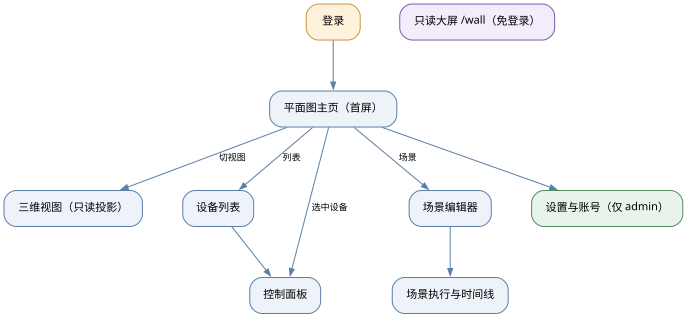
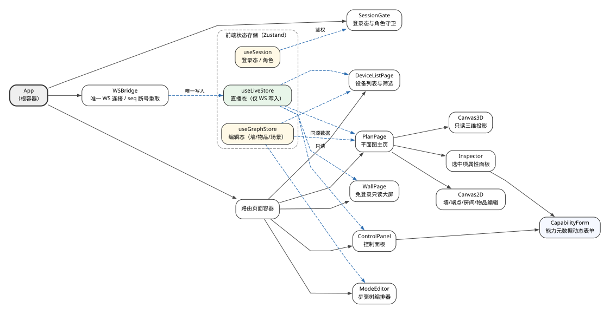

# 详细设计说明书

> 交付物 4／9 · 版本 **v0.17.1（骨架）** · 2026-11-23
> 上游：《概要设计说明书》v1.0（模块与接口编号沿用，`M-`/`IF-`/`T-` 前缀不变）
> 状态：结构已定、可直接开工；**算法、异常分支、界面细节在第 13 周迭代二跑通控制链路后补齐，冻结 v1.0**
> 本文回答「每个类长什么样、每张表怎么建、每个错误怎么报」，不回答「这个功能该不该做」（见 SRS）。

---

## 1 引言与范围

### 1.1 输入与基线

| 输入 | 版本 | 本文用到什么 |
| --- | --- | --- |
| 需求规格说明书 | v1.2 | `FR-x.y` 编号、验收判据、非功能阈值 |
| 概要设计说明书 | v1.0 | `M-` 模块清单、`IF-1`～`IF-4`、13 张逻辑表、三段 PDL 的意图 |
| [ADR 0001](../adr/0001-技术栈选型.md) / [ADR 0002](../adr/0002-数据模型与分层.md) | 已接受 | 技术栈、单一写入点、七条接缝 |

### 1.2 v0.9 与 v1.0 的分工

| 章节 | v0.9（本版） | v1.0（第 13 周后） |
| --- | --- | --- |
| 2 类与包结构 | 完整。类型、接口签名、错误码固定 | 只补实现类的私有成员 |
| 3 接口细节 | 完整。HTTP 路由、WS 封套、错误码表 | 补 `openapi.yaml` 字段级约束 |
| 4 关键算法 | **骨架**：签名、输入输出、复杂度与测试点 | 补完整 PDL 与边界用例推导 |
| 5 数据库物理 | 完整。DDL 已写并可生成代码 | 补执行计划与容量实测 |
| 6 界面结构 | 完整。页面结构、组件层级、状态流 | 补每页的交互态与空/错/载入 |
| 7 异常与日志 | 完整。错误分类与文案 | 补日志采样与告警阈值 |
| 8 可追溯 | 完整。需求 → 类/方法 → 表列 | 随 4/6 章补行 |

第 4 章之所以先给骨架：三段算法的最终形态要在迭代二真写一遍才知道，现在写死会与代码分叉；但接口与测试点必须现在定，否则无法排期。

### 1.3 写作约定

- 代码标识符用反引号；包路径相对仓库根。
- 类型用 Go 语法；前端用 TS 语法。
- 错误码一律 `大写下划线`，与 §3.3 表格一一对应。
- 所有时间字段是 `timestamptz`，JSON 中是 RFC3339 字符串。

---

## 2 类与包结构

### 2.1 目录与包职责

| 路径 | 语言 | 职责 | 对应模块 |
| --- | --- | --- | --- |
| `backend/api/` | Go | chi 路由、鉴权中间件、handler、WS | `M-Cm`、`M-Ca-01`、`M-Ca-02`、`M-Ce-01` |
| `backend/policy/` | Go | 纯函数：意图求值、舒适度策略 | `M-Ct-01`、`M-Ct-03` |
| `backend/control/` | Go | 命令分发、场景执行、房间推导 | `M-Ct-02`、`M-Ct-04` |
| `backend/device/` | Go | `Adapter` 接口与模拟器 driver | `M-Ct-05` |
| `backend/store/` | Go | 事务封装、查询；`gen/` 是 sqlc 产物 | `M-Dm-01`～`03` |
| `frontend/src/features/` | TS | 页面级功能 | `M-Ce-02`、`M-Ce-03` |
| `frontend/src/components/` | TS | 可复用视图组件 | `M-Ce-02` |
| `frontend/src/store/` | TS | zustand，三个 store：`useSession` / `useGraphStore` / `useLiveStore` | `M-Ce-02` |
| `frontend/src/api/` | TS | 由 OpenAPI 生成的 client + WS | `IF-1`～`IF-4` |

依赖方向：`api → control → (policy|device) → store`，`policy` 不依赖任何其他业务包（§2.3 的纯函数要求）。

### 2.2 领域类型

```go
type ItemType struct {
    Key          string        `json:"key"`
    Kind         string        `json:"kind"`          // furniture | device
    Name         string        `json:"name"`
    Icons        *string       `json:"icons,omitempty"`
    DefaultWidth float64       `json:"defaultWidth"`  // cm
    DefaultDepth float64       `json:"defaultDepth"`
    Capabilities []Capability  `json:"capabilities"`
    Version      int           `json:"capabilitiesVersion"`
    Driver       *string       `json:"driver,omitempty"` // 仅 device
}

type CapabilityOption struct {
    Value string `json:"value"` // 入库的机器标识，如 cool
    Label string `json:"label"` // 界面显示的中文名，如 制冷
}

type Capability struct {
    Key      string             `json:"key"`      // 发布后不得重命名
    Name     string             `json:"name"`
    Type     string             `json:"type"`     // bool | number | enum | string
    Unit     *string            `json:"unit,omitempty"`
    Min      *float64           `json:"min,omitempty"`
    Max      *float64           `json:"max,omitempty"`
    Step     *float64           `json:"step,omitempty"`
    Options  []CapabilityOption `json:"options,omitempty"` // type=enum 时必填
    Writable bool               `json:"writable"`
    Default  any                `json:"default,omitempty"`
    History  bool               `json:"history"`
}

type Item struct {
    ID       uuid.UUID       `json:"id"`
    TypeKey  string          `json:"typeKey"`
    Name     string          `json:"name"`
    RoomHash *string         `json:"roomHash,omitempty"` // 指向 room_name
    X, Y     float64         `json:"x"`                  // cm
    Rotation float64         `json:"rotation"`
    Status   *string         `json:"status,omitempty"`   // 仅家具
    Attrs    json.RawMessage `json:"attrs"`              // 纯装饰性属性
}

type State struct {
    ItemID    uuid.UUID       `json:"itemId"`
    Key       string          `json:"capabilityKey"`
    Value     json.RawMessage `json:"value"` // JSON 标量，不是对象
    Source    string          `json:"source"` // manual|automation|device|timeout
    UpdatedAt time.Time       `json:"updatedAt"`
}

type Command struct {
    RequestID  uuid.UUID  `json:"requestId"` // 幂等键
    ItemID     uuid.UUID  `json:"itemId"`
    Key        string     `json:"capabilityKey"`
    Value      any        `json:"value"`
    Source     string     `json:"source"`
    ActorID    *uuid.UUID `json:"createdBy,omitempty"`
}

type Intent struct {          // 用户的意图，尚未翻译成指令
    Kind     string          `json:"kind"`     // control | run_mode | adjust_room
    ItemID   *uuid.UUID      `json:"itemId,omitempty"`
    ModeID   *uuid.UUID      `json:"modeId,omitempty"`
    Key      *string         `json:"capabilityKey,omitempty"`
    Value    any             `json:"value,omitempty"`
    Text     *string         `json:"text,omitempty"`      // E3 原文，仅用于解释
    ActorID  uuid.UUID       `json:"actorId"`
    Confirmed bool           `json:"confirmed"` // 二次确认后为 true
}
```

**「能力值一律是 JSON 标量」这条要写死**：`true`、`70`、`"cool"` 都是合法值，`{"v":70}` 不是。理由：前端表单的每个控件只产出标量，历史曲线也只需要数值；允许对象会让每个消费方都要拆一层。

### 2.3 四个接缝的 Go 签名

```go
// 数据层（M-Dm-01）
type Store interface {
    GetState(ctx context.Context, itemID uuid.UUID, key string) (State, error)
    ListStates(ctx context.Context, itemID uuid.UUID) ([]State, error)
    WriteState(ctx context.Context, tx pgx.Tx, s State) error
    InsertHistory(ctx context.Context, tx pgx.Tx, s State) error
    InsertCommand(ctx context.Context, tx pgx.Tx, cmd Command) (int64, error)
    CompleteCommand(ctx context.Context, tx pgx.Tx, reqID uuid.UUID, status string, cause error) error
    ListTypes(ctx context.Context) ([]ItemType, error)
}

// 设备层（M-Ct-05）
type Adapter interface {
    Dispatch(ctx context.Context, cmd Command) (json.RawMessage, error) // 回显值
    Describe(ctx context.Context, driver string) (DriverMeta, error)
}

// 策略层（M-Ct-03）：纯函数，无 ctx 之外的外部依赖
type Policy interface {
    Evaluate(reading Reading, goal Goal) (target float64, reason string, err error)
}

// 出站（M-Ce-01）
type Broadcaster interface {
    Broadcast(ev Event)   // 落库后的状态变化
    Snapshot() []State    // 新连接先收全量
}
```

策略层签名里没有 `context.Context` 也没有 `Store`，这不是疏忽：它必须是纯函数，否则无法单测、也无法在场景执行中复用。

### 2.4 关键实现类

| 类 | 文件 | 职责 | 对外方法 |
| --- | --- | --- | --- |
| `CommandHandler` | `control/command.go` | 唯一写入点 | `Handle(ctx, Command) (Result, error)` |
| `ModeRunner` | `control/mode_runner.go` | 步骤树遍历 | `Start(ctx, modeID, actor) (uuid.UUID, error)`、`Advance(ctx, runID) error` |
| `RoomDeriver` | `control/room_deriver.go` | 墙环推导房间多边形（包级函数） | `Derive(corners, walls) Result`、`Hash(ring) string`；`Result{Rings, OpenWalls}` |
| `ComfortPolicy` | `policy/comfort.go` | 温控与滞回 | `Evaluate(reading, goal) (float64, string, error)` |
| `IntentEvaluator` | `policy/intent.go` | 意图 → 指令，含校验与让位 | `Eval(ctx, Intent) ([]Command, string, error)` |
| `SimulatorAdapter` | `device/simulator.go` | 模拟设备行为与回显 | `Dispatch`、`Describe` |
| `HubBroadcaster` | `api/ws.go` | WS 连接管理与推送 | `Broadcast`、`Snapshot` |

### 2.5 错误类型

```go
type AppError struct {
    Code string   // 见 §3.3
    Msg  string   // 面向用户可读，中文
    HTTP int
    Err  error    // 内部原因，只进日志
}

func (e *AppError) Error() string { return e.Code + ": " + e.Msg }
func (e *AppError) Unwrap() error { return e.Err }
```

handler 层用 `errors.As` 取 `*AppError` 决定状态码与响应体；非 `AppError` 一律归为 `INTERNAL` 并记完整栈。设备层的三种失败（`unavailable`/`timeout`/`rejected`）由 `SimulatorAdapter` 转成对应的 `AppError`，上层不看原始报文。

### 2.6 前端模块

| 模块 | 文件 | 职责 |
| --- | --- | --- |
| `useGraphStore` | `store/graph.ts` | 墙、端点、房间命名、家具布放（编辑态） |
| `useLiveStore` | `store/live.ts` | 能力状态（只由 WS 写入，见 §6.3） |
| `useSession` | `store/session.ts` | 登录态与角色 |
| `CapabilityForm` | `components/CapabilityForm.tsx` | 按 `Capability[]` 渲染表单，四类控件 |
| `Canvas2D` / `Canvas3D` | `features/plan/` | 平面编辑与三维投影，共用同一份 `useGraphStore` |
| `ModeEditor` | `features/modes/` | 步骤树编辑、拖拽、嵌套 |

前端**不保存业务真相**：`useLiveStore` 只接受 WS 推送与全量快照，编辑态改动一律先发请求再等回声（§6.3）。

---

## 3 接口细节

### 3.1 HTTP 路由

| 方法 | 路径 | 请求要点 | 成功 | 主要错误 |
| --- | --- | --- | --- | --- |
| POST | `/api/auth/login` | `{username, password}` | 204 + `Set-Cookie: session` | `UNAUTHENTICATED` |
| POST | `/api/auth/logout` | — | 204 | — |
| GET | `/api/auth/me` | — | `{id, name, role}` | `UNAUTHENTICATED` |
| GET | `/api/plan` | — | `Plan`（`corners` 可能含孤立端点；`rooms` 由后端从墙推导，`openWalls` 给出未闭环的墙数，`staleRooms` 给出失配的旧房间名；`openings` 是门窗，位置由「墙 + 沿墙偏移」算出来） | `UNAUTHENTICATED` |
| POST | `/api/walls` | `{ax, ay, bx, by, thickness?}` | 201 + `Plan` | `VALIDATION_FAILED` |
| PATCH | `/api/walls/{wallId}` | `WallInput`（改长度、角度、厚度或弧度 `arcExtent`；**部分更新**：不带 `thickness`/`arcExtent` 时沿用原值） | `Plan` | `VALIDATION_FAILED`（含 `\|arcExtent\| ≥ 180`）、`NOT_FOUND`、`CONFLICT`（与已有墙重合） |
| PUT | `/api/plan` | `{version, walls[]}` 整份替换，撤销/重做用 | `Plan` | `VALIDATION_FAILED`、`CONFLICT`（版本过期） |
| DELETE | `/api/walls/{wallId}` | — | 204（**级联删掉这面墙上的门窗与挂墙物品**） | `VALIDATION_FAILED`（uuid 不合法）、`NOT_FOUND` |
| POST | `/api/openings` | `OpeningInput`（`wallId`/`kind`/`offset`/`width`，`height`/`sill` 省略走默认：门 210/0、窗 120/90） | 201 + `Plan` | `VALIDATION_FAILED`（kind、宽高 10–500）、`NOT_FOUND`（墙不存在）、`VALIDATION_FAILED`（`offset+width` 超过墙长） |
| PATCH | `/api/openings/{openingId}` | `OpeningPatch`（逐字段：`offset`/`width`/`height`/`sill`） | `Plan` | `VALIDATION_FAILED`、`NOT_FOUND` |
| DELETE | `/api/openings/{openingId}` | — | 204（幂等） | — |
| PATCH | `/api/rooms/{hash}` | `{name, kind?}`，哈希必须是当前推导出来的房间 | `Plan` | `VALIDATION_FAILED`（空名/超 24 字）、`NOT_FOUND`（哈希已失配） |
| DELETE | `/api/rooms/{hash}` | — | 204（幂等，失配的旧名字也可清） | — |
| PUT | `/api/plan/underlay` | `application/octet-stream` 原始图片（png/jpeg/webp，≤5 MiB，像素边长 ≤8000）；服务端按墙的包围盒铺进户型 | `Plan` | `VALIDATION_FAILED`（类型/大小/解码）、`FORBIDDEN` |
| PATCH | `/api/plan/underlay` | `UnderlayPatch`（`cmPerPx`/`offsetXCm`/`offsetYCm`/`rotationDeg`/`opacity`/`visible` 逐字段，没传的保持原值） | `Plan` | `VALIDATION_FAILED`、`NOT_FOUND`（还没有底图） |
| DELETE | `/api/plan/underlay` | — | 204（幂等） | `FORBIDDEN` |
| GET | `/api/plan/underlay/image` | — | 图片字节 + `ETag`（内容 sha256），命中 `If-None-Match` 返回 304 | `NOT_FOUND` |
| GET | `/api/item-types` | — | `ItemType[]` | — |
| POST | `/api/item-types` | `ItemTypeInput` | 201 + `ItemType` | `VALIDATION_FAILED`、`FORBIDDEN`、`CONFLICT`（key 重复） |
| PATCH | `/api/item-types/{key}` | `ItemTypeUpdate`（key 不可改；改 `capabilities` 必须带 `capabilitiesVersion` 乐观锁） | `ItemType` | `VALIDATION_FAILED`、`FORBIDDEN`、`NOT_FOUND`、`CONFLICT`（版本过期） |
| DELETE | `/api/item-types/{key}` | — | 204 | `FORBIDDEN`、`NOT_FOUND`、`CONFLICT`（仍被物品引用） |
| GET | `/api/items` | `?room=&kind=&q=` | `Item[]` | `VALIDATION_FAILED`（非法 kind/超长关键字） |
| POST | `/api/items` | `ItemInput`（含 typeKey/坐标/可选房间；挂墙物品带 `wallId`+`wallOffset`，坐标由墙算） | 201 + `Item` | `VALIDATION_FAILED`（类型/房间/坐标/挂墙字段不成对）、`NOT_FOUND`（墙不存在） |
| PATCH | `/api/items/{id}` | `ItemUpdate`（逐字段；`wallId: ""` 表示脱离墙面） | `Item` | `VALIDATION_FAILED`（挂墙物品不能直接改 x/y/旋转）、`NOT_FOUND` |
| DELETE | `/api/items/{id}` | — | 204 | `NOT_FOUND` |
| POST | `/api/items/{id}/commands` | `{capabilityKey, value, requestId}` | 202 + `{requestId}` | `RANGE_OUT_OF_BOUNDS`、`CONFIRMATION_REQUIRED`、`DEVICE_UNAVAILABLE`、`DEVICE_TIMEOUT` |
| GET | `/api/items/{id}/history` | `?key=&from=&to=` | `State[]` | `NOT_FOUND` |
| GET | `/api/modes` | — | `Mode[]` | — |
| POST | `/api/modes/{id}/run` | `{requestId}` | 202 + `{runId}` | `NOT_FOUND`、`FORBIDDEN` |
| POST | `/api/export` | `{format: json\|csv}` | 文件流 | — |
| POST | `/api/import` | 文件（带 `schemaVersion`）+ `mode=merge\|replace` | `{created, updated}` | `IMPORT_VALIDATION_FAILED`（整份拒绝，见 DR-5） |
| GET | `/ws/state` | Cookie 鉴权 | 升级为 WS | `UNAUTHENTICATED` |

物品坐标的口径在 v0.9.8 明确：`item.x` / `item.y` 是**物品中心点**（厘米），`rotation` 是**绕中心**的顺时针角度。渲染时把绘制原点用 `offset` 挪回左上角，旋转自然绕自身；拖拽与落点读到的本来就是中心，不需要加减半个尺寸。改中心口径的原因是左上角口径下「转 45° 的沙发」会以角为轴甩出房间，标签也会与图形分家。

`Plan` 的四个字段各有分工，也是「房间不存几何」这条决策的落地形态：

| 字段 | 内容 | 谁维护 |
| --- | --- | --- |
| `corners` | 端点（墙共享，可能含孤立端点） | 数据层 |
| `walls` | 墙，含两端坐标，省得前端自己查两次 | 数据层 |
| `rooms` | 由墙的闭环推导出的房间：`hash`、`ring`、`areaM2`、可选 `name`/`kind` | 控制层 `RoomDeriver.Derive`，**每次读都重算** |
| `openWalls` | 没参与任何闭合区域的墙数 | 同上 |

画墙（`POST /api/walls`）返回整份 `Plan`，所以「画完第四面墙，房间立刻出现在响应里」不需要额外的请求；
删墙返回 204，前端删完必须重新 `GET /api/plan` —— 房间是每次读时重算的，本地只删一面墙会让 `rooms`/`openWalls` 停在旧值。
`hash` 是房间的身份：名字存在 `room_name(polygon_hash, name, kind)`，几何不进库；墙一改哈希就变，旧名字自然失配，
这是刻意设计——宁可让用户重命名，也不能把「客厅」挂到别处的房间上。


写操作一律带 `X-Requested-With: fetch` 头（CSRF 防护，见 [ADR 0002 §2.8](../adr/0002-数据模型与分层.md)），中间件对缺失该头的写请求返回 403。

类型模板的能力项有三条语义规则，都由 `backend/api/item_types.go` 在写入口拦住并返回 400（消息里说清是哪一条）：

1. **key 发布后就是身份**：不能改名、不能改 `type`，`enum` 的 `value` 只能新增，不能删除或改名（`label` 可以随便改）。
2. **删除能力项是允许的**：`capability_state` 的行不跟着删，只是元数据里没了、不再渲染——历史曲线与审计仍能查到旧值。
3. **删掉的 key 不能换一种语义复活**：若该类型下有物品在这个 key 上已有状态行，重新加回同名 key 会被拒（`checkReusedCapabilityKeys`）。
   否则旧的 `true` 会被当成 `number` 的 `1` 渲染出去。要保留就沿用原来那个 `type` 加回来。

### 3.2 WS 消息封套

```jsonc
{ "v": 1, "seq": 10241, "type": "state", "payload": { /* 见下 */ } }
```

| `type` | payload | 何时发 |
| --- | --- | --- |
| `snapshot` | `{states: State[]}` | 连接建立后立即发一次 |
| `state` | `{itemId, capabilityKey, value, ts, source}` | 每次落库成功 |
| `run_step` | `{runId, nodeId, status, ts}` | 场景执行的节点状态变化 |
| `error` | `{code, message}` | 服务端主动断开前的一帧（可选） |

`seq` 单调递增。客户端发现 `seq` 跳号即丢弃本地缓存并重新拉一次快照——这是刻意留的「一段代码换一致」：断线重连的场景不写增量补偿逻辑。

### 3.3 错误码

| 码 | HTTP | 触发 | 用户可见文案 |
| --- | --- | --- | --- |
| `UNAUTHENTICATED` | 401 | 无/过期会话 | 请重新登录 |
| `FORBIDDEN` | 403 | 角色不足（member 改配置） | 当前账号无此权限 |
| `NOT_FOUND` | 404 | 物品/类型/场景不存在 | 目标不存在，可能已被删除 |
| `VALIDATION_FAILED` | 400 | 字段缺失、类型不符 | 请求格式不正确 |
| `RANGE_OUT_OF_BOUNDS` | 400 | 值超出能力元数据的 `min`/`max` | 温度需在 16–30℃ 之间 |
| `CONFIRMATION_REQUIRED` | 409 | 危险操作未确认（越界、批量≥3、删除类） | 该操作影响多台设备，请确认 |
| `CONFLICT` | 409 | 乐观锁版本不符 | 数据已被修改，请刷新 |
| `ROOM_NOT_CLOSED` | — | **预留，本版不返回**：未闭合不当作错误，由 `Plan.openWalls` 计数 + 前端文案提示 | — |
| `DEVICE_UNAVAILABLE` | 503 | 设备离线 | 设备当前不可用 |
| `DEVICE_TIMEOUT` | 503 | 回显超时 | 设备没有响应，请稍后重试 |
| `IMPORT_VALIDATION_FAILED` | 400 | 导入文件版本不符、缺字段或坐标越界（整份回滚） | 导入失败，共 M 处校验未通过，数据未修改 |
| `INTERNAL` | 500 | 未归类的异常 | 服务异常，已记录 |

批量导入严格遵循 SRS `FR-1.5` 与 `DR-5` 的原子性约束：单事务整份校验，任一行不通过即整体回滚并返回 `400 IMPORT_VALIDATION_FAILED` 及全部错误行号，不做部分写入。

---

## 4 关键算法（v0.9 骨架）

三段算法在第 13 周迭代二实现，此处固定**签名、输入输出、复杂度与测试点**；PDL 与边界推导在 v1.0 补。

### 4.1 房间闭环推导 `RoomDeriver.Derive`

| 项 | 内容 |
| --- | --- |
| 输入 | 端点集合 `corner[]`、墙集合 `wall[]`（每条墙连接两个端点） |
| 输出 | `Result{Rings []Ring; OpenWalls int}`：每个环带 `Hash` 与 `AreaM2`；`OpenWalls` 是没参与任何闭合区域的墙数（悬空的 + 连接两屋的「桥」） |
| 思路 | 以端点为图节点、墙为无向边构平面图；用半边结构（每条无向边拆两条有向半边）在每步取反向半边的顺时针前驱（内部恒在左侧），绕行直到回到起点，即得一个面；对所有半边做一次访问标记即可得到全部内面与外环，按有符号面积剔除外环 |
| 复杂度 | O(E)，E 为墙数；50 面墙的户型在毫秒级 |
| 测试点 | ① 单个矩形 → 1 个内面 ② 两个相邻房间共用一面墙 → 2 个内面 ③ T 形交叉墙（度数为 3 的端点）不产生房间 ④ 悬空墙（一端度数为 1）不闭合 ⑤ 完全重合的重复墙由唯一约束挡在入库前 ⑥ 哈希对顶点顺序与起点不敏感（环规范化后哈希） |
| 失败形态 | 不抛异常：推不出房间时 `Rings` 为空、`OpenWalls` 为未围合的墙数，前端提示「还没围成闭合区域」 |

### 4.2 舒适度策略 `ComfortPolicy.Evaluate`

| 项 | 内容 |
| --- | --- |
| 输入 | `Reading{室内温度, 室内湿度, 室外温度?, 季节, 有人?}` 与 `Goal{目标温度?}` |
| 输出 | `target`（目标温度）与 `reason`（一句话依据，写进 `command_log`/执行记录） |
| 思路 | 先按季节与有人与否选区间（夏季 24–28℃、冬季 18–22℃、春秋自然通风），再在区间内按湿度与作息微调，最后套 1℃ 滞回（避免临界点反复启停） |
| 复杂度 | O(1)，无 IO |
| 测试点 | ① 32℃/75% → 夏季区间内取值且 `reason` 含依据 ② 同一读数连续调用结果稳定（无随机、无时间依赖） ③ 临界点附近不抖动（滞回） ④ 用户显式给目标温度时策略不覆盖它 ⑤ 春秋且室外适宜时返回「建议自然通风」 |
| 约束 | 纯函数；不得读时钟、不得读数据库；季节与有人与否由调用方传入 |

### 4.3 场景执行 `ModeRunner.Advance`

| 项 | 内容 |
| --- | --- |
| 输入 | `runID`（执行实例）、`definition_snapshot`（本次执行的树）、当前 `run_step` 状态 |
| 输出 | 推进到下一个可执行节点，或结束执行 |
| 思路 | 按 `nodeId` 在快照树上定位当前节点，取下一个兄弟；遇 `delay` 落库并订阅时间事件；遇 `choose` 求值守卫后进入 `then`/`else` 子序列；`action` 交给 `CommandHandler`；任一节点 `failed` 且在 `continueOnError=false` 时整单中止 |
| 复杂度 | 与步骤数线性；延时靠调度而非阻塞 |
| 测试点 | ① 顺序 3 步全 ok ② 第 2 步失败中止并标 `failed` ③ `delay` 期间进程重启后能续跑（靠 `run_step` 而非内存） ④ `choose` 两侧分支各一次 ⑤ 同一 `nodeId` 不重复执行（幂等） |
| 约束 | 执行状态只以 `run_step` 为准，内存里不保存「执行到哪」 |

E2 的栅格路径规划不在 v0.9 范围（增量功能，见 SRS `FR-7.x`）。

---

## 5 数据库物理设计

### 5.1 表与索引

DDL 见 [`sql/0001_init.sql`](../../sql/0001_init.sql)、[`sql/0003_underlay.sql`](../../sql/0003_underlay.sql) 与 [`sql/0004_wall_arc.sql`](../../sql/0004_wall_arc.sql)（14 张表，含注释）。索引清单：

| 表 | 索引 | 服务于 |
| --- | --- | --- |
| `item` | `item_type_idx (type_key)` | 按类型筛选 |
| `item` | `item_room_idx (room_hash)` | 按房间筛选（F1） |
| `item` | `item_wall_idx (wall_id) WHERE wall_id IS NOT NULL` | 挪墙时重算这面墙上的物品 |
| `opening` | `opening_wall_idx (wall_id)` | 出图时按墙取门窗 |
| `corner` | `corner_xy_uniq (x, y)` | **端点以坐标为身份**：吸附的数据库兜底 |
| `wall` | `wall_pair_uniq (LEAST(a,b), GREATEST(a,b))` | 无向边去重，防半边图重边 |
| `state_history` | `state_history_lookup_idx (item_id, capability_key, recorded_at DESC)` | 历史曲线（F4） |
| `state_history` | `state_history_time_idx (recorded_at)` | 按天清理 |
| `command_log` | `command_log_time_idx (created_at DESC)` | 操作记录列表 |
| `command_log` | `command_log_item_idx (item_id, created_at DESC)` | 单设备排查 |
| `run` | `run_mode_idx (mode_id, started_at DESC)` | 场景执行历史 |
| `capability_state` | 主键 `(item_id, capability_key)` | 寻址即主键，无需额外索引 |
| `plan_underlay` | 主键 `id boolean` + `CHECK (id)` | 单行表：底图只有一张，「只能有一行」写进约束而不是靠应用层 |

不建 GIN 索引：13 张表里 `jsonb` 只用于存储与整块读写，没有 `@>` 查询；等真出现「按能力值搜索」再加。

后两条是**唯一性约束**而不是查询索引，作用是让两条业务不变量成立：端点靠坐标去重（`ON CONFLICT (x, y) DO UPDATE ... RETURNING id`），所以「墙与墙共享端点」不依赖前端是否记得复用 `corner`；墙是无向边，`(a, b)` 与 `(b, a)` 视为同一条，否则半边图会出现重边。

### 5.2 约束与业务规则的对应

| 业务规则 | 落点 | 说明 |
| --- | --- | --- |
| 值域（温度 16–30℃、亮度 0–100%） | **应用层**（能力元数据 `min`/`max`） | 不在库里写死 CHECK：新增类型不该改表（QA-4） |
| 能力键发布后不得重命名 | 约定 + 文档 | 库里无法表达「不得改」，靠评审与 ADR 0002 记录 |
| 家具才能有 `status` | 应用层 + 列注释 | 跨表 CHECK 需触发器，ADR 明确不用触发器 |
| 一条命令幂等 | `command_log.request_id UNIQUE` | 重复提交直接命中唯一约束 |
| 墙端点不得自环 | `wall_endpoints_distinct CHECK (a <> b)` | — |
| 挂墙物品必须同时有墙与偏移 | `item_wall_fields_together CHECK ((wall_id IS NULL) = (wall_offset IS NULL))` | 只有一半字段的行没有意义 |
| 挂载方式只有三种 | `item_type_mount_check CHECK (mount IN ('floor','wall','ceiling'))` | 前端文案与吸附行为都按这三值分支 |
| 删墙不留孤儿 | `item.wall_id` / `opening.wall_id` 均 `ON DELETE CASCADE` | issue #8 二选一里选了级联：删墙前前端统计数量并确认 |
| 同一对端点只连一面墙 | `wall_pair_unique UNIQUE (a, b)` | 应用层先归一化端点顺序 |
| 能力元数据必须是数组 | `item_type_capabilities_is_array` | 防止写进对象 |
| 场景定义必须是对象 | `mode_definition_is_object` | 同上 |
| 历史不随设备删除 | `state_history` 不建外键 | 删设备后历史仍在，靠保留期清理 |

### 5.3 `jsonb` 的三处约定

| 列 | 形状 | 约定 |
| --- | --- | --- |
| `item_type.capabilities` | 数组，元素见 §2.2 `Capability` | 元素 `key` 唯一；`type=enum` 必须带 `options`；`version` 变更时整体替换 |
| `capability_state.value` / `state_history.value` | **JSON 标量** | 只存 `true`/`70`/`"cool"`；不接受对象与数组 |
| `mode.definition` / `run.definition_snapshot` | 对象 | `{version, steps: Node[]}`；每个节点有唯一 `nodeId`；节点类型 `action`/`delay`/`choose` |

不建「每表一个 `metadata` 兜底列」：避免无约束键值桶演变为结构失控的过度设计。

### 5.4 sqlc 配置与 `jsonb` 映射

`sqlc.yaml` 里 `jsonb` 有**两条** override（`db_type: jsonb` 与 `db_type: jsonb, nullable: true`）。只写一条时，可空列（如 `command_log.target`）会静默退回 `[]byte`——该问题已在前期技术验证（V5）中实测确认并固化到配置文件。

生成产物落在 `backend/store/gen/` 与 `backend/api/gen/`，**随代码入库**，CI 用 `git diff --exit-code` 检查是否与 `sqlc`/`oapi-codegen` 的输入一致：生成代码依赖尚未创建的 `go.mod`，第 12 周建模块后统一入库。

### 5.5 迁移与重建

| 项 | 做法 |
| --- | --- |
| 迁移文件 | `sql/0001_init.sql`、`sql/0002_mount_and_openings.sql`、`sql/0003_underlay.sql`、`sql/0004_wall_arc.sql`，一文件一目的，只做 additive；改动另建 `000N_*.sql`。新增文件**必须同时加进 `sqlc.yaml` 的 `schema:` 列表**，否则 sqlc 解析时报「列不存在」 |
| 重建 | `scripts/reset.sh`：`DROP SCHEMA public CASCADE` → **按文件名顺序跑 `sql/0*.sql`** → seed（没有独立的迁移表：课程项目只要求「能从零重建」） |
| 演示数据 | `sql/seed.sql`，UUID 全部写死，重建后 id 不变 |
| 清理 | `state_history` 保留 30 天、`command_log` 保留 90 天，按天删除（SQL 见下） |

```sql
DELETE FROM state_history WHERE recorded_at < now() - interval '30 days';
DELETE FROM command_log    WHERE created_at  < now() - interval '90 days';
```

**验证状态（截至 2026-11-21）**：

1. **生成层**：`sqlc v1.31.1 generate` 通过（PostgreSQL 方言解析通过、6 条查询全部生成 Go 方法、`jsonb` 映射正确）。
2. **执行层——已完成（两个版本各跑一遍）**：`sql/0001_init.sql` 与 `sql/seed.sql` 已在本机 **PostgreSQL 19.0**（Homebrew 临时集群，端口 55433）与**目标版本 PostgreSQL 17.12**（`postgres:17-alpine` 容器，端口 55434）**分别真实执行通过**：13 张表全部创建，seed 一致写入 4 `corner` / 4 `wall` / 2 `opening` / 12 `item_type` / 8 `item` / 12 `capability_state`。两条唯一约束在两个版本上均实测生效——同坐标端点裸插入报 `corner_xy_uniq` 冲突、反向墙插入报 `wall_pair_uniq` 冲突、`ON CONFLICT (x, y) DO UPDATE ... RETURNING id` 能取回已存在的端点 id 且行数不变；`sqlc generate` 重跑后生成物零 diff。
3. **仍待办**：容器内的一次执行是**手工复现**（临时容器，验证完即删除），尚不是 `docker-compose.yml` 下的可重复流程。M1 落地 compose 后按第 12 周流程重跑一次，把同一组计数与约束用例贴进测试报告。

---

## 6 界面结构

### 6.1 页面结构



*图 18 页面结构与跳转（源文件 `docs/diagrams/src/18-sitemap.dot`）*

| 页面 | 路由 | 进入条件 | 退出后回到 |
| --- | --- | --- | --- |
| 登录 | `/login` | 未登录一律重定向到此 | 登录后回原路径或首页 |
| 平面图主页（首屏） | `/` | 已登录 | — |
| 三维视图 | `/3d` | 已登录 | 平面图 |
| 设备列表 | `/devices` | 已登录 | 平面图 |
| 控制面板 | `/devices/{id}` | 已登录 | 设备列表或平面图 |
| 场景编辑器 | `/modes` | 已登录 | 平面图 |
| 场景执行与时间线 | `/modes/{id}/runs` | 已登录 | 场景编辑器 |
| 设置与账号 | `/settings` | **仅 `admin`** | 平面图 |
| 只读大屏 | `/wall` | **免登录**、只读 | — |

### 6.2 组件层级与状态流



*图 19 前端组件层级与状态流（源文件 `docs/diagrams/src/19-component-tree.dot`，Graphviz 渲染为 SVG）*

三条硬规则：

1. **数据类 store 只有两个，分工固定**：`useGraphStore` 管「这个家怎么摆的」（墙、物品、坐标、场景定义），`useLiveStore` 管「现在是什么状态」（能力值）。两者不互相拷贝字段；`useSession` 只放登录态与角色，不放业务数据。
2. **`useLiveStore` 只有一个写入者**：WS 推送与全量快照。用户在控制面板改值时不直接改 store，而是发命令 → 等广播回来 → store 更新 → 界面变。这样「界面显示的值」永远等于「库里存的值」。
3. **断号即重取**：`seq` 跳号意味着漏了消息，客户端丢弃缓存并重新拉快照，不做增量补偿。

### 6.3 每页关键交互

| 页面 | 关键交互 | 失败时的表现 |
| --- | --- | --- |
| 平面图 | 画墙（吸附到端点）、拖家具、框选删除、双击房间命名 | 墙未闭合 → 区域标灰 + 提示「未闭合」；拖拽越界 → 松手回弹 |
| 三维视图 | 轨道旋转/缩放、点击物品高亮 | WebGL 不可用 → 降级提示并给平面图链接 |
| 设备列表 | 按房间/类型筛选、关键字搜索 | 无结果 → 空态文案，不显示 0 条列表 |
| 控制面板 | 开关、滑杆、枚举下拉 | 设备离线 → 控件禁用 + 灰色「不可用」；超时 → 顶部 toast + 恢复原值 |
| 场景编辑器 | 增删步骤、拖拽排序、`choose` 嵌套、保存整棵树 | 保存冲突 → `CONFLICT`，提示刷新而非覆盖 |
| 场景时间线 | 订阅 `run_step`，按 `nodeId` 点亮节点 | 执行中止 → 停止推进并标红失败节点 |
| 设置与账号 | 类型模板查看、账号管理、导入导出 | 导入校验失败 → 整份拒绝不写入，列出全部错误行号与原因（DR-5） |
| 只读大屏 | 自动轮播、无交互 | WS 断开 → 保留最后画面并标「已断开」 |

### 6.4 平面图编辑器的交互契约

世界坐标 1 单位 = 1 厘米，画布只做视口变换（平移 + 缩放），不做单位换算。

| 交互 | 契约 |
| --- | --- |
| 端点吸附 | 屏幕 12 px 内吸到最近端点（`12 / scale` 世界单位） |
| 墙线吸附 | 垂距 ≤ 1 px 时吸到该墙所在直线，并画出整面墙作参考线 |
| 正交 | 画墙默认锁 0°/90°；按住 `Shift` 关闭吸附与正交，画任意角度 |
| 建墙最短 | 拖拽短于 8 px 视为点击（选中），不建墙 |
| 精确尺寸 | 画完一面墙自动选中并聚焦长度输入；改长度保方向、改角度保长度、改坐标平移另一端 |
| 拖端点改墙 | 默认自由旋转；接近水平/垂直（≤ 8 px）时软吸正；`Shift` 关闭吸附 |
| 选中命中 | 点到线段距离 ≤ `10 / scale` 世界单位；长度标签也可点选（`cancelBubble` 防清空选中） |
| 视口 | 空格/中键拖动平移；滚轮以指针为锚点缩放 0.25×–4×；「回到全览」按内容包围盒 + 96 px 留白 |
| 标注 | 共线且共享端点的墙合并成「链」，一级标总长、二级标分段；**只标下方与左方**两条边（GB/T 50001—2017 §11.2「同方向集中排列」，四边同标属重复）；开启尺寸标注时贴墙标签让位给尺寸线 |
| 轴线尺寸 | 总尺寸链外侧再画一排开间/进深链：取与该边垂直、长度不小于跨度 1/4 的墙的轴线位置分段，短隔断（如房间里的围栏）不参与定轴，避免把 3300 切成 800 + 2500 |
| 标注单位 | 图上数字一律以**毫米**计且不注单位（GB/T 50001—2017 §11.2.1），如 `3300`；属性面板里的输入框仍用厘米/米并带单位，那是「输入数据」而不是图上标注 |
| 标注文字 | 白描边按屏幕像素取 1.2–2.4 px（`字号 × scale × 0.18` 夹紧），不随缩放变粗，高倍放大时字不会被自己的描边糊住 |
| 墙的绘制 | 墙画成实心 poché；端面取斜接线，转角处两面墙共用同一条端面，任意夹角严丝合缝；斜接长度上限 2.5 倍墙厚，锐角处只留短尖不外甩；同色 2 px 圆角描边盖住相邻多边形的抗锯齿发丝缝 |
| 弧墙 | 墙多存一个 `arc_extent`（度，0 为直墙）；半径与圆心由弦长和弧角反解、不落库；画布按 ≤5° 采样成折线带、端面与直墙共用斜接（按端点切线求平分线）；房间推导同样按 ≤5° 离散（面积误差 < 0.1%）；画的时候可以点工具栏「画弧」进入画弧模式，也可以按住 `Ctrl`（macOS 用 `⌥`——Ctrl+点击会被系统当成右键）：拖出弦 → 松手 → 移动鼠标定弧度 → 单击落定（Esc 取消）；弦不强制正交（要正交按住 Shift），墙属性面板也可直接改「弧度」；弧长按 GB/T 50001—2017 §11.2.5 标在该弧外侧：尺寸线是与弧同心的虚线，数字用毫米并带弧长符号，字头朝上；v1 弧墙不开门窗、不挂物品 |
| 房间标签 | 只写「名字 + 面积」，不标宽×深（异形房间没有唯一宽深）；落点取包围盒左上角，不在多边形内时沿顶点方向找第一个内点；面积行按屏幕宽度 ≥ 96 px 才显示 |
| 操作提示 | 画布内的操作提示在滚轮缩放/中键平移时淡出，避免压住墙与尺寸数字；「回到全览」时复位 |
| 标注排布 | 数字从**墙外表面**量起：间距 = 墙厚/2 + 文字半宽 + 6 px，宽度用 `getTextWidth()` 实测而非估字符数，因此缩放时数字始终距墙面 4.5 px 左右，不会被变粗的墙盖住 |
| 标注字形 | 尺寸线竖直时数字竖排、字头朝左（GB/T 50001—2017 §11.2.3）；每端画尺寸界线，起止符为中粗 45° 斜短线 |
| 拖动物品 | 拖动过程中标签跟随图形（Konva 节点坐标手推，松手才写 state）；挂墙类型的判断看**类型 `mount`**，不看 `wall_id` 是否有值，历史遗留的空 `wall_id` 挂墙物品拖到墙边会自动贴回去 |
| 门窗 | 窗画一条蓝线；门画门扇 + 90° 开启弧线，开向取门洞中点沿墙法线 25 cm 的探测点所在房间，两侧都不是房间则默认局部 +y |
| 删除 | `Esc` 先退出输入框，再按 `Delete` 删选中墙；同一按键优先删选中物品 |
| 取消 | `Esc` 或右键取消进行中的画线与拖动，不写入 |
| 撤销/重做 | `Ctrl/Cmd+Z` / `Shift+Ctrl+Z`，快照栈深 50，整份 `PUT /api/plan` 写回；版本冲突时重取并清空历史 |

两条实现约束：

1. **命中用几何计算**，不依赖 Konva 的 hit graph——在自定义 Stage 变换下 `getIntersection` 对墙层始终返回空。
2. **T 型接墙在推导时做 noding**，不在写入时切分墙：墙等于用户画的那条，删内墙后外墙仍是一整段，门窗的 `wall_id` 不会失效。代价是推导 O(E²)，按 E ≤ 100 控制。

### 6.5 房间命名与失配

房间几何由墙推导，库里只存名字（`room_name`，主键是多边形哈希）。所以「改名」不是编辑房间对象，而是**给一个哈希贴标签**。

| 动作 | 交互 | 接口 |
| --- | --- | --- |
| 选中房间 | 墙与物品都没命中时，用 `pointInPolygon` 判断落点在哪个 `ring` 里；选中态加深填充并加蓝色描边 | — |
| 起名 / 改用途 | 右侧「房间属性」面板：名字 1–24 字、用途六选一；保存后直接用返回的 `Plan` 刷新，不再取一次 | `PATCH /api/rooms/{hash}` |
| 清除名字 | 「清除名字」按钮 | `DELETE /api/rooms/{hash}` |
| 失配提示 | `plan.staleRooms` 非空时顶栏出现提示条，列出旧名字并提供「全部清理」 | 同上（逐个清） |

两条约定：

1. **失配的名字不自动迁移**。墙一改哈希就变，形状也可能已不是同一个房间；服务端把旧名字放进 `staleRooms`，由用户决定重新命名还是清掉，既不静默丢弃，也不挂到别人头上。
2. **房间面板不提供几何编辑**。改形状请改墙——推导是后端唯一实现（§5.2），前端只渲染结果。

### 6.6 挂墙物品与门窗开口

家具与门窗都长在墙上，但**墙才是位置的真相源**：库里的 `item.x/y/rotation` 对挂墙物品是派生值，不独立可变。

| 对象 | 存什么 | 位置怎么算 |
| --- | --- | --- |
| 挂墙物品（窗帘、壁挂空调） | `item.wall_id` + `item.wall_offset`（距墙 A 端点的厘米数） | 后端 `placeOnWall` 用墙的端点与朝向算 x/y/rotation；墙一转，物品跟着转 |
| 门 / 窗 | `opening.wall_id` + `offset` + `width`（+`height`/`sill`） | 前端 `clampWallOffset` 夹到 `[0, 墙长-开口宽]`，再按墙角度旋转绘制 |

交互约定：

1. **落下要贴墙**。拖窗帘到画布时，落点距最近墙面超过 40 屏幕像素就拒绝并提示；物品类型的 `mount === 'wall'` 决定这条规则，不靠名字判断。**服务端同样兜底**：`mount = wall` 的类型创建时不带 `wallId` 一律 400——换个客户端或旧版页面也造不出悬空的窗帘。
2. **拖动只报偏移**。挂墙物品拖到房间中央会退回原位；松手在墙边则只提交 `{wallId, wallOffset}`，x/y/rotation 一律由服务端重算（直接改坐标返回 400）。
3. **脱离只对落地类型开放**。落地家具贴墙后可以把 `wallId` 设成空串解除挂墙、回到自由摆放；`mount = wall` 的类型不允许脱离（400「不能脱离墙面」），只能换一面墙。`ItemInspector` 对挂墙物品只显示「沿墙偏移」，隐藏 x/y 与旋转。
4. **删墙级联**。开口与挂墙物品随墙消失；前端删前用 `confirm` 报出数量，库里因此不存在指向不存在墙的行。
5. **墙变短就夹**。`UpdateWall` 之后服务端把开口与物品的偏移重新夹回 `[0, 墙长-对象宽]`（只夹短、不主动拉长），否则改短一面墙会让门悬在墙外。

### 6.7 底图（把户型图垫在下面照着描）

底图不是墙、也不是家具：它只是**参照物**，所以整条链路按「一张图」设计。

| 层 | 存什么 | 谁维护 |
| --- | --- | --- |
| 字节 | `plan_underlay.bytes`（`bytea`，单行表） | `PUT /api/plan/underlay` 写入，`GET /api/plan/underlay/image` 按存储的 content type 原样返回 |
| 元数据 | `Plan.underlay`：像素尺寸、`cmPerPx`、偏移、旋转、透明度、显隐 | `PATCH /api/plan/underlay`；定标时由前端解出后回写 |
| 视图 | 画布 `<KonvaImage>`，垫在网格之上、墙之下，`listening={false}` | 纯函数 `imageToPlan/planToImage/calibrate`（`frontend/src/features/plan/underlay.ts`） |

约定：

1. **上传即铺满**。服务端用墙的包围盒 `fitUnderlay` 把图按 0.9 倍铺进去（空户型退回 400×300 默认画布）；用户随后用定标修正比例，不必先量像素。
2. **定标只解比例与平移**。点两个已知距离的点、填真实长度，`calibrate` 解出新的 `cmPerPx` 并平移，让第一个点不动；**不改旋转**——旋转单独一步，两个自由度混在一个方程里会得到反直觉的结果。两点图上距离 < 2 像素直接拒绝。
3. **示例图自带定标点**。`frontend/public/underlays/samples/synthetic/index.json` 记了每张合成图的两个标定点与真实长度；面板「垫示例图」上传后立即按它定标，比例误差由 `samples.test.ts` 钉在 0.1% 以内。
4. **换图是硬操作**。上传与删除清空撤销栈（栈里只有墙与端点，回退过去会让人以为能撤销换图）；定标与显示参数不进栈。
5. **示例与上传共用一条链路**。示例图 `fetch` 成 `File` 后调用同一个上传接口，不为示例另开后端。

**与 #31 spec 的有意偏离**（评审时按这几条核对）：

| spec | 实现 | 理由 |
| --- | --- | --- |
| 元数据随 `PUT /api/plan` 更新 | `PATCH /api/plan/underlay` | `PUT /api/plan` 是「整份户型替换 + 版本冲突」，调透明度不该让人撞 409 |
| `multipart/form-data` 上传 | `application/octet-stream` 原始字节 | 单文件、无附加字段，multipart 只增加解析代码 |
| 前端 `fitIntoBounds` 决定初始摆放 | 后端 `fitUnderlay` | 前端拿不到「服务端认为的户型包围盒」，两边都算会漂 |
| 取图带 `?sha=`，`Cache-Control: no-cache` | 同 URL + `ETag`（内容 sha）+ `private, no-cache` | 304 足够省流量，`?sha=` 需要前端在换图后改 URL，收益不大 |
| 图片路由写进 openapi | chi 手工注册 | 多 content-type 响应会让 codegen 生成难用的 union，见 `router.go` 注释 |

---

## 7 异常与日志

### 7.1 失败分类与降级

| 失败 | 判定 | 处理 | 用户看到 |
| --- | --- | --- | --- |
| 设备离线 | `Adapter` 返回 `unavailable`，或 `updated_at` 超出窗口 | 不写历史；`command_log.status=failed`；广播 `unavailable` | 控件禁用 + 原因（QA-2） |
| 设备超时 | `Dispatch` 超过阈值（默认 3s） | 同上，`status=timeout` | 「设备没有响应」 |
| 部分场景失败 | 步骤失败且 `continueOnError=false` | 中止执行，`run.status=failed`，已完成步骤保留 | 时间线停在失败节点 |
| WS 断开 | 心跳超时 | 指数退避重连；重连后先收快照 | 顶部条「连接中断，正在重连」 |
| 导入校验失败 | 整份校验 | 整份拒绝并回滚事务，不做部分写入（DR-5） | 列出全部错误行号与具体原因 |

原则：**失败绝不显示过期值**。宁可显示「不可用」，也不显示最后一次成功时的数字——这是 HA 的做法，也是 QA-2 的判据。

### 7.2 日志

| 位置 | 字段 | 去向 |
| --- | --- | --- |
| HTTP 中间件 | `requestId`、`method`、`path`、`status`、`durationMs`、`userId` | stdout（结构化 JSON） |
| 命令路径 | `requestId`、`itemId`、`capabilityKey`、`source`、`status`、`durationMs` | 同时写 `command_log` |
| WS | `connId`、`type`、`seq`、`payloadSize` | stdout |
| 错误 | `code`、`msg`、`stack`、`requestId` | stderr |

不记录：密码、会话 Cookie 值、自然语言原文（E3 只记「已解析为 N 条指令」）。

### 7.3 文案原则

面向用户的消息必须是「发生了什么 + 该怎么办」，不出现错误码与英文异常。错误码只进日志与开发调试面板。

---

## 8 可追溯矩阵

| 需求 | 类 / 方法 | 表 / 列 |
| --- | --- | --- |
| FR-1.1 物品增删改查 | `List/Create/Update/DeleteItem`、`store.Items` | `item.*`、`item_type.key` |
| FR-1.2 筛选与搜索 | `GET /api/items?room=&kind=&q=`、`ItemSidebar` | `item.room_hash`、`item.type_key` |
| FR-1.3～FR-1.5 批量导入导出与原子校验 | `api` 导入导出 handler | `item`、`room_name`、`wall`、`opening` |
| FR-1.6 坐标落库 | `ItemShape` 拖拽 → `PATCH /api/items/{id}` | `item.x`、`item.y`、`item.rotation` |
| FR-1.7～FR-1.9 房间自动推导与重算 | `RoomDeriver.Derive` / `Hash` | `room_name.polygon_hash` |
| FR-2.1～FR-2.3 类型模板与能力元数据维护 | `List/Create/Update/DeleteItemType`、`validateItemType` | `item_type.*` |
| FR-2.4 新增类型不改前端 | `CapabilityForm`（读 `Capability[]`） | `item_type.capabilities` |
| FR-2.5～FR-2.6 图标与值域校验 | `ItemType.icons`、`validateCapabilityValueDomain` | `item_type.icons`、`item_type.capabilities` |
| FR-3.1、FR-3.5 墙与门窗 | `Canvas2D` 编辑 → `PATCH` | `corner`、`wall`、`opening."offset"` |
| FR-4.1 命令下发 | `CommandHandler.Handle` | `capability_state`、`command_log` |
| FR-4.2、FR-4.7 三处一致与只读大屏 | `HubBroadcaster.Broadcast` + `useLiveStore` | `capability_state.updated_at` |
| FR-4.4 历史曲线 | `GET /api/items/{id}/history` | `state_history`（含索引） |
| FR-4.5 成功/失败/超时 | `CompleteCommand` | `command_log.status/error/duration_ms` |
| FR-5.1～FR-5.4 场景编排与嵌套分支 | `ModeEditor` + `ModeRunner.Start/Advance` | `mode.definition`、`run.definition_snapshot`、`run_step` |
| FR-5.8 过程回显 | `run_step` 消息 | `run_step.status` |
| FR-6.x 环境自适应 | `ComfortPolicy.Evaluate`、`IntentEvaluator.Eval`（让位） | `capability_state.source` |
| FR-8.x 自然语言 | `IntentEvaluator.Eval`（`Text` 字段） | `command_log`（不存原文） |
| FR-9.x 管家解释 | `reason` 文本落库 | `command_log.error`/执行记录 |

---

## 9 评审与待办

### 9.1 v0.9 自查

| 项 | 结论 | 说明 |
| --- | --- | --- |
| 类型与接口是否可直接开工 | 通过 | 四个接缝签名已固定，实现类清单齐全 |
| 错误码是否覆盖已识别失败 | 通过 | 12 个码覆盖鉴权、校验、确认、冲突、设备三类、导入校验失败 |
| 表结构是否可生成代码 | 通过 | `sqlc generate` 成功，`jsonb` 映射正确 |
| 表结构是否已真跑 | **已验证** | PG 19.0 与目标版本 PG 17.12 各跑一遍，见 §5.5 |
| 算法是否可写 | 骨架 | 签名、复杂度、测试点已给，PDL 待 v1.0 |
| 界面是否可开工 | 通过 | 页面结构、组件层级、状态流、每页交互与失败表现 |

评分口径提醒：课程对「设计说明完整性」按推导痕迹计分，v1.0 补算法时要保留「为什么这样分层」。

### 9.2 v1.0 待补清单

| 编号 | 待补 | 触发时点 |
| --- | --- | --- |
| DD-1 | 三段算法的完整 PDL 与边界用例 | 迭代二跑通控制链路后 |
| DD-2 | `openapi.yaml` 字段级约束（必填、范围、示例） | 第 12 周第一批 |
| DD-3 | 每页的空/错/载入三态与无障碍要求 | 迭代三 |
| DD-4 | 表结构的执行计划与容量实测（50 家具、180 万行历史） | 迭代三 |
| DD-5 | 真实 PostgreSQL 上跑通 `reset.sh` 并回填证据 | 第 12 周建库时 |
| DD-6 | E2 栅格路径规划（A* + 牛耕式覆盖） | 迭代三（增量） |
| DD-7 | 日志采样与告警阈值 | 迭代三 |

### 9.3 AI 使用声明

本版由 AI 辅助编写，人工把关四处关键判断：

1. **拒绝把算法写死**：第 4 章只给签名与测试点，PDL 留到真写过一遍之后——现在写死的 PDL 会在第 13 周变成对不上的注释。
2. **拒绝为值域建数据库 CHECK**：温度 16–30℃ 这类规则放能力元数据，不放表约束；否则新增设备类型就要改表，直接违反 QA-4。
3. **拒绝触发器维护 `updated_at`**：触发器在 sqlc 生成的代码里不可见，排查时会被当成「值自己变了」。由写入语句显式赋值。
4. **明确标注未验证项**：DDL 只到「能生成代码」，没有伪造「已在数据库跑通」的结论。

图表由 Graphviz 16.1.1 生成；DDL 校验用 `sqlc v1.31.1`。

---

## 10 变更记录

| 版本 | 日期 | 变更内容 | 影响 |
| --- | --- | --- | --- |
| v0.9 | 2026-11-21 | 骨架版：包结构与接缝签名、接口与错误码、三段算法骨架、表物理与索引、界面结构、异常与日志、可追溯矩阵 | 待在迭代二补算法细节与异常分支后升 v1.0 |
| v0.9.1 | 2026-11-21 | 端点以坐标为身份（`corner_xy_uniq`）、墙为无向边（`wall_pair_uniq`）；DDL 在真实 PostgreSQL 执行通过 | §5.1、§5.5 |
| v0.9.2 | 2026-11-21 | 目标版本 PostgreSQL 17.12 容器内执行通过（与 PG 19.0 结果一致）；仍待办从「未在 PG17 跑过」改为「尚未进入 compose 流程」 | §5.5、§9 |
| v0.9.3 | 2026-11-21 | T2 画墙接口进表（`GET /api/plan`、`POST /api/walls`、`DELETE /api/walls/{id}`）；路径参数非法统一返回 `VALIDATION_FAILED` 封套；坐标值域与 `thickness` 下界与实现对齐；`/api/plan` 说明孤立端点语义 | §3.1、§5 |
| v0.9.4 | 2026-11-21 | T3 房间推导：`Plan` 增 `rooms`/`openWalls`，补 `Room` 与 `PlanPoint` 契约；删墙改为 204 + 前端重取；`ROOM_NOT_CLOSED` 标为预留；`Derive` 签名对齐实现 | §2.4、§3.1、§4.1 |
| v0.9.5 | 2026-11-21 | T6 类型模板接口进表（`GET/POST /api/item-types`、`PATCH/DELETE /api/item-types/{key}`）；`Capability.options` 改为 `{value,label}` 对象并补 `default`；补 FR-2.1～2.6 可追溯行 | §2.2、§3.1、§8、§10 |
| v0.9.6 | 2026-11-21 | 能力项 key 的三条语义规则写进正文，并补上「删掉的 key 不能换语义复活」的守卫（`checkReusedCapabilityKeys`）；`icons` 的空串语义写进契约 | §3.1、§10 |
| v0.9.7 | 2026-11-22 | T7 物品布放接口进表（`GET/POST /api/items`、`PATCH/DELETE /api/items/{id}`）；物品创建事务初始化设备 capability_state；前端家具库/筛选/属性面板进可追溯行 | §3.1、§8、§10 |
| v0.9.8 | 2026-11-22 | T7 三处收尾：物品坐标改为**中心点**、旋转绕中心；未知字段与类型错误给出可操作文案；设备不接受 `item.status`；顺带删掉路由表里重复的物品行与一处断表空行 | §3.1、§6.3、§10 |
| v0.10.0 | 2026-11-22 | 平面图二维补全：精确尺寸输入、网格吸附开关、两级标注、导出 PNG、撤销/重做（快照 + 服务端版本号，`PUT /api/plan` 与 `plan_meta` 单行表）；新增 §6.4 交互契约 | §3.1、§5、§6.4、§10 |
| v0.10.1 | 2026-11-22 | 交互细节收敛：拖动端点时 `Shift` 关闭吸附；长度标签可点选（`cancelBubble` 防止选中被清空）；T7 合并后物品坐标口径改为中心点 | §3.1、§6.3、§6.4 |
| v0.11.0 | 2026-11-22 | 房间命名：`PATCH/DELETE /api/rooms/{hash}` 进表；`Plan.staleRooms` 暴露失配名字；新增 §6.5（点选房间、属性面板、失配提示与清理） | §3.1、§6.5、§10 |
| v0.12.0 | 2026-11-22 | 挂墙与开口：`item_type.mount`、`item.wall_id/wall_offset`、`/api/openings` 三条路由进表；删墙级联写进约束表；新增 §6.6（贴墙吸附、只报偏移、脱离、级联、变短夹紧） | §3.1、§5.1、§5.2、§5.5、§6.6、§10 |
| v0.12.1 | 2026-11-22 | 挂墙守卫：`mount = wall` 的类型创建必须带 `wallId`（400）、不允许 `wallId: ""` 脱离；契约描述与 §6.6 同步 | §6.6 |
| v0.13.0 | 2026-11-22 | 制图细节与前端兜底：外侧尺寸线覆盖单墙链、竖向数字竖排 + 尺寸界线 + 45° 起止符、标注按墙外表面与实测文字宽定位；拖动时物品标签跟随；门补门扇与开启弧线；挂墙类型的拖拽判定改看类型 `mount` | §6.4、§6.6 |
| v0.14.0 | 2026-11-22 | 底图：`/api/plan/underlay` 三条路由 + 取图路由进表；新增 `plan_underlay` 单行表与迁移 0003；新增 §6.7（上传铺满、两点定标只解比例与平移、元数据不进户型版本、换图清空撤销栈、示例图复用上传链路） | §3.1、§5.1、§5.5、§6.7、§10 |
| v0.15.0 | 2026-11-23 | 制图口径收口：墙改实心 poché 与斜接端面（任意夹角共面、斜接上限、圆角描边盖缝）；尺寸只标下方与左方并加轴线链（短隔断不定轴）；图上数字改毫米不注单位；标注白边按屏幕像素；房间标签只留名字与面积并避到多边形内；操作提示随缩放淡出 | §6.4 |
| v0.16.0 | 2026-11-23 | 弧墙 v1：`wall.arc_extent` 列与迁移 0004；`Wall`/`WallInput`/`WallSnapshot` 增 `arcExtent`；房间推导把弧离散成折线；弧墙上开门窗与挂物品一律 400 | §3.1、§5.1、§5.5、§6.4 |
| v0.17.0 | 2026-11-23 | 弧墙交互收口：`Ctrl`（macOS `⌥`）拖出弦再移动定弧度、单击落定；墙属性面板可改弧度；弧长按 GB/T 50001—2017 §11.2.5 标在弧外侧（同心虚线 + 毫米 + 自绘弧长符号 + 字头朝上）；斜接端面对弧墙改用端点切线，弧带与直墙接头无缺口；`PATCH /api/walls` 改为部分更新，拖端点不再把弧拉直、把厚度打回默认 | §3.1、§6.4 |
| v0.17.1 | 2026-11-23 | 弧墙手势补「画弧」按钮（不按修饰键也能拉弧）；弦不再强制正交；按住修饰键时给出操作提示；按下即记住修饰键，先松 ⌥ 再松鼠标也能进定弧度 | §6.4 |
